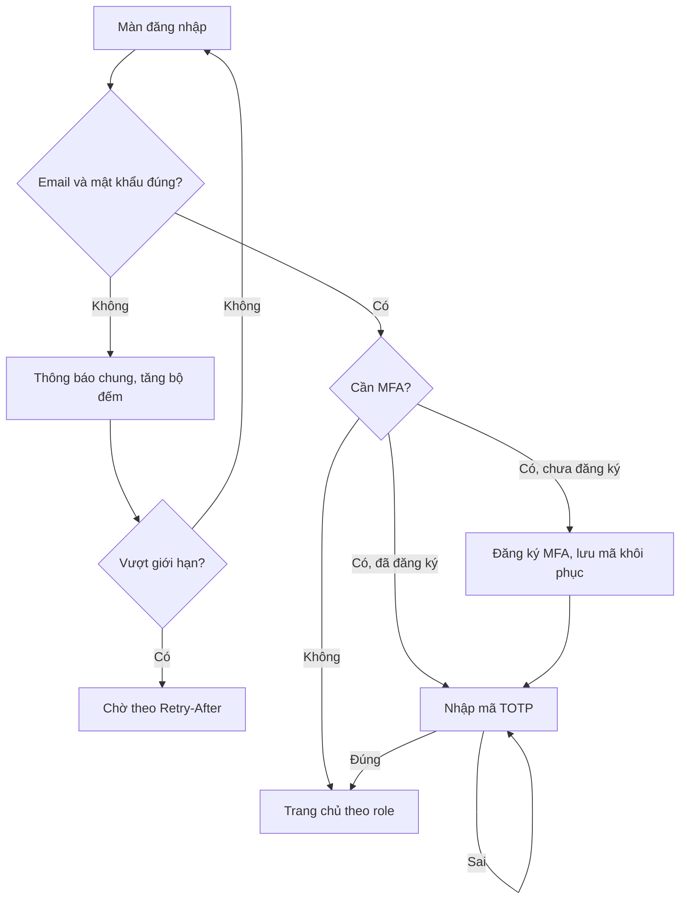
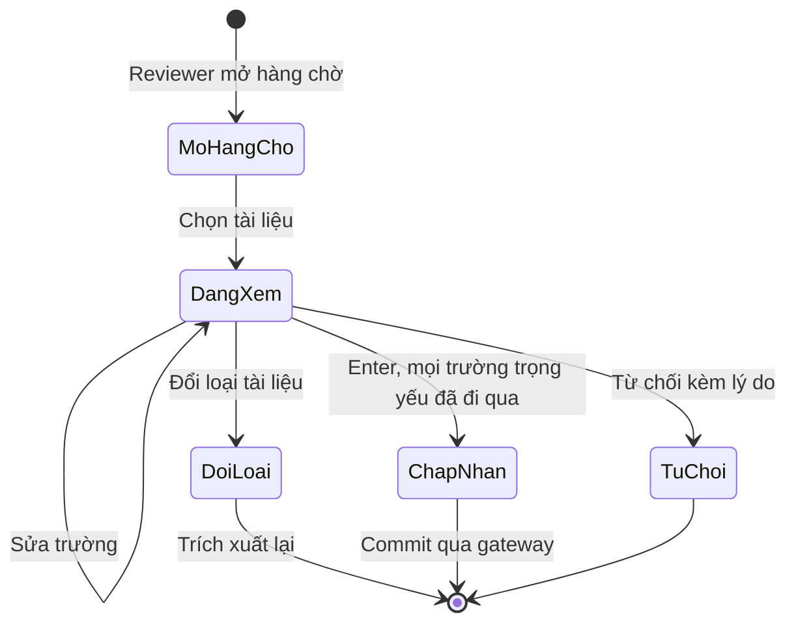
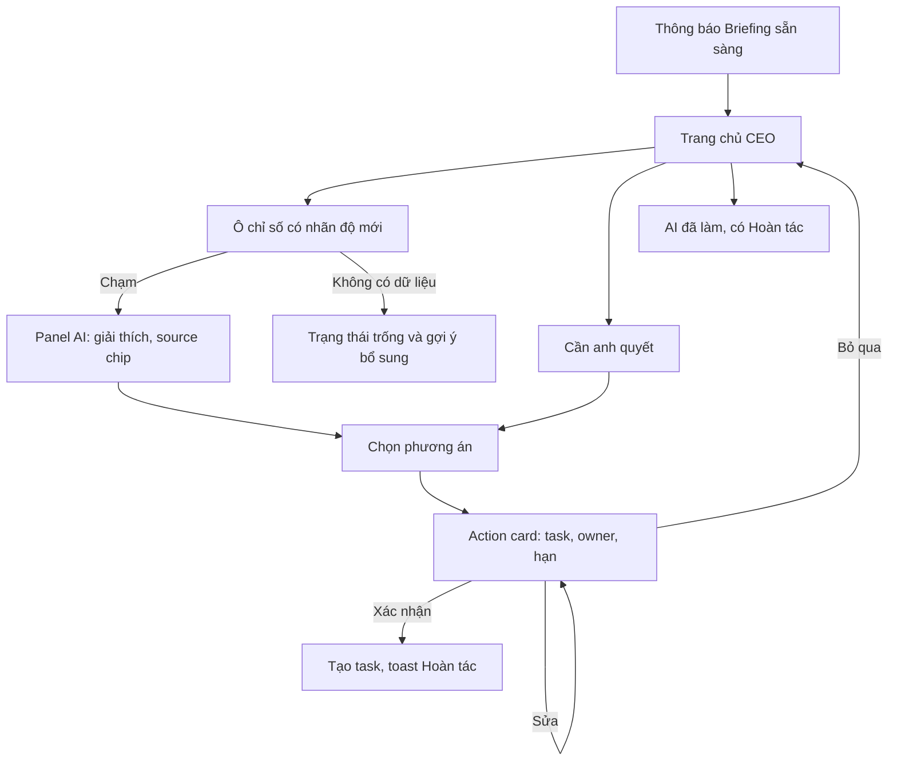
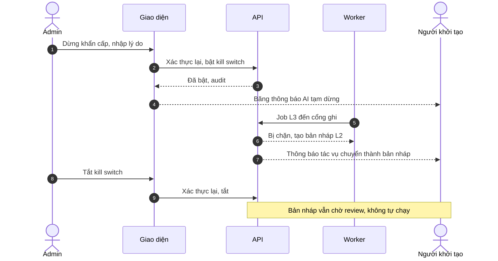
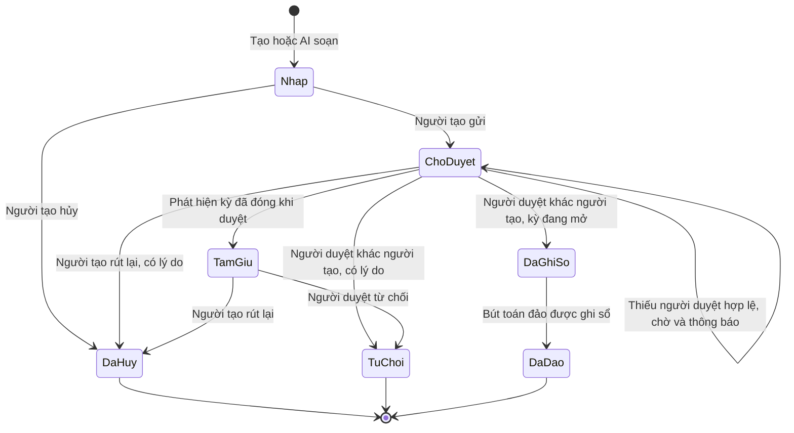
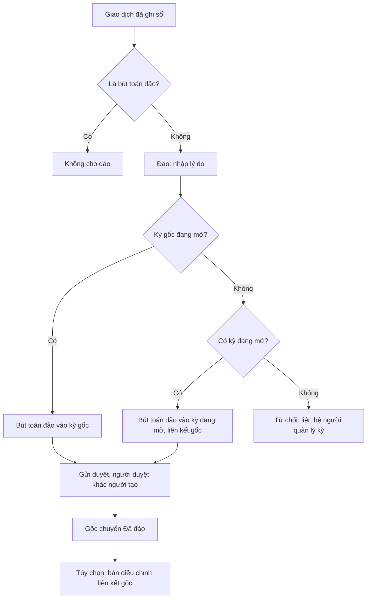

# AI-EOS — UX Flows

> Phiên bản: 1.1 · Ngày: 12/10/2026 · Trạng thái: **Stage 2B — CDA duyệt có điều kiện** · Thay đổi 1.1: FL-07, FL-10, FL-11, FL-13, FL-15 theo D-37…D-39 (ghi chú "[1.1]")
> Nguồn: UX (`UI_UX_Proposal.md`) §3–§9, [SRS.md](SRS.md), Architecture §5–§8. Quy tắc nghiệp vụ không lặp lại ở đây; mỗi flow tham chiếu SRS.
> **Deliverable:** mô tả luồng bằng Markdown + sơ đồ Mermaid. **Không có wireframe hay prototype** trong Stage 2B (quy trình không yêu cầu; 3 wireframe gốc của UX bị mất — GAP-12). Prototype HTML cho F1, F2 là đề xuất của UX §10.3, chưa thực hiện.

## 0. Thành phần dùng chung

### 0.1. Điều hướng
- 8 mục điều hướng + Quản trị (UX §4); danh sách mục chính thức chờ D-23. Mục không có quyền bị ẩn (UX-08).
- Thanh AI ⌘K/Ctrl+K ở mọi màn (UX-02). Người nhiều role đổi ngữ cảnh ở thanh trên (UX-09).
- Mobile < 768 px: thanh tab dưới 4 mục + nút "+" (UX-17); màn khác chỉ đọc (mặc định an toàn D-33).

### 0.2. Trạng thái chung (áp dụng mọi màn)

| Trạng thái | Hiển thị | Hành động khôi phục |
| --- | --- | --- |
| Đang tải | Skeleton theo bố cục; AI hiển thị bước thật (UX-23) | Nút Dừng với AI |
| Trống | Câu giải thích + gợi ý bổ sung dữ liệu (tải tài liệu, nhập tay) — không hiện số 0 giả (SRS-BRF-06) | Liên kết tới hành động phù hợp quyền |
| Không có quyền | Mục bị ẩn; truy cập trực tiếp bằng link → trang "Không tìm thấy hoặc bạn không có quyền" (không lộ tồn tại — SRS-ACC-02) | Về Trang chủ |
| Lỗi tạm thời | Thông báo ngắn + mã tham chiếu (`correlation_id`) | Thử lại; dữ liệu đã nhập được giữ |
| Xung đột version | "Dữ liệu đã thay đổi bởi người khác" + xem bản mới | Tải lại và thao tác lại |
| Phiên hết hạn | Hộp thoại đăng nhập lại; giữ nháp phía client | Đăng nhập lại |
| AI không khả dụng | Băng thông báo; luồng thủ công vẫn dùng được (BR-21) | Tiếp tục thủ công |
| Kill switch bật | Băng thông báo trên đầu ứng dụng cho mọi người (UX-29) | — |
| Dữ liệu cũ | Nhãn độ tươi chuyển cảnh báo (UX-26) | Liên kết nguồn |

### 0.3. Mẫu giao diện AI (UX §7.1)
L0 insight card · L1 suggestion chip · L2 action card "AI soạn · chờ xác nhận" · L3 undo toast 10 giây + feed "AI đã làm" 24 giờ. L4 không có trong MVP (D-11).

---

## FL-01 — Đăng nhập và MFA

| Mục | Nội dung |
| --- | --- |
| Actor | Mọi người dùng; MFA bắt buộc với Admin |
| Precondition | Tài khoản `ACTIVE` |
| Main path | Nhập email + mật khẩu → (Admin) nhập mã TOTP → Trang chủ theo role |
| Alternate/error | Sai thông tin → thông báo chung; vượt giới hạn → chờ `Retry-After`; tài khoản khóa tạm → thông báo sau khi mật khẩu đúng; Admin chưa đăng ký MFA → bắt buộc đăng ký (quét mã, nhập mã xác nhận, lưu mã khôi phục) trước mọi thao tác |
| Postcondition | Session mới (ID mới sau đăng nhập và MFA) |
| Kiểm tra quyền | Session chờ MFA chỉ gọi được API MFA và đăng xuất |
| Yêu cầu | SRS-IAM-04…07; US-IAM-02 |

## FL-02 — Lời mời và kích hoạt tài khoản

| Mục | Nội dung |
| --- | --- |
| Actor | Admin; người được mời |
| Precondition | Admin đã đăng nhập + MFA, có `user.manage` |
| Main path | Admin: Quản trị › Người dùng › Tạo → nhập email, tên, role, lý do → xác thực lại → hệ thống hiển thị link mời **một lần** (nút sao chép) → Admin trao link → người được mời mở link → đặt mật khẩu → đăng nhập (FL-01) |
| Alternate/error | Đóng màn mà chưa sao chép link → cấp lời mời mới (lời mời cũ bị thu hồi); link đã dùng/hết hạn/thu hồi → một thông báo chung "lời mời không còn hiệu lực, liên hệ quản trị"; mật khẩu yếu → báo lỗi tại chỗ |
| Postcondition | Tài khoản `ACTIVE`; lời mời không dùng lại được; audit |
| Kiểm tra quyền | `user.manage` + step-up khi tạo; trang chấp nhận lời mời công khai, giới hạn tốc độ |
| Yêu cầu | SRS-IAM-01…03; US-IAM-01, US-IAM-03 |

## FL-03 — Quản lý role và assignment (gồm khôi phục người quản lý kỳ)

| Mục | Nội dung |
| --- | --- |
| Actor | Admin |
| Precondition | `role.assign` / `assignment.manage`; step-up |
| Main path | Chọn người dùng → sửa role hoặc thêm assignment (permission, phạm vi, thời hạn) → nhập lý do → xác thực lại → lưu → thông báo "phiên của người này đã bị thu hồi" |
| Alternate/error | Sửa chính mình → nút bị vô hiệu + giải thích; chọn `ADMIN` và `CFO` cùng lúc → cảnh báo không cho lưu; gỡ Admin cuối → từ chối; assignment cho role không đủ điều kiện → thông báo role cần có; xung đột version → tải lại |
| Recovery người quản lý kỳ | Trang tình trạng hệ thống hiện cảnh báo "Chưa có người quản lý kỳ" → Admin mở danh sách người có role `CFO` → giao `finance.period.manage` → nếu không có ai có role `CFO`: Admin gán role `CFO` cho một người phù hợp (không phải chính Admin) rồi giao assignment |
| Postcondition | Quyền mới hiệu lực ngay; audit có lý do |
| Yêu cầu | SRS-ACC-05…08, SRS-FIN-12; US-IAM-03 |

## FL-04 — Gửi tài liệu và xử lý file

| Mục | Nội dung |
| --- | --- |
| Actor | Người có `record.submit` |
| Precondition | Đã đăng nhập |
| Main path | Thả 1–100 file vào bất kỳ màn nào (hoặc mobile: "+" › Chụp chứng từ, chụp nhiều trang khi app đang mở) → thẻ tiến trình góc màn hình "Đang đọc N file" → người dùng làm việc khác → thông báo "2 biên bản họp, 1 báo cáo KPI. 1 cần xem lại" |
| Alternate/error | Định dạng không cho phép (theo nội dung) → thẻ lỗi "Định dạng không hỗ trợ"; quá 50 MB/100 file/300 trang → báo giới hạn trước khi tải; nhiễm mã độc → "File bị chặn vì lý do an toàn", không thử lại; trùng tài liệu → cảnh báo, vẫn xử lý; lỗi xử lý → "Thử lại"; loại tài liệu Phase 2 (vd. hóa đơn) → "Loại tài liệu chưa hỗ trợ trong phiên bản này"; AI lỗi → chuyển review thủ công |
| Postcondition | Tài liệu ở `NEEDS_REVIEW`, `APPROVED` hoặc `FAILED` |
| Kiểm tra quyền | Tài liệu thuộc phạm vi người tải + đơn vị |
| Yêu cầu | SRS-CAP-01…22; US-DC-003; F2 (không có nhánh email — D-18) |

## FL-05 — Review trích xuất

| Mục | Nội dung |
| --- | --- |
| Actor | Người có assignment hàng chờ (`extraction.review`) |
| Precondition | Có tài liệu `NEEDS_REVIEW` trong hàng chờ được giao |
| Main path | Mở hàng chờ → tài liệu gốc bên trái, trường bên phải → con trỏ nhảy vào trường cần xem (vàng/đỏ, trường trọng yếu) → Tab qua trường, sửa nếu sai → Enter chấp nhận → tài liệu kế tiếp mở ngay → toast "Xem bản ghi" |
| Alternate/error | Trường trọng yếu chưa đi qua → không chấp nhận được; Từ chối → bắt buộc lý do; Đổi loại → trích xuất lại; Tách/Gộp; Chuyển người khác có assignment; trường tài chính → tạo giao dịch nháp chờ duyệt tài chính (không ghi sổ); kill switch không ảnh hưởng (đây là xác nhận của người) |
| Postcondition | `APPROVED` → commit qua gateway → `COMMITTED`; mỗi chỉnh sửa lưu ground truth |
| Kiểm tra quyền | Chỉ tài liệu được giao; trường dữ liệu cá nhân bị che nếu không có quyền |
| Yêu cầu | SRS-REV-01…09; US-DC-006 |

## FL-06 — Import dữ liệu

| Mục | Nội dung |
| --- | --- |
| Actor | Người có `record.submit`; nhân sự: Admin có `hr.import` |
| Precondition | File XLSX/CSV |
| Main path | Chọn đích → tải file → AI đề xuất map cột → người dùng sửa map → xem trước số dòng hợp lệ/lỗi → Ghi các dòng hợp lệ → kết quả + tải file lỗi |
| Alternate/error | Cột bắt buộc không map được → không cho ghi; mọi dòng lỗi → không ghi gì, chỉ có file lỗi; bấm Ghi hai lần → chỉ ghi một lần; import nhân sự có cột nhạy cảm → cột bị bỏ qua, không hiện trong xem trước và file lỗi |
| Postcondition | Dòng hợp lệ ghi qua gateway, có lineage |
| Yêu cầu | SRS-IMP-01…03; US-DC-007; J1 |

## FL-07 — CEO Trang chủ / Briefing

| Mục | Nội dung |
| --- | --- |
| Actor | CEO |
| Precondition | Đăng nhập; có dữ liệu `ACTIVE`/đã ghi sổ (nếu không: trạng thái trống) |
| Main path | Thông báo "Briefing sẵn sàng" → Trang chủ: dòng tóm tắt → 4 ô chỉ số có nhãn độ mới → khối "Cần anh quyết" (mỗi dòng có nút hành động) → "AI đã làm" (nền khác, Hoàn tác) → chạm ô → panel AI giải thích kèm source chip → chọn phương án → action card (task, owner, hạn) → Xác nhận → toast "Đã tạo N task · Hoàn tác" |
| Alternate/error | [1.1] Ô chỉ số luôn có nhãn "Chỉ số đề xuất — chưa chính thức", không có màu trạng thái/cảnh báo (D-39); chỉ hiển thị mục có nguồn truy vết được; kill switch bật → dòng tóm tắt là bản gần nhất kèm nhãn "AI đang tạm dừng — cập nhật lúc …" (D-38); Ô không có dữ liệu → trạng thái trống + gợi ý; dữ liệu cũ → nhãn độ tươi; AI lỗi → ô vẫn hiện, tóm tắt "chưa tạo được"; kill switch bật → action card luôn chờ xác nhận; khối "Rủi ro" ẩn (SRS-BRF-09); "đặt lịch" không có trong MVP (Q-35) |
| Postcondition | Task tạo với owner/hạn; quyết định ghi Decision |
| Kiểm tra quyền | Dữ liệu toàn công ty (CEO); action card tài chính → không có (CEO không duyệt tài chính mặc định) |
| Yêu cầu | SRS-BRF-01…12, SRS-WRK-08, SRS-WRK-11; US-BRF-01…04; F1 |

## FL-08 — Công việc: tạo, sửa, giao từ biên bản, theo dõi

| Mục | Nội dung |
| --- | --- |
| Actor | Mọi role nghiệp vụ |
| Precondition | Đăng nhập |
| Main path A (tạo tay) | Công việc › Tạo → form (tiêu đề, owner, hạn, liên kết mục tiêu) → lưu → owner nhận thông báo |
| Main path B (từ biên bản — F3) | Tải biên bản vào cuộc họp → AI trả 3 khối: Quyết định, Việc cần làm, Vấn đề mở → bảng action item (avatar đã khớp, hạn đã quy ra ngày, dấu hỏi ở mục chưa chắc) → sửa trực tiếp → "Giao việc" → mỗi người nhận task kèm trích đoạn |
| Main path C (theo dõi) | Employee: Task của tôi → đánh dấu Xong (≤ 10 giây); Manager: task của team, lọc trễ; CEO: tổng quan thực thi |
| Alternate/error | Thiếu owner/hạn → dòng báo lỗi, các dòng khác vẫn giao; giao cho người ngoài phạm vi → không có trong danh sách chọn; xung đột version khi sửa → tải lại; mở lại task đã xong → chỉ người giao `[CẦN XÁC NHẬN]` |
| Không có căn cứ | "Gửi duyệt" task, trạng thái ngoài Mở/Xong, workload/heatmap (F5), đặt lịch → không thiết kế trong MVP (Q-33, Q-34, Q-35) |
| Postcondition | Task có lịch sử, audit; task trễ xuất hiện ở ô "Task trễ" |
| Yêu cầu | SRS-WRK-01…12; US-WRK-01…05; US-DC-004 |

## FL-09 — AI đề xuất, review, chấp thuận/từ chối, hoàn tác

| Mục | Nội dung |
| --- | --- |
| Actor | Người khởi tạo; reviewer có quyền |
| Precondition | Hành động AI có mức hiệu lực L2 (hoặc bị hạ do kill switch) |
| Main path | Thông báo "AI soạn · chờ xác nhận" → mở action card: xem trước kết quả, nguồn → Sửa từng dòng nếu cần → Xác nhận → thực thi qua gateway → toast |
| L3 | AI thực thi → undo toast 10 giây (tạm dừng khi hover/focus) → feed "AI đã làm" với Hoàn tác trong 24 giờ |
| Alternate/error | Từ chối → lý do; quá thời hạn → nhãn "cần rà soát", vẫn xác nhận/từ chối được; người khác đã xử lý → xung đột version; hoàn tác quá hạn → nút ẩn, thông báo hết hạn; bản nháp tài chính → chuyển sang luồng FL-11 |
| Kiểm tra quyền | Reviewer có permission tương ứng; tài chính không tự duyệt |
| Yêu cầu | SRS-AIC-07, 08, 10, 11; US-AIC-02, 03 |

## FL-10 — Kill switch

| Mục | Nội dung |
| --- | --- |
| Actor | Admin; người dùng bị ảnh hưởng |
| Precondition | `ai.kill_switch`, step-up |
| Main path (bật) | Quản trị › AI Control Center › Dừng khẩn cấp → nhập lý do → xác thực lại → băng thông báo xuất hiện cho mọi người dùng → hành động AI tự động mới thành bản nháp → người khởi tạo nhận "Tác vụ đã chuyển thành bản nháp vì AI đang tạm dừng" |
| Hiển thị job bị chặn | Feed "AI đã làm" và trang tình trạng hệ thống: số tác vụ đã chuyển nháp, số job thất bại do thiếu dữ liệu (`BLOCKED_BY_KILL_SWITCH`), lịch bị bỏ qua, job tạo nội dung AI bị hủy (Briefing không được cập nhật) [1.1] |
| Main path (tắt) | Admin tắt (lý do, xác thực lại) → băng biến mất → bản nháp vẫn nằm chờ review, không tự chạy |
| Alternate/error | Không phải Admin → mục không hiển thị; hai Admin bật/tắt cùng lúc → xung đột version |
| Yêu cầu | SRS-AIC-04…08; US-AIC-01; D-09, D-10 |

## FL-11 — Giao dịch tài chính và phê duyệt

| Mục | Nội dung |
| --- | --- |
| Actor | Người tạo (`finance.submit`); người duyệt (`finance.approve`) |
| Precondition | Có kỳ `OPEN` chứa ngày giao dịch (bắt buộc khi gửi duyệt — D-37) |
| Main path | Người tạo: Tài chính › Ghi nhận → chọn loại (doanh thu/chi phí/số dư tiền mặt) → nhập → lưu nháp → Gửi duyệt → người duyệt nhận thông báo → mở giao dịch → Duyệt → trạng thái "Đã ghi sổ" → số liệu tổng hợp cập nhật kèm thời điểm |
| Alternate/error | Người duyệt là người tạo → nút Duyệt không có + giải thích; thiếu người duyệt hợp lệ → nhãn "Chờ — thiếu người duyệt hợp lệ" cho người tạo, thông báo Admin; Từ chối → lý do bắt buộc; người tạo Rút lại → lý do; hai người duyệt cùng lúc → người sau thấy "đã được xử lý"; kỳ của ngày giao dịch đã khóa → không gửi được, thông báo "Kỳ <mã> đã khóa — tạo giao dịch với ngày thuộc kỳ đang mở nếu phù hợp" (hệ thống không tự đổi ngày/kỳ) [1.1]; trạng thái "Tạm giữ — kỳ đã đóng" (`ON_HOLD`, phòng thủ) → chỉ có nút Rút lại (người tạo) và Từ chối (người duyệt), thông báo cho người tạo, người duyệt, Admin [1.1]; không có kỳ mở → "Chưa có kỳ báo cáo mở. Liên hệ người quản lý kỳ" (và FL-03 recovery); bấm gửi hai lần → một giao dịch |
| AI soạn | AI tạo nháp (ghi "AI hỗ trợ"); người tạo kiểm tra rồi tự gửi — AI không gửi/duyệt |
| Postcondition | `POSTED` bất biến; lịch sử trạng thái |
| Yêu cầu | SRS-FIN-01…09, 12…15; US-FNL-01, 02, 05 |

## FL-12 — Đảo và điều chỉnh khi kỳ gốc đã khóa; mở/khóa kỳ

| Mục | Nội dung |
| --- | --- |
| Actor | Người có `finance.reverse.request`; người duyệt; người quản lý kỳ |
| Precondition | Giao dịch gốc "Đã ghi sổ", không phải bút toán đảo |
| Main path | Mở giao dịch → Đảo → nhập lý do → hệ thống hiện "Kỳ gốc đã khóa — bút toán đảo sẽ ghi vào kỳ <kỳ đang mở>" → xác nhận → bút toán đảo ở trạng thái nháp → gửi duyệt → người duyệt khác duyệt → gốc "Đã đảo" → (tùy chọn) Tạo bản điều chỉnh với số đúng, liên kết gốc → quy trình FL-11 |
| Alternate/error | Đã có đề nghị đảo → "Giao dịch đang/đã được đảo"; là bút toán đảo → nút Đảo không có; không có kỳ mở → từ chối + hướng dẫn liên hệ người quản lý kỳ |
| Mở/khóa kỳ | Người quản lý kỳ: Tài chính › Kỳ báo cáo → Mở kỳ mới (không chồng lấn) / Khóa kỳ (lý do, xác thực lại); còn giao dịch chờ duyệt → "Không khóa được: còn N giao dịch chờ duyệt"; không có nút mở lại kỳ đã khóa |
| Yêu cầu | SRS-FIN-10…12, 16; US-FNL-03, 04 |

## FL-13 — Dữ liệu nhân sự và dữ liệu nhạy cảm

| Mục | Nội dung |
| --- | --- |
| Actor | Mọi người dùng; Admin import |
| Main path | Danh bạ hiển thị họ tên, chức danh, đơn vị, quản lý cho mọi người đăng nhập; trường nhạy cảm (nếu có trong tài liệu) hiển thị dạng che `•••` kèm biểu tượng khóa |
| Alternate | Người không có quyền mở tài liệu gốc chứa dữ liệu cá nhân → không tải được file gốc, chỉ xem trường đã che; Admin xem kết quả import → chỉ số dòng và lỗi, không xem lại hồ sơ |
| Lưu ý | [1.1] Quyền tách biệt: xem hồ sơ, xem lương, import, xuất, bỏ che — không cấp theo tên role; hiện chỉ có import (Admin, giới hạn tác vụ). Hiện **chưa có role nào** được xem dữ liệu nhạy cảm (R6); AI trả lời cũng che các trường này; dữ liệu nhạy cảm không gửi provider ngoài |
| Yêu cầu | SRS-ACC-10, 11, SRS-IMP-02, SRS-PRV-02; US-PRV-01 |

## FL-14 — Thông báo và việc cần hành động

| Mục | Nội dung |
| --- | --- |
| Actor | Mọi người dùng |
| Main path | Biểu tượng chuông có số chưa đọc → danh sách: tài liệu cần review, task được giao, bản nháp AI chờ, giao dịch chờ duyệt/bị từ chối/thiếu người duyệt, Briefing sẵn sàng → chạm → đi tới đối tượng (kiểm tra quyền lại) → đánh dấu đã đọc |
| Alternate/error | Đối tượng không còn quyền truy cập → trang "không có quyền"; thông báo về đối tượng đã xử lý → hiển thị trạng thái mới |
| Ngoài MVP | Email, push ngoài ứng dụng, Zalo/Slack/Teams (D-32) |
| Yêu cầu | SRS-NTF-01…03; K6 |

## FL-15 — KPI/OKR: kích hoạt mục tiêu và check-in

| Mục | Nội dung |
| --- | --- |
| Actor | Manager/CEO (kích hoạt); owner KR (check-in) |
| Main path A | Tải kế hoạch/KPI → review trích xuất (FL-05) → Objective/KR/KPI ở trạng thái "Nháp" trên cây mục tiêu → người có quyền kích hoạt xem cây, sửa → Kích hoạt → mục tiêu tính vào chỉ số |
| Main path B (F4) | Thông báo check-in → thẻ check-in: giá trị điền sẵn (giá trị đo gần nhất), thanh độ tự tin, blocker (gõ/giọng nói) → Gửi (≤ 30 giây) → Manager thấy tổng hợp team |
| Alternate/error | [1.1] Kích hoạt cần permission `goals.activate` được giao (chưa có quyền nền — D-39); chưa ai được giao → mục tiêu ở "Nháp", Admin thấy cảnh báo trên trang tình trạng hệ thống; Người không có quyền kích hoạt → nút không có; mục tiêu "Nháp" không xuất hiện ở Trang chủ; check-in KR không phải của mình → không có |
| Không có căn cứ | % đạt, màu cảnh báo lệch, nhịp check-in tự động (Q-29, Q-30) — giao diện chỉ hiển thị baseline, target, giá trị thực tế |
| Yêu cầu | SRS-GOAL-01…11; US-GOAL-01…04; US-DC-005 |

---

## Ma trận flow ↔ yêu cầu

| Flow | SRS | PRD | Nguồn |
| --- | --- | --- | --- |
| FL-01, FL-02, FL-03 | SRS-IAM, SRS-ACC | US-IAM-01…04 | A1–A6, R1–R8 |
| FL-04, FL-05, FL-06 | SRS-CAP, SRS-REV, SRS-IMP | US-DC-001…008 | F2, Domain 22 |
| FL-07 | SRS-BRF | US-BRF-01…04 | F1, UX §6.1 |
| FL-08 | SRS-WRK | US-WRK-01…05 | F3, UC-06 |
| FL-09, FL-10 | SRS-AIC | US-AIC-01…03 | UX §7, D-09, D-10 |
| FL-11, FL-12 | SRS-FIN | US-FNL-01…05 | D-12…D-14, CDA-F1…CDA-F7 |
| FL-13 | SRS-ACC-10, SRS-PRV-02 | US-PRV-01 | R6, SEC-DC-02 |
| FL-14 | SRS-NTF | — | K6 |
| FL-15 | SRS-GOAL | US-GOAL-01…04 | F4, US-DC-005 |
| (không có flow) | SRS-SLS | US-SLS-01 | Q-38 — chờ đặc tả |
