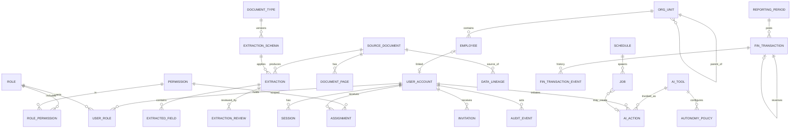

# AI-EOS — Database Design (Stage 2C)

> Phiên bản: 1.2 · Ngày: 12/10/2026 · Trạng thái: **Thiết kế — đang hiện thực theo migration** · Thay đổi: §12
> Schema thiết kế. **Đã có migration** (15/10/2026): `0001` (M-01, schema + quyền role, T-005), `0002` (M-04 `audit.event` + INV-14, T-008), `0003` (phần `jobs` của M-05, T-009); phần còn lại vẫn là đề xuất. Hiện trạng: [PROJECT_STATUS](../PROJECT_STATUS.md).
> Nguồn: ADR-004, ADR-005, ADR-007…ADR-010; Architecture §3–§8. Nhãn nguồn như Architecture (`SOURCE`, `CDA`, `CDA_DIRECTIVE`, `ARCHITECTURE_DECISION`, `[CẦN XÁC NHẬN]`).

## 1. Nguyên tắc

1. Một CSDL PostgreSQL; mỗi module một schema (ADR-001, ADR-004).
2. Khóa chính `uuid` (sinh ở ứng dụng, v7 hoặc v4); bảng append-only lớn (`audit.event`) dùng `bigint identity`.
3. Thời gian `timestamptz` (UTC); ngày nghiệp vụ `date`.
4. Tiền `numeric(20,2)` + `currency char(3)` (VND/USD theo FR-DC-13); không dùng `float`.
5. Bất biến quan trọng được thực thi **ở CSDL** (CHECK, unique có điều kiện, trigger), không chỉ ở ứng dụng (§8).
6. Không có cascade delete trên dữ liệu nghiệp vụ; xóa logic bằng trạng thái nếu được phép, giao dịch tài chính và audit không bao giờ bị xóa.
7. Bảng có cập nhật đồng thời có cột `version int` (optimistic locking).
8. Không lưu secret dạng rõ; token chỉ lưu hash.

## 2. Schema và role CSDL

| Schema | Module | Ghi chú |
| --- | --- | --- |
| `identity` | identity | Tài khoản, session, lời mời, MFA |
| `access` | access | Role, permission, assignment |
| `org` | org | Đơn vị, nhân sự (danh bạ) |
| `capture` | capture | Tài liệu, trích xuất, review, import, lineage |
| `goals` | goals | Objective, KR, KPI, đo lường, check-in (SRS §6) |
| `work` | work | Task, cuộc họp, quyết định, action item (SRS §7) |
| `insights` | insights | Bản chụp Briefing, tùy chọn ô chỉ số (SRS §8) |
| `knowledge` | knowledge | Tài liệu quy trình/SOP |
| `finance` | finance | Kỳ, giao dịch |
| `ai` | ai, gateway, providers | Tool, autonomy, kill switch, bản nháp, call log, feedback |
| `jobs` | jobs | Queue, lịch |
| `audit` | audit | Sự kiện audit |
| `notify` | notify | Thông báo in-app |

| Role CSDL | Quyền | Dùng bởi |
| --- | --- | --- |
| `aieos_owner` | Chủ sở hữu schema, DDL | Chỉ lệnh migration |
| `aieos_app` | `SELECT, INSERT, UPDATE` trên bảng nghiệp vụ; **không** `DELETE` trên `finance.*`, `audit.*`; chỉ `INSERT, SELECT` trên `audit.event`, `finance.transaction_event` | API, worker |
| `aieos_backup` | Chỉ đọc / replication cho backup | Công cụ backup |

## 3. ERD tổng quan

## 4. Identity và access

### `identity.user_account`
| Cột | Kiểu | Ràng buộc / ghi chú |
| --- | --- | --- |
| id | uuid | PK |
| email | citext | UNIQUE, NOT NULL |
| display_name | text | NOT NULL |
| status | text | CHECK in (`INVITED`,`ACTIVE`,`LOCKED`,`DISABLED`) |
| password_hash | text | NULL khi `INVITED`; Argon2id encoded |
| mfa_secret_enc | bytea | Mã hóa bằng khóa ứng dụng (ADR-006) |
| mfa_enabled | boolean | NOT NULL default false |
| must_enroll_mfa | boolean | true với ADMIN cho đến khi đăng ký |
| failed_login_count | int | default 0 |
| locked_until | timestamptz | NULL |
| employee_id | uuid | FK `org.employee`, NULL, UNIQUE |
| created_by | uuid | FK user_account, NULL chỉ khi bootstrap |
| created_at, updated_at | timestamptz | |
| version | int | |

### `identity.session`
| Cột | Kiểu | Ghi chú |
| --- | --- | --- |
| id | uuid | PK |
| token_hash | bytea | UNIQUE; SHA-256 của token ≥ 256 bit |
| user_id | uuid | FK |
| csrf_token_hash | bytea | |
| mfa_verified | boolean | |
| reauth_at | timestamptz | Lần step-up gần nhất |
| created_at, last_seen_at, idle_expires_at, absolute_expires_at, revoked_at | timestamptz | |
| ip, user_agent | text | |

Index: `(user_id) WHERE revoked_at IS NULL` để thu hồi hàng loạt (A3).

### `identity.invitation`
| Cột | Kiểu | Ghi chú |
| --- | --- | --- |
| id | uuid | PK |
| user_id | uuid | FK |
| token_hash | bytea | UNIQUE |
| expires_at | timestamptz | NOT NULL |
| used_at, revoked_at | timestamptz | CHECK không đồng thời có cả hai |
| created_by | uuid | FK |

Một lời mời còn hiệu lực mỗi user: unique `(user_id) WHERE used_at IS NULL AND revoked_at IS NULL`.

### `identity.mfa_recovery_code`
`id`, `user_id`, `code_hash`, `used_at`.

### `identity.login_attempt`
`id`, `email_hash`, `ip`, `occurred_at`, `success` — phục vụ giới hạn tốc độ; dọn theo lịch.

### `access.role`, `access.permission`, `access.role_permission`
- `role(code text PK)` — seed: `ADMIN`, `CEO`, `CFO`, `MANAGER`, `EMPLOYEE` (R1).
- `permission(code text PK, category text CHECK in ('READ','WRITE','APPROVE','ADMIN','AI'), assignable boolean)`.
- `role_permission(role_code, permission_code, kind text CHECK in ('BASE','ELIGIBLE'))` — `BASE` = quyền nền, `ELIGIBLE` = role đủ điều kiện nhận assignment (ma trận Architecture §6). Seed qua migration.

### `access.user_role`
| Cột | Ghi chú |
| --- | --- |
| user_id, role_code | PK kép |
| granted_by | uuid NULL (chỉ NULL khi bootstrap/recovery); **CHECK `granted_by IS NULL OR granted_by <> user_id`** (A5) |
| granted_at, reason | reason NOT NULL khi granted_by NOT NULL |

Trigger `trg_user_role_no_admin_cfo`: từ chối INSERT nếu user đã có role còn lại của cặp `ADMIN`/`CFO` (R7).
Xóa role: trigger `trg_last_admin_guard` từ chối nếu sau thao tác không còn `ADMIN` có `user_account.status='ACTIVE'`; ứng dụng giữ advisory lock `admin-membership` khi thay đổi để tránh race (A4).

### `access.assignment`
| Cột | Ghi chú |
| --- | --- |
| id | PK |
| user_id | FK |
| permission_code | FK; permission phải `assignable` |
| scope_type | CHECK in (`COMPANY`,`ORG_UNIT`,`DOCUMENT_TYPE`,`REVIEW_QUEUE`) |
| scope_id | uuid/text NULL khi `COMPANY` |
| valid_from, valid_to | `valid_to` NULL = không hạn |
| granted_by | CHECK `granted_by <> user_id` |
| reason, created_at, revoked_at, revoked_by | |

Trigger `trg_assignment_eligibility`: từ chối nếu không có role nào của user ở `role_permission.kind='ELIGIBLE'` cho permission đó.

## 5. AI, gateway, jobs

### `ai.tool`
| Cột | Ghi chú |
| --- | --- |
| name | PK (vd. `commit_extraction`, `create_task`, `record_kpi_measurement`, `create_finance_draft`) |
| module | text |
| operation_type | CHECK in (`READ`,`WRITE`,`EXECUTION`) |
| risk_level | CHECK in (`LOW`,`MEDIUM`,`HIGH`) |
| financial | boolean |
| max_autonomy_level | smallint; **CHECK `max_autonomy_level BETWEEN 0 AND 3` AND (`NOT financial` OR `max_autonomy_level <= 2`)** (D-11, D-12, R8) |
| approval_required | boolean |
| params_schema | jsonb |
| enabled | boolean |

Danh mục tool: các tool READ/WRITE của Domain 22 trong BRD §3.9 (`upload_document`, `classify_document`, `extract_document`, `validate_extraction`, `submit_extraction_for_review`, `approve_extraction`, `commit_extraction`, `import_table`, `search_documents`, `get_source_document`) và các tool đích BRD nêu ví dụ (`create_task`, `record_kpi_measurement`). Tool đích khác cho loại tài liệu MVP (tạo Objective/KR/KPI, đơn vị/nhân sự, knowledge item, bản nháp tài chính) là `ARCHITECTURE_DECISION`, tham số chờ 2B. `create_invoice` thuộc Phase 2.

### `ai.autonomy_policy`
`id`, `tool_name` FK, `role_code` FK NULL (NULL = mọi role), `value_threshold numeric` NULL (`[CẦN XÁC NHẬN]` — D-16, không có giá trị mặc định), `level smallint CHECK (level BETWEEN 0 AND 3)`, `updated_by`, `updated_at`, `reason`, `version`. Trigger kiểm tra `level <= ai.tool.max_autonomy_level`.

### `ai.kill_switch`
| Cột | Ghi chú |
| --- | --- |
| id | smallint PK **CHECK (id = 1)** — singleton |
| enabled | boolean NOT NULL |
| changed_by | uuid FK |
| changed_at | timestamptz |
| reason | text NOT NULL |
| version | int |

### `ai.setting`
`key text PK`, `value jsonb`, `updated_by`, `updated_at` — gồm `draft_expiry_days` (mặc định 30, K5), trần chi phí AI (GAP-14).

### `ai.action`
| Cột | Ghi chú |
| --- | --- |
| id | PK |
| tool_name | FK |
| initiated_by | uuid FK user — người khởi tạo (AI hành động thay người này) |
| agent | text (vd. `data_capture_agent`) |
| params | jsonb (đã validate) |
| effective_level | smallint 0–3 |
| status | CHECK in (`PENDING_REVIEW`,`NEEDS_REVIEW_STALE`,`EXECUTED`,`REJECTED`,`UNDONE`,`FAILED`) |
| blocked_by_kill_switch | boolean |
| idempotency_key | text NOT NULL |
| source_job_id | uuid FK `jobs.job` NULL |
| result_resource_type, result_resource_id | Sau khi thực thi |
| reviewed_by, reviewed_at, review_reason | `reviewed_by` khác `initiated_by` khi tool `financial` (trigger) |
| undo_deadline | ≥ executed_at + 24h với L3 (BR-11) |
| created_at, stale_at, executed_at | |
| version | int |

Unique `(initiated_by, idempotency_key)`.

Job bị chặn do kill switch: `jobs.job.status = 'CANCELLED'`, `last_error_code = 'KILL_SWITCH'` (với `AI_CONTENT`).

### `ai.call_log`, `ai.feedback`
- `call_log`: `id`, `provider`, `model`, `purpose`, `data_classification`, `provider_is_local`, `tokens_in`, `tokens_out`, `pages`, `latency_ms`, `cost_estimate numeric`, `outcome`, `job_id`, `correlation_id`, `created_at`. CHECK: `data_classification IN ('SENSITIVE','PERSONAL') → provider_is_local` (ADR-011).
- `feedback`: `id`, `user_id`, `target_type` (`ANSWER`,`EXTRACTION`,`SUGGESTION`), `target_id`, `verdict` (`UP`,`DOWN`), `comment`, `created_at` (FR-AIQ-04).

### `jobs.job`
| Cột | Ghi chú |
| --- | --- |
| id | PK |
| kind | text (vd. `document.process`, `review.reminder`, `draft.expire`, `briefing.generate`) |
| job_class | text CHECK in (`ORCHESTRATION`,`AI_CONTENT`,`BUSINESS_WRITE`); bắt buộc khớp registry trong code cho `kind` (kiểm tra ở ứng dụng + test) — ADR-005 Amendment 1 |
| payload | jsonb — chỉ ID, không chứa dữ liệu nhạy cảm |
| status | CHECK in (`QUEUED`,`RUNNING`,`SUCCEEDED`,`FAILED`,`DEAD`,`CANCELLED`) |
| attempts, max_attempts | CHECK `attempts <= max_attempts` |
| run_after | timestamptz |
| lease_expires_at, locked_by | |
| idempotency_key | UNIQUE |
| initiated_by | uuid NULL (NULL = hệ thống) |
| correlation_id | text |
| last_error_code, last_error | không chứa secret |
| created_at, finished_at | |

Index claim: `(run_after, id) WHERE status = 'QUEUED'`; index reaper: `(lease_expires_at) WHERE status = 'RUNNING'`.

### `jobs.schedule`
`id`, `kind`, `job_class` (kế thừa từ `kind`), `interval` (kiểu `interval`; MVP không hỗ trợ cron — D-56), `next_run_at`, `may_write boolean` (= `job_class <> 'ORCHESTRATION'`), `enabled`, `last_run_at`, `last_skipped_at`, `last_skip_reason`. Job sinh từ lịch có `idempotency_key = schedule_id || ':' || slot`.

## 6. Capture, org, goals, work, knowledge

### `org.org_unit`, `org.employee`
- `org_unit`: `id`, `name`, `code UNIQUE NULL`, `parent_id` FK self, `head_employee_id` NULL, `source_document_id` NULL, `version`.
- `employee`: `id`, `full_name`, `title`, `org_unit_id`, `manager_id` FK self, `status`, `source_document_id`, `version`. **Chỉ các trường danh bạ** theo US-DC-007/BRD §3.4 (họ tên, chức danh, phòng ban, quản lý trực tiếp). Trường nhân sự nhạy cảm (CCCD, lương, sức khỏe) **không có trong MVP**; nếu bổ sung phải ở bảng riêng `org.employee_sensitive` với quyền `hr.profile.read`/`hr.salary.read` (R6).

### `capture.document_type`, `capture.extraction_schema`
- `document_type`: `code PK`, `name`, `phase` CHECK in (`MVP`,`PHASE2`), `target_module`, `enabled` (Phase 2 luôn `false` trong MVP — D-17), `auto_commit_enabled boolean default false` (BR-05).
- `extraction_schema`: `id`, `document_type_code`, `version`, `fields jsonb` (khóa, kiểu, bắt buộc, quy tắc, `critical`), `display_thresholds jsonb` (mặc định 0,90/0,60 — UX §6.2), `routing_thresholds jsonb` (theo trường, NULL = luôn review) — hai cấu hình tách biệt (D-29 chờ chốt), `status` (`DRAFT`,`ACTIVE`,`RETIRED`), `created_by`. Unique `(document_type_code, version)`; một `ACTIVE` mỗi loại.

### `capture.source_document`
| Cột | Ghi chú |
| --- | --- |
| id | PK |
| uploaded_by | FK user |
| channel | CHECK in (`C1`…`C5`) trong MVP |
| original_filename | text đã chuẩn hóa (metadata) |
| storage_key | text UNIQUE (UUID) |
| sha256 | bytea; index (không unique — trùng chỉ cảnh báo, FR-DC-08) |
| size_bytes, page_count | CHECK theo giới hạn cấu hình |
| declared_mime, detected_mime | detected từ magic bytes |
| scan_status | CHECK in (`PENDING`,`CLEAN`,`INFECTED`,`ERROR`) |
| status | CHECK in (`UPLOADED`,`PROCESSING`,`FAILED`,`EXTRACTED`,`NEEDS_REVIEW`,`APPROVED`,`REJECTED`,`COMMITTED`,`SUPERSEDED`) |
| document_type_code | FK NULL |
| classification_confidence | numeric(4,3) |
| sensitivity | CHECK in (`NORMAL`,`PERSONAL`,`SENSITIVE`) |
| superseded_by | FK self NULL |
| org_unit_id | phạm vi quyền (SEC-DC-01) |
| version, created_at | |

### `capture.document_page`
`document_id`, `page_no`, `image_storage_key`, `text_layer boolean`, PK `(document_id, page_no)`.

### `capture.extraction`, `capture.extracted_field`, `capture.extraction_review`
- `extraction`: `id`, `document_id`, `schema_id`, `status`, `created_at`, `version`.
- `extracted_field`: `id`, `extraction_id`, `field_key`, `value jsonb`, `normalized_value jsonb`, `confidence numeric(4,3) CHECK 0..1`, `page_no`, `bbox jsonb`, `source_text`, `critical boolean`, `reviewed_value jsonb`, `corrected boolean` (FR-DC-12, FR-LRN-01).
- `extraction_review`: `id`, `extraction_id`, `reviewer_id`, `decision` CHECK in (`APPROVE`,`REJECT`,`REASSIGN`,`CHANGE_TYPE`,`SPLIT`,`MERGE`), `reason` (bắt buộc với REJECT), `started_at`, `finished_at` (đo MET-04).

### `capture.review_queue`
`id`, `name`, `document_type_code` NULL, `org_unit_id` NULL, `sla_hours` NULL (`[CẦN XÁC NHẬN]` — GAP-18). Người xử lý xác định qua `access.assignment` (`REVIEW_QUEUE`).

### `capture.import_batch`, `capture.import_row_error`
- `import_batch`: `id`, `source_document_id`, `target` (vd. `org.employee`), `column_mapping jsonb`, `status` (`PREVIEW`,`COMMITTED`,`PARTIAL`,`FAILED`), `rows_total`, `rows_valid`, `rows_committed`, `created_by`.
- `import_row_error`: `batch_id`, `row_no`, `field`, `message` — chỉ lỗi, không sao chép dữ liệu nhạy cảm.

### `capture.data_lineage`
`id`, `target_type`, `target_id`, `target_field` NULL, `source_document_id`, `page_no`, `extraction_id`, `extracted_field_id`, `committed_by`, `ai_action_id` NULL, `created_at` (FR-DF-04, FR-DC-23).

### `goals.*`, `work.*`, `knowledge.*`, `insights.*` — theo SRS §6–§8 (Stage 2B)
Chỉ các thuộc tính có nguồn hoặc được SRS đặc tả; công thức, ngưỡng, SLA, trạng thái mở rộng chưa có → không tạo cột (Q-28…Q-41).

| Bảng | Cột chính | Ràng buộc | Nguồn |
| --- | --- | --- | --- |
| `goals.objective` | `id`, `title`, `owner_user_id`, `period_label`, `org_unit_id` NULL (NULL = công ty), `parent_id` NULL, `status`, `activated_by`, `activated_at`, `source_document_id`, `created_by`, `version` | `status` CHECK in (`DRAFT`,`ACTIVE`); `ACTIVE` ⇒ `activated_by` NOT NULL | SRS-GOAL-01, 03 |
| `goals.key_result` | `id`, `objective_id`, `metric`, `baseline numeric`, `target numeric`, `unit`, `owner_user_id`, `period_label`, `status`, `source_document_id`, `version` | `status` như objective | SRS-GOAL-01, 03 |
| `goals.kpi` | `id`, `metric`, `baseline`, `target`, `unit`, `owner_user_id`, `period_label`, `org_unit_id`, `status`, `source_document_id`, `version` | như trên | SRS-GOAL-02, 03 |
| `goals.measurement` | `id`, `target_type` (`KR`,`KPI`), `target_id`, `value numeric`, `report_period_label`, `recorded_by`, `source_document_id`, `created_at` | append-only | SRS-GOAL-06 |
| `goals.check_in` | `id`, `key_result_id`, `value numeric`, `confidence smallint` (thang Q-30), `blocker text`, `submitted_by`, `created_at` | append-only | SRS-GOAL-07 |
| `work.meeting` | `id`, `meeting_date`, `participants jsonb` (employee id), `source_document_id`, `created_by` | | SRS-WRK-05 |
| `work.decision` | `id`, `meeting_id` NULL, `content`, `decided_by` NULL, `source_document_id`, `source_locator jsonb`, `created_by`, `created_at` | | SRS-WRK-05, 11 |
| `work.action_item` | `id`, `meeting_id`, `content`, `assignee_employee_id` NULL, `due_date` NULL, `uncertain boolean`, `task_id` NULL | | SRS-WRK-05, 07 |
| `work.task` | `id`, `title`, `owner_user_id` NOT NULL, `assigned_by`, `due_date`, `status`, `completed_at`, `completed_by`, `objective_id` NULL, `source_document_id` NULL, `source_locator jsonb`, `created_via` (`MANUAL`,`MEETING`,`AI`), `ai_action_id` NULL, `version` | `status` CHECK in (`OPEN`,`DONE`); `DONE` ⇔ `completed_at` NOT NULL | SRS-WRK-01…03 |
| `knowledge.knowledge_item` | `id`, `title`, `version_label`, `effective_date`, `owner_user_id`, `source_document_id` | | FR-DCS-02 |
| `insights.briefing` | `id`, `for_user_id`, `generated_at`, `summary_text`, `tiles jsonb` (giá trị, `as_of`, nguồn), `decision_items jsonb`, `data_quality_notes jsonb`, `generation_status`, `source_job_id` | append-only; chỉ bản chụp, không phải dữ liệu nghiệp vụ | SRS-BRF-10, 11 |
| `insights.user_tile_preference` | `user_id`, `slot` (1–4), `metric_code` | PK `(user_id, slot)` | SRS-BRF-02 |

Index: `work.task (owner_user_id, status, due_date)`; `goals.objective (org_unit_id, status)`; `goals.measurement (target_type, target_id, created_at)`.

Sales Pipeline Lite: **không có bảng** cho tới khi trả lời Q-38 (SRS-SLS-03).

## 7. Finance

### `finance.reporting_period`
| Cột | Ghi chú |
| --- | --- |
| id | PK |
| code | text UNIQUE (vd. `2026-10`) — độ dài kỳ `[CẦN XÁC NHẬN]`, mặc định tháng |
| start_date, end_date | CHECK `start_date <= end_date`; ràng buộc loại trừ chồng lấn (`EXCLUDE USING gist` trên daterange) |
| status | CHECK in (`OPEN`,`CLOSED`) |
| opened_by, opened_at, closed_by, closed_at, close_reason | |
| version | |

Không có chuyển `CLOSED → OPEN` trong MVP (trigger chặn).

### `finance.transaction`
| Cột | Ghi chú |
| --- | --- |
| id | PK |
| record_type | CHECK in (`REVENUE`,`EXPENSE`,`CASH_BALANCE`) (F7) |
| kind | CHECK in (`ORIGINAL`,`REVERSAL`,`ADJUSTMENT`) |
| status | CHECK in (`DRAFT`,`PENDING_APPROVAL`,`ON_HOLD`,`POSTED`,`REVERSED`,`REJECTED`,`CANCELLED`) |
| hold_reason | text NULL; CHECK `(status = 'ON_HOLD') = (hold_reason IS NOT NULL)`; giá trị MVP: `PERIOD_CLOSED` (ADR-009 Amendment 1) |
| amount | numeric(20,2) NOT NULL; `REVERSAL` mang dấu ngược của gốc |
| currency | char(3) |
| transaction_date | date |
| period_id | FK `reporting_period` — kỳ ghi sổ |
| description, counterparty, category, org_unit_id | Trường chi tiết theo Finance Lite; danh mục cụ thể `[CẦN XÁC NHẬN]` (chờ 2B) |
| reverses_id | FK self; **CHECK `(kind = 'REVERSAL') = (reverses_id IS NOT NULL)`** |
| adjusts_id | FK self; CHECK `(kind = 'ADJUSTMENT') = (adjusts_id IS NOT NULL)` |
| reason | NOT NULL khi `kind <> 'ORIGINAL'` |
| created_by | NOT NULL |
| submitted_by, submitted_at | |
| approved_by, approved_at | **CHECK `approved_by IS NULL OR (approved_by <> created_by AND approved_by IS DISTINCT FROM submitted_by)`** |
| rejected_by, rejected_at, reject_reason | CHECK tương tự về người tạo; reason NOT NULL khi REJECTED |
| cancelled_by, cancelled_at, cancel_reason | |
| no_eligible_approver | boolean (Architecture §7.4) |
| ai_assisted | boolean; `ai_action_id` FK NULL (F5) |
| source_document_id | NULL (nhập từ import/tài liệu) |
| idempotency_key | text NOT NULL; **UNIQUE `(created_by, idempotency_key)`** |
| request_hash | bytea — phát hiện cùng key khác nội dung |
| version | int |
| created_at, updated_at | |

### `finance.transaction_event`
Append-only: `id bigint`, `transaction_id`, `from_status`, `to_status`, `actor_id`, `reason`, `occurred_at`, `correlation_id`.

### `finance.approval_delegation` (dự trữ, không dùng trong MVP — F6)
`id`, `delegate_user_id`, `scope_type`, `scope_id`, `amount_limit numeric NULL`, `valid_from`, `valid_to`, `granted_by`, `reason`. Không có dữ liệu seed; logic phê duyệt MVP không đọc bảng này.

## 8. Ràng buộc bất biến và index quan trọng

| # | Bất biến | Thực thi CSDL | Nguồn |
| --- | --- | --- | --- |
| INV-01 | Người duyệt ≠ người tạo/gửi | CHECK trên `finance.transaction` | D-14, F6 |
| INV-02 | Mỗi giao dịch gốc tối đa một bút toán đảo đang mở hoặc đã ghi | `UNIQUE (reverses_id) WHERE kind='REVERSAL' AND status IN ('DRAFT','PENDING_APPROVAL','POSTED')` | D-14 |
| INV-03 | Không đảo bút toán đảo | Trigger: `reverses_id` phải trỏ tới bản ghi `kind <> 'REVERSAL'` và `status='POSTED'` | F4 |
| INV-04 | Nội dung giao dịch đã ghi bất biến | Trigger chặn UPDATE cột nội dung khi `status IN ('POSTED','REVERSED')`; chỉ cho đổi `status` `POSTED → REVERSED` | D-13 |
| INV-05 | Không xóa giao dịch, lịch sử, audit | Không cấp DELETE cho `aieos_app`; trigger chặn DELETE | D-13, D-15 |
| INV-06 | Chuyển trạng thái hợp lệ (gồm `PENDING_APPROVAL → ON_HOLD`, `ON_HOLD → CANCELLED/REJECTED`; không có `ON_HOLD → POSTED`) | Trigger kiểm tra cặp (from, to) theo ADR-009 | ADR-009 |
| INV-07 | Gửi duyệt và ghi sổ chỉ vào kỳ `OPEN` | Trigger khi `status → PENDING_APPROVAL` hoặc `→ POSTED`: kỳ `OPEN` (cùng `SELECT … FOR SHARE` ở ứng dụng) | CDA-F1, CDA-F2, D-37 |
| INV-08 | Idempotency | UNIQUE `(created_by, idempotency_key)`; `ai.action`, `jobs.job` tương tự | ADR-005, ADR-009 |
| INV-09 | Không tự cấp quyền | CHECK `granted_by <> user_id` trên `user_role`, `assignment` | A5 |
| INV-10 | Không `ADMIN` + `CFO` | Trigger trên `user_role` | R7 |
| INV-11 | Còn ít nhất một ADMIN hoạt động | Trigger + advisory lock ở ứng dụng | A4 |
| INV-12 | Trần autonomy | CHECK trên `ai.tool`, trigger trên `ai.autonomy_policy` | D-11, D-12, R8 |
| INV-13 | Kill switch singleton | CHECK `id = 1` | D-09 |
| INV-14 | Audit append-only | Quyền + trigger | ADR-010 |
| INV-15 | Dữ liệu nhạy cảm chỉ tới provider local | CHECK trên `ai.call_log` (phát hiện vi phạm, chặn ở adapter) | ADR-011 |
| INV-16 | Token chỉ lưu hash | Kiểu `bytea` hash; không có cột token rõ | ADR-006 |

Index chính: `finance.transaction (status, period_id)`, `(created_by, status)`; `capture.source_document (status, document_type_code)`, `(sha256)`; `ai.action (status, initiated_by)`, `(status, stale_at)`; `audit.event (resource_type, resource_id, occurred_at)`, `(actor_user_id, occurred_at)`; `notify.notification (user_id, read_at)`.

## 9. Audit và thông báo

### `audit.event`
| Cột | Ghi chú |
| --- | --- |
| id | bigint identity PK |
| occurred_at | timestamptz NOT NULL |
| category | CHECK in (`SECURITY`,`ADMIN`,`BUSINESS`,`AI`) |
| actor_type | CHECK in (`USER`,`AI`,`SYSTEM`,`BOOTSTRAP`) |
| actor_user_id, on_behalf_of_user_id | NULL theo actor_type |
| ai_agent, autonomy_level | NULL khi không phải AI |
| action | text (vd. `finance.transaction.approve`, `ai.kill_switch.enable`) |
| resource_type, resource_id | |
| outcome | CHECK in (`SUCCESS`,`DENIED`,`FAILED`,`BLOCKED`) |
| reason | |
| changes | jsonb — trước/sau đã che |
| correlation_id, request_ip, user_agent | |

Phân vùng theo tháng khi cần. Không có cột chứa token/mật khẩu.

### `notify.notification`
`id`, `user_id`, `type`, `title`, `body` (không chứa dữ liệu nhạy cảm), `link`, `created_at`, `read_at`.

## 10. Quy tắc migration

1. Alembic, một chuỗi revision cho toàn ứng dụng; mỗi revision có mô tả và ID yêu cầu/ADR liên quan.
2. Chạy bằng role `aieos_owner` qua lệnh riêng; API/worker kiểm tra phiên bản migration ở `/health/ready`.
3. Thay đổi phá vỡ tương thích theo mô hình mở rộng → di chuyển dữ liệu → thu hẹp, qua nhiều release.
4. Seed role/permission/tool qua migration; **không seed tài khoản**.
5. Test migration trong CI: rỗng → head; so khớp model ↔ schema (ADR-013).
6. Không chạy migration nào trong Stage 2C.

## 11. Điểm còn mở

| Điểm | Ảnh hưởng schema | Mặc định |
| --- | --- | --- |
| Độ dài kỳ báo cáo | `reporting_period.code` | Tháng `[CẦN XÁC NHẬN]` |
| Danh mục doanh thu/chi phí, tài khoản tiền mặt | `finance.transaction.category`, có cần `cash_account` | Text tự do, chờ 2B |
| Trường trọng yếu (D-16) | `extraction_schema.fields.critical` | Mọi trường tiền là trọng yếu |
| Ngưỡng (D-29) | `display_thresholds`, `routing_thresholds` | Tách hai cấu hình |
| Dữ liệu nhân sự nhạy cảm (R6) | `org.employee_sensitive` | Không tạo trong MVP |
| Chi tiết goals/work/insights ngoài SRS; toàn bộ sales | Bảng liên quan | Q-28…Q-41; sales chờ Q-38 |
| Thời hạn lưu audit, tài liệu (GAP-15) | Phân vùng, chính sách xóa | Không xóa |

## 12. Thay đổi phiên bản

| Phiên bản | Thay đổi | Lý do | Ảnh hưởng ADR |
| --- | --- | --- | --- |
| 1.0 | Thiết kế ban đầu Stage 2C | — | — |
| 1.2 | §7: thêm `ON_HOLD`, `hold_reason` (AMD-01); §8: INV-06, INV-07 cập nhật; §5: `job_class` cho `jobs.job`, `jobs.schedule` (AMD-02) | D-37, D-38 | ADR-005, ADR-009 Amendment 1 |
| 1.1 | §6: đặc tả cột cho `goals.*`, `work.*` (thêm `status`, `completed_at`, `activated_by`, `measurement`, `check_in`…), thêm schema `insights` (`briefing`, `user_tile_preference`); §2: thêm schema `insights` | SRS Stage 2B (C-01, C-02) — làm rõ module khung | Không |
