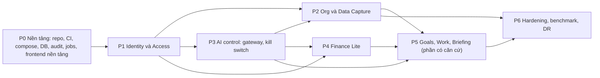

# AI-EOS — Implementation Plan (Stage 2D)

> Phiên bản: 1.0 (cập nhật 14/10/2026: D-42, D-43) · Ngày: 12/10/2026 · Trạng thái: **Đã duyệt — D-46 (CDA, 15/10/2026)**; cập nhật 15/10/2026 theo D-44, D-47, D-49, D-51
> Hiện trạng thực thi từng task: mục 10 (bằng chứng) và [PROJECT_STATUS](../PROJECT_STATUS.md) (tổng hợp).
> Nguồn: [SRS](../02-requirements/SRS.md) 1.1, [Architecture](../03-architecture/Architecture.md) 1.2, [Database_Design](../03-architecture/Database_Design.md) 1.2, [API_Specification](../03-architecture/API_Specification.md) 1.2, ADR-001…013 (ADR-005/008/009 có Amendment 1), [Decision_Log](../00-source/Decision_Log.md) 0.7. Kiểm thử: [TEST_Plan](TEST_Plan.md).

## 1. Quy ước

| Trường | Ý nghĩa |
| --- | --- |
| ID | `T-xxx`, ổn định, không tái sử dụng |
| Sẵn sàng | `READY` (đủ căn cứ để làm) · `PARTIAL` (làm được phần có căn cứ; phần còn lại ghi rõ) · `BLOCKED` (chờ quyết định, không làm) |
| Thực thi | `TODO` (chưa làm) · `IN_REVIEW` (đã có code, kiểm tra cục bộ đã chạy, chờ CDA review; chưa đủ DoD vì DoD cần CI) · `DONE` (đủ DoD chung + DoD riêng, có bằng chứng CI). Ghi ở mục 10 |
| Điều kiện bắt đầu | Tách khỏi "Sẵn sàng": `READY` chỉ nói task **đủ căn cứ**, không nói dependency đã đáp ứng. Task chỉ được bắt đầu khi mọi task ở cột "Phụ thuộc" đã `DONE`. **Ngoại lệ duy nhất** (CDA, 12/10/2026): T-002 được bắt đầu khi T-001 đang `IN_REVIEW`, vì DoD chung 1 của T-001 cần CI do T-002 tạo. Ngoại lệ không áp dụng cho task khác và không đổi trạng thái T-001 |
| DoD chung | Áp dụng cho mọi task, xem mục 2 |

Không task nào được triển khai nghiệp vụ không có trong SRS. Giá trị `PROPOSED` (vd. 07:00 cho Briefing, thang độ tự tin 0–10) được cài dưới dạng **cấu hình**, có nhãn "đề xuất" trong mã và tài liệu, để đổi được mà không sửa code.

## 2. Definition of Done chung

1. Code theo ranh giới module ADR-001; lint, type check, test pass trong CI (ADR-013).
2. Test tương ứng trong TEST_Plan được viết và chạy xanh; test âm (từ chối quyền, lỗi validation) bắt buộc với mọi endpoint. **"Test tương ứng" (D-44, 15/10/2026)** = TC có task chủ là task đó (TEST_Plan §12). TC chỉ ghi `PASSED` khi task chủ chạy toàn bộ kịch bản xanh trong CI; task khác tham chiếu TC chỉ ghi "bằng chứng thành phần", không phải PASS; task sau chạy lại TC như hồi quy (quy tắc R1–R7, [Q-51_TC_Ownership_Draft](Q-51_TC_Ownership_Draft.md) mục 2).
3. Thao tác nhạy cảm có audit (thành công và thất bại); không log secret.
4. Migration (nếu có) chạy được từ rỗng → head trong CI; có ràng buộc CSDL theo Database_Design §8.
5. API khớp API_Specification; thay đổi contract phải cập nhật tài liệu trước.
6. Requirements_Traceability cập nhật cột Task/Test; trạng thái requirement chỉ chuyển `IMPLEMENTED` khi có code, `VERIFIED` khi test liên quan xanh trong CI.

## 3. Trình tự và phụ thuộc

Đường găng (suy ra từ cột "Phụ thuộc" ở mục 4; chưa có ước lượng thời lượng nên tính theo số task nối tiếp; `{…}` = cần tất cả; cập nhật 14/10/2026 theo D-43): P0: T-001 → {T-002, T-004} → T-005 → T-008 → T-009; T-003, T-006 chỉ cần T-001, T-007 và T-010 cần T-005, T-011 cần T-004, T-012 cần T-001 và T-002 — làm song song; T-013 (Compose tích hợp) cần T-003, T-004, T-005, T-006, T-009. Chuỗi dài nhất tới P5: T-001 → {T-002, T-004} → T-005 → T-101 → T-102 → T-104 → T-402 → T-403 → T-404 → T-406 → T-510 → T-511. **Cập nhật 15/10/2026 (D-44: T-510 thêm T-211, T-206 thêm T-112; D-49: T-513):** chuỗi dài nhất tới P5 là T-001 → T-004 → T-005 → T-101 → T-107 → T-108 → T-201 → T-202 → T-203 → T-206 → T-211 → T-510 → T-511 (13 task); tới P6: … → T-510 → T-513 → T-608 (14 task). Kiểm tra tự động: không có vòng phụ thuộc. Finance (P4) có thể làm song song P2 sau khi có T-108 và T-302.

## 4. Danh sách task

### P0 — Nền tảng

| ID | Task | Phụ thuộc | SRS / requirement | Thiết kế | DoD riêng | Sẵn sàng |
| --- | --- | --- | --- | --- | --- | --- |
| T-001 | Khung repo: `backend/` (package theo module ADR-001), `frontend/` (React + Vite + TS strict), `infra/` (Compose), `docs/` | — | ADR-001, ADR-002, ADR-003 | Architecture §3 | Cấu trúc thư mục khớp module; README chạy local | READY |
| T-002 | Toolchain + CI: lint, format, type check (Python, TS), pytest với PostgreSQL container, Vitest, quét phụ thuộc, kiểm tra quy tắc import giữa module | T-001 | ADR-013, ADR-001 | ADR-013 | CI chặn merge khi một bước lỗi; vi phạm ranh giới module làm CI đỏ | READY |
| T-003 | Docker Compose — **cấu hình** (D-43): khai báo `proxy` (TLS nội bộ), `api`, `worker`, `db`, `scanner`, service cập nhật chữ ký scanner (D-45, chỉ service này có đường ra internet tới nguồn chữ ký); mạng nội bộ, volume, biến môi trường/secret theo mục 7 (chỉ tên), healthcheck; chỉ `proxy` publish cổng. Không gồm profile `llm` (chờ D-08) và `observability` (D-43). Chạy đủ service thuộc T-013 | T-001 | SRS-NFR-04 | Architecture §9.1, ADR-004, D-43 | `docker compose config` hợp lệ — chạy ở môi trường có Docker (CI); không có Docker → ghi NOT RUN, không tuyên bố đạt. Kiểm tra tĩnh: chỉ `proxy` có `ports`, `db` không publish cổng, mạng backend `internal`, không có giá trị secret trong file | READY — công cụ đã duyệt (D-43, 15/10/2026): Caddy, ClamAV; cập nhật chữ ký bằng service riêng, `scanner` ở mạng `internal`, tuổi chữ ký ≤ 90 ngày (D-45) |
| T-004 | Cấu hình và secret: loader kiểm tra biến bắt buộc khi khởi động, không có giá trị mặc định cho secret, `.env.example` chỉ chứa tên biến (mục 7) | T-001 | ADR-006, ADR-011 | Architecture §9.1 | Thiếu secret → tiến trình dừng với lỗi rõ ràng, không in giá trị | READY |
| T-005 | Nền CSDL: SQLAlchemy 2, Alembic, 3 role CSDL (`aieos_owner`, `aieos_app`, `aieos_backup`), harness test migration; engine/session và tích hợp Alembic ở `platform` (D-42) | T-002, T-004 (D-43: bỏ T-003) | SRS-NFR-03 | Database_Design §2, §10 | Migration rỗng → head trong CI; role ứng dụng không có DDL | READY |
| T-006 | Logging JSON, correlation ID, bộ lọc che secret, `/health/live`, `/health/ready` | T-001 | SRS-GEN-05 | ADR-012, API-SYS-01, API-SYS-02 | Test: header `Authorization`, cookie, mật khẩu không xuất hiện trong log | READY |
| T-007 | Hạ tầng HTTP: lỗi `problem+json`, CSRF + kiểm tra `Origin`, idempotency store, `ETag`/`If-Match`, rate limit | T-005 | SRS-GEN-01, SRS-GEN-02, SRS-GEN-03, SRS-GEN-04, SRS-GEN-05 | API_Specification §1 | Test TC-GEN-01…05 | READY |
| T-008 | Module audit: bảng append-only, trigger chặn UPDATE/DELETE, API ghi trong transaction, che trường nhạy cảm | T-005 | SRS-AUD-01, SRS-AUD-02, SRS-AUD-03 | ADR-010, Database_Design §9 | UPDATE/DELETE audit bị CSDL từ chối; TC-AUD-03 (chủ: T-008); bằng chứng thành phần TC-AUD-01 (chủ T-109), TC-AUD-02 (chủ T-105) — D-55 | READY |
| T-009 | Module jobs: queue, claim `SKIP LOCKED`, lease, reaper, retry + backoff, scheduler (advisory lock), registry `job_class` + test cấm handler `ORCHESTRATION` gọi gateway/provider/bảng nghiệp vụ | T-005, T-008 | SRS-JOB-01, SRS-JOB-02, SRS-JOB-03, SRS-AIC-06 | ADR-005 (+Amendment 1), Database_Design §5 | TC-JOB-01…04, TC-JOB-06 (chủ: T-009); bằng chứng thành phần TC-JOB-05 (chủ T-203, D-56); tham số kỹ thuật theo D-56 | READY |
| T-010 | Thông báo in-app | T-005, T-102 (D-58) | SRS-NTF-01, SRS-NTF-02 | API-NOT-01, API-NOT-02 | Nội dung thông báo không chứa dữ liệu nhạy cảm; bằng chứng thành phần TC-NTF-01 (chủ T-510, D-58) | READY |
| T-011 | Storage adapter (volume cục bộ), khóa UUID | T-004 | SRS-CAP-03 | ADR-004 | Không đường dẫn nào lấy từ tên file người dùng | READY |
| T-012 | Nền tảng frontend (ADR-003): Tailwind CSS + shadcn/ui (Radix) với design token trung tính (D-35); React Router; TanStack Query (request kèm cookie session, không lưu token ở `localStorage`/`sessionStorage`); manifest PWA + service worker chỉ cache tài nguyên tĩnh, không cache response `/api`. Không gồm: đăng nhập, app shell nghiệp vụ (T-111), i18n (T-607), màn hình nghiệp vụ | T-001, T-002 | ADR-003 | ADR-003, UX §8.1–8.2, Architecture §2.2 | Qua toàn bộ `scripts/ci.sh` (T-002); test: service worker không cache `/api`; không dùng `dangerouslySetInnerHTML`; build không có inline script (tương thích CSP của ADR-003). Chưa có TC trong TEST_Plan — bổ sung khi triển khai, cần CDA duyệt | READY (đủ căn cứ: Q-45, D-41) — dependency T-001, T-002 đã `DONE`; thực thi: mục 10 |
| T-013 | Docker Compose — **tích hợp** (D-43): Dockerfile/image `api`, `worker` build được; `docker compose up` chạy đủ service của T-003 và vượt healthcheck; `db` dùng script role và lệnh migration của T-005 | T-003, T-004, T-005, T-006, T-009 | SRS-NFR-04 | Architecture §9.1, ADR-004, ADR-012, D-43 | Mọi service `healthy` ở môi trường có Docker (CI); TC-NFR-01; không publish cổng DB | READY — như T-003 (D-43, D-45); TC-NFR-01 theo phạm vi D-45 |

### P1 — Identity và Access

| ID | Task | Phụ thuộc | SRS / requirement | Thiết kế | DoD riêng | Sẵn sàng |
| --- | --- | --- | --- | --- | --- | --- |
| T-101 | Bảng `identity.*` + migration | T-005 | SRS-IAM-06 | Database_Design §4 | Token chỉ lưu hash | READY |
| T-102 | Đăng nhập, session (xoay ID, hết hạn), đăng xuất, `/auth/me`, giới hạn thử | T-101, T-007 | SRS-IAM-04, SRS-IAM-06, SRS-IAM-07, SRS-GEN-01 | API-AUTH-01, API-AUTH-06, API-AUTH-07 | TC-IAM-01…05; TC-AUD-02 (phần đăng nhập, D-55) | READY |
| T-103 | MFA TOTP: đăng ký, xác minh, mã khôi phục; bắt buộc với ADMIN | T-102 | SRS-IAM-05 | API-AUTH-02, API-AUTH-03, API-AUTH-04 | TC-IAM-06, TC-IAM-07; TC-AUD-02 (phần MFA, D-55) | READY |
| T-104 | Step-up (reauth), đổi mật khẩu + thu hồi session khác | T-102 | SRS-IAM-08, SRS-IAM-11 | API-AUTH-05, API-AUTH-09 | TC-IAM-08; TC-AUD-02 (phần đổi mật khẩu, D-55) | READY |
| T-105 | Tạo tài khoản + lời mời; chấp nhận lời mời | T-102, T-108, T-103, T-104 (D-55) | SRS-IAM-01, SRS-IAM-02, SRS-IAM-03 | API-ADM-02, API-ADM-03, API-AUTH-08 | TC-IAM-09, TC-IAM-10; thời hạn lời mời và chính sách mật khẩu là cấu hình (PROPOSED); TC-AUD-02 (phần lời mời + đạt tổng, D-55) | READY |
| T-106 | CLI `bootstrap-admin`, `recover-admin` | T-101, T-107, T-010 (D-58) | SRS-IAM-09, SRS-IAM-10 | ADR-006 | TC-IAM-11, TC-IAM-12 | READY |
| T-107 | Bảng `access.*`, seed role/permission (Architecture §6) qua migration, trigger INV-09/10/11, kiểm tra điều kiện assignment | T-101 | SRS-ACC-05, SRS-ACC-06, SRS-ACC-07, SRS-ACC-08 | Database_Design §4, §8 | Không seed tài khoản; seed `hr.*`, `pii.unmask`, `goals.activate` **không** có quyền nền | READY |
| T-108 | Module policy `authorize()`, bộ lọc phạm vi, mặc định deny, bắt buộc mọi route khai báo permission | T-107 | SRS-ACC-01, SRS-ACC-02, SRS-ACC-03, SRS-ACC-09, SRS-ACC-11 | ADR-007 | Route chưa khai báo quyền bị từ chối (TC-ACC-02) | PARTIAL — SRS-ACC-04 (định nghĩa "team") dùng mặc định PROPOSED |
| T-109 | API quản trị người dùng/role/assignment, thu hồi session, khóa ADMIN cuối | T-108, T-104 | SRS-ACC-05, SRS-ACC-06, SRS-ACC-07, SRS-ACC-08, SRS-IAM-11 | API-ADM-01, API-ADM-04, API-ADM-05, API-ADM-06, API-ADM-07, API-ADM-08, API-ADM-09 | TC-ACC-04…08, TC-AUD-01 (D-55) | READY |
| T-110 | Xem audit, trang tình trạng hệ thống (gồm cảnh báo thiếu người quản lý kỳ, không có kỳ mở, hàng chờ không người, chưa ai có `goals.activate`) | T-109, T-009, T-401 hoặc T-402 (D-44, `[CẦN XÁC NHẬN]` — chưa thêm vào chuỗi phụ thuộc) | SRS-AUD-04, SRS-FIN-12 | API-ADM-10, API-ADM-11 | TC-AUD-04, TC-FIN-14 (chủ: T-110, D-44) | READY |
| T-111 | Frontend: app shell, đăng nhập, MFA, chấp nhận lời mời, quản trị người dùng/quyền, ẩn mục không có quyền, trạng thái chung | T-102…T-109, T-012 | SRS-ACC-09, SRS-GEN-06 | UX_Flows §0, FL-01, FL-02, FL-03 | Bằng chứng thành phần TC-E2E-01 (chủ: T-608, D-44) | READY |
| T-112 | Che dữ liệu cá nhân: phát hiện bằng quy tắc (CCCD, số tài khoản…), nhãn `sensitivity`, che ở API, file xuất, câu trả lời AI | T-108 | SRS-ACC-10, SRS-PRV-02 | Architecture §6, §8.5 | TC-PRV-01…03 | READY — R6 đã quyết: không ai giữ quyền `hr.*`, `pii.unmask` trong MVP (D-21, 15/10/2026) |

### P2 — Org và Data Capture

| ID | Task | Phụ thuộc | SRS / requirement | Thiết kế | DoD riêng | Sẵn sàng |
| --- | --- | --- | --- | --- | --- | --- |
| T-201 | `org.*` + API danh bạ | T-108 | SRS-ACC-11 | API-ORG-01, API-ORG-02, Database_Design §6 | Chỉ trường danh bạ | READY |
| T-202 | Bảng `capture.*` + migration | T-005, T-201 | SRS-CAP-13, SRS-REV-07, SRS-REV-09 | Database_Design §6 | — | READY |
| T-203 | Upload: allowlist + magic bytes, giới hạn, chuẩn hóa tên, lưu, hash trùng, job quét mã độc | T-202, T-011, T-009 | SRS-CAP-01, SRS-CAP-02, SRS-CAP-03, SRS-CAP-04, SRS-CAP-05, SRS-CAP-06, SRS-CAP-07 | API-DOC-01, API-DOC-02, API-DOC-03, API-DOC-04, API-DOC-05 | TC-FILE-01…08, TC-JOB-05 (D-56) | READY |
| T-204 | Provider adapter: interface LLM/OCR/converter, adapter giả lập cho test, định tuyến theo phân loại dữ liệu, timeout/retry/fallback, call log, trần chi phí | T-004, T-009 | SRS-PRV-01, SRS-PRV-02, SRS-PRV-03, SRS-PRV-04, SRS-NFR-07 | ADR-011 | TC-PRV-04…07; trần chi phí là cấu hình (GAP-14) | READY |
| T-205 | Adapter provider thật (LLM, OCR) | T-204, T-606 | SRS-PRV-01 | ADR-011 | Theo kết quả benchmark | PARTIAL — D-50: DeepSeek qua OpenRouter cho demo; provider local cho production chờ T-606 (D-08). `[CẦN XÁC NHẬN]` phần demo có cần chờ T-606 không. Phần demo DeepSeek bị chặn tới khi Q-53 và các điểm D-50 được giải quyết (D-60) |
| T-206 | Pipeline xử lý: tiền xử lý ảnh, phân loại, trích xuất, chuẩn hóa VN, kiểm tra, định tuyến (tự ghi tắt mặc định), tách/gộp, thử lại | T-203, T-204, T-302, T-112 (D-44) | SRS-CAP-08, SRS-CAP-10, SRS-CAP-11, SRS-CAP-12, SRS-CAP-14, SRS-CAP-15, SRS-CAP-16, SRS-CAP-17, SRS-CAP-18, SRS-CAP-20, SRS-CAP-21, SRS-CAP-22 | Architecture §8.5, API-DOC-06, API-DOC-07 | TC-CAP-01…04, TC-CAP-06…08, TC-SEC-06 (chủ: T-206); TC-CAP-05 chủ T-208 (D-44) | READY — GAP-13, D-16, D-29 đã quyết theo mặc định (D-51) |
| T-207 | Hàng chờ review + API + UI bàn phím | T-206, T-108, T-012, T-408 (D-44) | SRS-REV-01, SRS-REV-02, SRS-REV-03, SRS-REV-04, SRS-REV-05, SRS-REV-06, SRS-REV-07, SRS-REV-08, SRS-REV-09, SRS-NFR-10 | API-REV-01…07, FL-05 | TC-REV-01…06 (gồm TC-REV-05, D-44) | READY — SLA review là cấu hình, giá trị trống (GAP-18, D-51) |
| T-208 | Cấu hình loại tài liệu/schema/ngưỡng, kiểm tra điều kiện bật tự ghi (BR-05) | T-206 | SRS-CAP-15, SRS-CAP-16, SRS-CAP-17 | API-CFG-01…05 | TC-CAP-05 (chủ: T-208); TC-CAP-06 chủ T-206 (D-44) | READY |
| T-209 | Form sinh từ schema, gợi ý/trùng, nhập ngôn ngữ tự nhiên (bản dự kiến), lưu nháp, audit thay đổi thủ công | T-206, T-204 | SRS-CAP-30, SRS-CAP-31, SRS-CAP-32, SRS-CAP-33, SRS-CAP-34 | API-CAP-01…04 | TC-CAP-09…11 | READY |
| T-210 | Import XLSX/CSV: map cột, xem trước, lỗi theo dòng, commit qua gateway; import nhân sự giới hạn cột | T-206, T-302 | SRS-IMP-01, SRS-IMP-02, SRS-IMP-03 | API-IMP-01…05, FL-06 | TC-IMP-01…04 | READY |
| T-211 | Lineage API + popover nguồn | T-206 | SRS-CAP-19, SRS-BRF-04 | API-ORG-03 | TC-CAP-12 | READY |
| T-212 | Frontend capture: drop zone toàn cục, thẻ tiến trình, chụp ảnh (app đang mở), import | T-203, T-210, T-012 | SRS-CAP-09 | FL-04, FL-06 | Bằng chứng thành phần TC-E2E-02 (chủ: T-608, D-44) | READY |

### P3 — AI control

| ID | Task | Phụ thuộc | SRS / requirement | Thiết kế | DoD riêng | Sẵn sàng |
| --- | --- | --- | --- | --- | --- | --- |
| T-301 | Bảng `ai.*`, seed Tool Registry (tool BRD §3.9 + tool đích MVP), trần autonomy | T-005, T-107 | SRS-AIC-02, SRS-AIC-03 | Database_Design §5, INV-12, INV-13 | CHECK trần có hiệu lực | READY |
| T-302 | Write gateway: thứ tự kiểm tra, bản nháp L2, thực thi L3, idempotency, audit; lint chặn ghi domain bỏ qua gateway | T-301, T-108, T-008 | SRS-AIC-01, SRS-AIC-02, SRS-AIC-05, SRS-AIC-09, SRS-CAP-18 | ADR-008, Architecture §8.1 | TC-AIC-01…06 | READY |
| T-303 | Kill switch: API, step-up, banner, tích hợp gateway và jobs (`job_class`) | T-302, T-009 | SRS-AIC-04, SRS-AIC-05, SRS-AIC-06 | API-AI-01, API-AI-02, FL-10 | TC-KS-01…07, TC-KS-10; TC-KS-08, TC-KS-09 chủ T-511 (D-44) | READY |
| T-304 | Bản nháp: review/xác nhận/từ chối, hoàn tác L3 (toast + 24 giờ), đánh dấu quá hạn (cấu hình, mặc định 30 ngày), nhắc hằng ngày | T-302, T-010 | SRS-AIC-07, SRS-AIC-08, SRS-AIC-10, SRS-AIC-11 | API-AI-06, API-AI-07, API-AI-08, API-AI-09, API-AI-10, API-AI-11, FL-09 | TC-AIC-07…11; TC-NTF-01 (phần bản nháp AI, D-58) | READY |
| T-305 | Cấu hình autonomy trong trần | T-301 | SRS-AIC-15 | API-AI-03, API-AI-04, API-AI-05 | TC-AIC-12 | READY |
| T-306 | Chat AI: SSE, tool READ theo phạm vi, trích dẫn, Dừng, trả lời theo ngôn ngữ câu hỏi | T-204, T-108 | SRS-AIC-12, SRS-AIC-13 | API-AI-12 | TC-AIC-13…15 (adapter giả lập) | PARTIAL — chất lượng trả lời chờ provider thật (D-08) |
| T-307 | Phản hồi người dùng; harness Evaluation Engine (bộ câu hỏi/đáp án, chạy trước thay đổi model/prompt) | T-306 | SRS-AIC-14, SRS-AIC-16 | API-AI-13, ADR-013 | Harness chạy được với adapter giả lập | READY |
| T-308 | Frontend panel chat AI (D-49): thanh/panel AI, trả lời truyền dần (SSE), bước thật, nút Dừng, source chip, độ tin cậy Cao/TB/Thấp; render nội dung AI dạng văn bản (ADR-003) | T-306, T-111, T-012 | SRS-AIC-12, SRS-AIC-13 | API-AI-12, UX_Flows §0.3 | Test component (Vitest): không dùng `dangerouslySetInnerHTML`, Dừng hủy luồng, source chip hiển thị. Chưa có TC trong TEST_Plan — bổ sung cần CDA duyệt | READY |

### P4 — Finance Lite

| ID | Task | Phụ thuộc | SRS / requirement | Thiết kế | DoD riêng | Sẵn sàng |
| --- | --- | --- | --- | --- | --- | --- |
| T-401 | Bảng `finance.*` + trigger INV-01…07, ràng buộc loại trừ chồng lấn kỳ, `ON_HOLD`/`hold_reason` | T-005, T-107 | SRS-FIN-13, SRS-FIN-17 | Database_Design §7, §8 | TC-FIN-01…04 ở mức CSDL | READY |
| T-402 | Kỳ báo cáo: mở/khóa, khóa dòng, chặn khóa khi còn chờ duyệt | T-401, T-104 | SRS-FIN-12 | API-FIN-01, API-FIN-02, API-FIN-03 | TC-FIN-12, TC-FIN-13, TC-FIN-15; TC-FIN-14 chủ T-110 (D-44) | PARTIAL — độ dài kỳ: tháng (Q-31, D-51); người giữ `finance.period.manage` do CDA giao vận hành (D-14, còn mở) |
| T-403 | Tạo/sửa/gửi/hủy/rút lại giao dịch; idempotency; kiểm tra kỳ `OPEN` khi gửi (AMD-01); cờ thiếu người duyệt | T-401, T-402, T-010 | SRS-FIN-01, SRS-FIN-02, SRS-FIN-04, SRS-FIN-05, SRS-FIN-06, SRS-FIN-07, SRS-FIN-16 | API-FIN-04…09 | TC-FIN-05…11; TC-NTF-01 (phần giao dịch chờ duyệt, D-58) | READY — danh mục là văn bản tự do (Q-42, D-51) |
| T-404 | Duyệt/từ chối: khóa dòng, version, tách nhiệm vụ, nhánh `ON_HOLD` | T-403 | SRS-FIN-08, SRS-FIN-09, SRS-FIN-17 | API-FIN-10, API-FIN-11 | TC-FIN-16…22 | READY |
| T-405 | Bút toán đảo và điều chỉnh | T-404 | SRS-FIN-10, SRS-FIN-11 | API-FIN-12 | TC-FIN-23…28 | READY |
| T-406 | Lịch sử, tổng hợp doanh thu/chi phí/tiền mặt với `as_of` | T-404 | SRS-FIN-14 | API-FIN-13, API-FIN-14 | TC-FIN-29 | READY |
| T-407 | Runway | T-406 | SRS-FIN-15 | API-FIN-14 | — | BLOCKED — Q-39 một phần (D-51): còn thiếu định nghĩa burn ròng và cửa sổ tính |
| T-408 | Tool AI `create_finance_draft` qua gateway (chỉ tạo `DRAFT`) | T-302, T-403 | SRS-FIN-03, SRS-REV-08 | ADR-008, ADR-009 | TC-FIN-30 | READY |
| T-409 | Frontend tài chính (FL-11, FL-12) | T-403…T-406, T-012 | SRS-FIN-12 | UX_Flows FL-11, FL-12 | Bằng chứng thành phần TC-E2E-03 (chủ: T-608, D-44) | READY |

### P5 — Goals, Work, Briefing (phần có căn cứ)

| ID | Task | Phụ thuộc | SRS / requirement | Thiết kế | DoD riêng | Sẵn sàng |
| --- | --- | --- | --- | --- | --- | --- |
| T-501 | `goals.*`: tạo/sửa bản nháp, đo lường, check-in, xem theo phạm vi; hiển thị baseline/target/giá trị, **không** tính % | T-108, T-201 | SRS-GOAL-01, SRS-GOAL-02, SRS-GOAL-05, SRS-GOAL-06, SRS-GOAL-07, SRS-GOAL-09, SRS-GOAL-11 | API-GOAL-01, API-GOAL-02, API-GOAL-03, API-GOAL-05, API-GOAL-06 | TC-GOAL-01…06 | READY — nhịp check-in, thang độ tự tin theo đề xuất (Q-30, D-51) |
| T-502 | Kích hoạt mục tiêu với permission `goals.activate` (assignment, không quyền nền) | T-501, T-109 | SRS-GOAL-03, SRS-GOAL-04 | API-GOAL-04 | TC-GOAL-07, TC-GOAL-08; TC-ACC-03 (phần mục tiêu, D-59) | PARTIAL — kích hoạt: CEO cấp công ty, MANAGER cấp đơn vị (Q-28, D-51); vòng đời ngoài DRAFT/ACTIVE và người được giao `goals.activate` còn mở |
| T-503 | Commit mục tiêu và giá trị đo từ tài liệu (kế hoạch, báo cáo định kỳ) qua gateway; gợi ý alignment L1 | T-206, T-302, T-501 | SRS-GOAL-03, SRS-GOAL-06, SRS-GOAL-10 | ADR-008 | TC-GOAL-09 | READY |
| T-504 | Frontend mục tiêu (cây, check-in) | T-501, T-502, T-012 | SRS-GOAL-08 | FL-15 | Bằng chứng thành phần TC-E2E-04 (chủ: T-608, D-44) | PARTIAL — điền sẵn check-in = giá trị đo gần nhất (PROPOSED); điền từ task: CDA đồng ý (Q-29, D-51) nhưng quy tắc chưa đặc tả |
| T-505 | `work.task`: tạo, sửa, hoàn thành/mở lại, xem theo phạm vi | T-108, T-201 | SRS-WRK-01, SRS-WRK-02, SRS-WRK-03, SRS-WRK-04, SRS-WRK-10 | API-WORK-01, API-WORK-03, API-WORK-04, API-WORK-05 | TC-WRK-01…05; TC-NTF-01 (phần giao task, D-58); TC-ACC-03 (chủ, D-59) | READY — trạng thái OPEN/DONE, mở lại bởi người giao (Q-33, D-51) |
| T-506 | Biên bản → Meeting/Decision/ActionItem → giao việc qua gateway | T-206, T-302, T-505 | SRS-WRK-05, SRS-WRK-06, SRS-WRK-07, SRS-WRK-11 | API-WORK-02, API-WORK-06, FL-08 | TC-WRK-06…08 | READY |
| T-507 | Job `ORCHESTRATION` task quá hạn + thông báo | T-009, T-505 | SRS-WRK-09 | ADR-005 | TC-WRK-09 | READY |
| T-508 | Action card F1 tạo task L3 + hoàn tác | T-304, T-505 | SRS-WRK-08 | ADR-008 | TC-WRK-10 | READY |
| T-509 | Frontend công việc | T-505, T-506, T-012 | SRS-WRK-10 | FL-08 | Bằng chứng thành phần TC-E2E-05 (chủ: T-608, D-44) | READY |
| T-510 | Trang chủ CEO: ô chỉ số (nhãn "đề xuất — chưa chính thức", không cảnh báo), "Cần anh quyết" (chỉ mục có nguồn), "AI đã làm", trạng thái trống, ẩn khối chưa đủ căn cứ, chọn ô | T-406, T-501, T-505, T-304, T-211 (D-44) | SRS-BRF-01, SRS-BRF-02, SRS-BRF-03, SRS-BRF-04, SRS-BRF-05, SRS-BRF-06, SRS-BRF-07, SRS-BRF-08, SRS-BRF-09, SRS-BRF-12, SRS-SLS-03 | API-INS-01, API-INS-02, FL-07 | TC-BRF-01…07; TC-NTF-01 (tổng, D-58) | PARTIAL — công thức ô chính thức (Q-37, D-51); ngưỡng "dữ liệu cũ" là cấu hình trống |
| T-511 | Tạo nội dung Briefing (`AI_CONTENT`) theo lịch + API quản lý lịch; hành vi kill switch | T-510, T-303, T-204 | SRS-BRF-10, SRS-BRF-11, SRS-BRF-13 | API-INS-03, ADR-005/008 Amendment 1 | TC-BRF-08…11, TC-KS-08, TC-KS-09 | READY — nội dung, giờ/tần suất theo mặc định (Q-36, D-51); provider demo D-50 |
| T-512 | Tài liệu quy trình/SOP → knowledge item | T-206, T-302 | FR-DCS-02 | API-KNOW-01 | TC-CAP-13 | READY |
| T-513 | Frontend Trang chủ CEO (D-49): dòng tóm tắt, 4 ô chỉ số có độ mới và nguồn, "Cần anh quyết", "AI đã làm", trạng thái trống, popover nguồn | T-510, T-111, T-012 | SRS-BRF-01, SRS-BRF-02, SRS-BRF-03, SRS-BRF-04, SRS-BRF-05, SRS-BRF-06, SRS-BRF-07, SRS-BRF-08, SRS-BRF-09, SRS-BRF-12 | FL-07, API-INS-01, API-INS-02 | Test component (Vitest) cho các khối và trạng thái trống; E2E thuộc TC-E2E-05 (chủ T-608). Chưa có TC riêng — bổ sung cần CDA duyệt | PARTIAL — ngưỡng "dữ liệu cũ" là cấu hình trống (Q-37) |

### P6 — Hardening, benchmark, phục hồi

| ID | Task | Phụ thuộc | SRS / requirement | Thiết kế | DoD riêng | Sẵn sàng |
| --- | --- | --- | --- | --- | --- | --- |
| T-601 | Sinh bộ test ma trận authorization từ seed | T-107; các task API liệt kê ở §17 (D-44) | SRS-ACC-01, SRS-ACC-02, SRS-NFR-11 | ADR-013 | Mọi endpoint × role × phạm vi | READY |
| T-602 | Bộ test bảo mật (TEST_Plan §6) | T-111, T-203, T-306, T-013 (D-44) | SRS-NFR-11 | Architecture §10 | AC-ARCH-05, 07, 08, 09, 11, 12 xanh; TC-SEC-01, TC-SEC-02, TC-SEC-04, TC-SEC-05 (chủ: T-602, D-44) | READY |
| T-603 | Test đồng thời và idempotency | T-404, T-405, T-009 | SRS-GEN-03, SRS-GEN-04 | Architecture §7.2 | AC-ARCH-01, 02, 03 xanh | READY |
| T-604 | Test hiệu năng NFR-01/02 | T-206, T-205 | SRS-NFR-01, SRS-NFR-02 | ADR-005 | Báo cáo số đo; không tuyên bố đạt nếu chưa đo | BLOCKED — cần provider thật (D-08) để đo đại diện; có thể đo pipeline với adapter giả lập |
| T-605 | Backup/restore: base backup + WAL archiving, backup volume, quy trình và diễn tập | T-005, T-013 (D-43), T-203, T-008, T-101, T-107, T-301, T-302, T-401, T-403 (D-44) | SRS-NFR-03 | Architecture §9.3 | Diễn tập ghi kết quả RPO/RTO đo được; TC-DR-01, TC-DR-02, TC-MIG-02 (chủ: T-605, D-44) | READY (công cụ cụ thể chọn khi triển khai) |
| T-606 | Benchmark LLM/OCR: tạo bộ dữ liệu tổng hợp, ground truth, harness, báo cáo | T-204 | SRS-NFR-09 | TEST_Plan §9, ADR-011 | Báo cáo so sánh ≥ 2 phương án; không dùng PII thật | READY |
| T-607 | Truy cập (WCAG 2.1 AA), i18n vi/en | T-111 | SRS-NFR-05, SRS-NFR-08 | ADR-003 | Kiểm tra tự động + thủ công | READY |
| T-608 | E2E Playwright cho FL-01…FL-15 trong phạm vi | T-013 (D-43); task frontend liệt kê ở §17 (D-44) | SRS-NFR-06 | UX_Flows | TC-E2E-01…06 (chủ: T-608, D-44) | READY |

### Bị chặn / ngoài phạm vi triển khai

| ID | Hạng mục | Phụ thuộc | Requirement | Lý do | Sẵn sàng |
| --- | --- | --- | --- | --- | --- |
| T-901 | Sales Pipeline Lite | — | SRS-SLS-01, SRS-SLS-02, FR-HM-04 | D-40, Q-38 — giữ ngoài MVP (D-51) | BLOCKED |
| T-902 | Workload/quá tải (F5) | — | SRS-WRK-12, F5, FR-HM-06 | Q-34 — không có workload trong MVP (D-51) | BLOCKED |
| T-903 | Đặt lịch / đồng bộ lịch | — | SRS-WRK-12 | Q-35, D-31 — không có lịch trong MVP (D-51) | BLOCKED |
| T-904 | % đạt mục tiêu, cảnh báo lệch | — | SRS-GOAL-09 | Q-29 một phần (D-51): công thức % đạt chờ CDA duyệt đề xuất; ngưỡng "dưới 20%" `[CẦN XÁC NHẬN]` | BLOCKED |
| T-905 | Theo dõi Decision Log 30/60/90 | — | SRS-WRK-11 | Q-41 — chỉ ghi quyết định (D-51) | BLOCKED |
| T-906 | Nhắc check-in tự động | — | SRS-GOAL-07 | Q-30 — không nhắc tự động (D-51) | BLOCKED |
| T-907 | Quyền xem dữ liệu nhân sự nhạy cảm | — | SRS-ACC-10 | R6 — không ai giữ trong MVP (D-21, 15/10/2026) | BLOCKED |
| T-908 | Hóa đơn/biên lai, email forwarding, C6–C10, L4 | — | SRS-NTF-03 | D-11, D-17, D-18; điều kiện mở: Phase 2 | BLOCKED |

## 5. Kế hoạch migration (không chạy trong Stage 2D)

| # | Migration | Nội dung | Bất biến kèm theo | Task |
| --- | --- | --- | --- | --- |
| M-01 | `base_roles_schemas` | Schema theo module, quyền role CSDL | Role ứng dụng không DDL | T-005 |
| M-02 | `identity` | Bảng identity | Hash token | T-101 |
| M-03 | `access_seed` | Role, permission, role_permission (seed), user_role, assignment | INV-09, INV-10, INV-11 | T-107 |
| M-04 | `audit` | `audit.event` | INV-14 | T-008 |
| M-05 | `jobs_notify` | `jobs.job` (`job_class`), `jobs.schedule`, `notify.notification` — D-56: tách thành revision `0003` (`jobs.*`, T-009) và revision của T-010 (`notify.notification`) | — | T-009, T-010 |
| M-06 | `org` | `org_unit`, `employee` (chỉ trường danh bạ) | — | T-201 |
| M-07 | `capture` | Bảng capture | — | T-202 |
| M-08 | `ai_seed` | `ai.*`, seed tool | INV-12, INV-13, INV-15 | T-301 |
| M-09 | `finance` | Kỳ, giao dịch (`ON_HOLD`), event, delegation (rỗng) | INV-01…INV-08 | T-401 |
| M-10 | `goals_work_knowledge_insights` | Bảng theo Database_Design §6 | — | T-501, T-505, T-510 |

Quy tắc: một chuỗi revision; mỗi migration có test rỗng → head và test bất biến tương ứng; không seed tài khoản; thay đổi phá vỡ theo mở rộng → di chuyển → thu hẹp (Database_Design §10).

## 6. Môi trường local và điều kiện triển khai

| Hạng mục | Yêu cầu |
| --- | --- |
| Công cụ | Docker + Docker Compose v2; Python và Node phiên bản ổn định được hỗ trợ (chốt trong lockfile ở T-001); trình duyệt hiện đại cho E2E |
| TLS local | Reverse proxy cấp chứng chỉ nội bộ; cookie `Secure` cần HTTPS |
| Phần cứng | Chưa xác định — scanner và model local là phần tốn RAM; xác định sau T-606 |
| Dữ liệu | Chỉ dữ liệu giả/tổng hợp trong dev, test, CI |
| Triển khai nội bộ | Chưa có trong phạm vi Stage 2D; điều kiện: T-605 diễn tập đạt, T-602/T-603 xanh, CDA duyệt |

## 7. Biến cấu hình và secret (chỉ tên, không có giá trị)

| Biến | Loại | Dùng bởi |
| --- | --- | --- |
| `AIEOS_DATABASE_URL` | Secret | api, worker, CLI quản trị `admin-cli` (role `aieos_app`) |
| `AIEOS_DATABASE_OWNER_URL` | Secret | lệnh migration |
| `AIEOS_CSRF_KEY` | Secret | api |
| `AIEOS_TOTP_ENCRYPTION_KEY` | Secret — 32 byte ngẫu nhiên mã hóa base64 (AES-256-GCM cho secret TOTP, T-103); sai định dạng → api thoát mã 2 | api |
| `AIEOS_STORAGE_PATH` | Cấu hình | api, worker |
| `AIEOS_ALLOWED_ORIGINS` | Cấu hình | api |
| `AIEOS_SCANNER_HOST` | Cấu hình | worker |
| `AIEOS_LLM_PROVIDERS`, `AIEOS_OCR_PROVIDERS` | Cấu hình (JSON: tên, URL, `local`, mức phân loại cho phép) | worker, api |
| `AIEOS_LLM_API_KEY_<NAME>` | Secret | worker, api |
| `AIEOS_AI_BUDGET_LIMIT` | Cấu hình (GAP-14) | worker, api |
| `AIEOS_SESSION_IDLE_MINUTES`, `AIEOS_SESSION_ABSOLUTE_HOURS`, `AIEOS_INVITE_TTL_HOURS`, `AIEOS_REAUTH_MINUTES` | Cấu hình | api |
| `AIEOS_BACKUP_TARGET` | Cấu hình | backup |
| `AIEOS_AUTH_RATE_LIMIT_ATTEMPTS`, `AIEOS_AUTH_RATE_LIMIT_WINDOW_SECONDS` | Cấu hình bắt buộc, không mặc định (D-57) — số lần thử tối đa trong cửa sổ, theo IP và theo tài khoản, cho đăng nhập, MFA, chấp nhận lời mời, reauth (API_Specification §1.9); đăng ký vào loader ở T-102 (đã đăng ký) | api |
| `AIEOS_AUTH_LOCKOUT_THRESHOLD`, `AIEOS_AUTH_LOCKOUT_MINUTES` | Cấu hình bắt buộc, không mặc định — số lần sai liên tiếp để khóa tạm và thời gian khóa (SRS-IAM-07 "giá trị cấu hình"; áp nguyên tắc D-57; đăng ký ở T-102) | api |
| `AIEOS_PASSWORD_MIN_LENGTH` | Cấu hình bắt buộc, không mặc định (D-58) — độ dài mật khẩu tối thiểu cho CLI T-106, đổi mật khẩu T-104, lời mời T-105; đăng ký vào loader ở T-106 (đã đăng ký) | api, CLI |

Secret nạp qua Docker secrets hoặc file môi trường không commit. Không có giá trị mặc định cho secret; thiếu → tiến trình dừng (T-004).

## 8. Rủi ro còn mở

| Rủi ro | Ảnh hưởng | Giảm thiểu |
| --- | --- | --- |
| Provider chưa chọn (D-08) | Chất lượng trích xuất, hiệu năng chưa biết | T-606 trước T-205; adapter giả lập để không chặn phát triển |
| Một người tài chính duy nhất | Giao dịch không ghi sổ được | Cảnh báo hệ thống; CDA giao assignment |
| Module P5 thiếu quy tắc | Phải sửa khi có câu trả lời | Giá trị PROPOSED là cấu hình; endpoint giữ ổn định |
| Thông lượng queue PostgreSQL chưa đo | NFR-02 | T-604 |
| Audit không có chuỗi hash | Người có quyền owner CSDL có thể can thiệp | Tách role CSDL; ghi nhận rủi ro (ADR-010) |
| PWA trên iOS | Thông báo/camera hạn chế | Không cam kết (ADR-003) |
| Provider demo cloud cho mọi loại dữ liệu (D-50) | Dữ liệu `PERSONAL`/`SENSITIVE` rời máy triển khai, ra provider ngoài Việt Nam | ADR-011 Amendment 1: chỉ khi demo; production thêm provider local; `[CẦN XÁC NHẬN]` demo dùng dữ liệu tổng hợp |

## 9. Tiêu chí nghiệm thu MVP (kỹ thuật)

1. Mọi task `READY` và phần có căn cứ của task `PARTIAL` hoàn thành theo DoD.
2. AC-ARCH-01…12 xanh trong CI.
3. TEST_Plan: mọi test mức độ P0 xanh; không có lỗi Critical/High mở.
4. Benchmark D-08 có báo cáo; mục tiêu MET-01 chỉ được tuyên bố khi đo đạt.
5. Diễn tập backup/restore có kết quả.
6. Traceability: mọi requirement P0 không DEFERRED có Task và Test, hoặc lý do N/A/BLOCKED.

## 10. Tiến độ thực thi

Điều kiện bắt đầu T-002: đáp ứng theo ngoại lệ ở mục 1 (CDA, 12/10/2026); T-002 đã bắt đầu theo ngoại lệ này, nay `DONE`. T-012 không thuộc ngoại lệ; dependency T-001, T-002 nay đã `DONE`.

Chỉ ghi task đã bắt đầu (ID trong dấu `` ` `` để không trùng với bảng task mục 4); bằng chứng là lệnh đã thực sự chạy. Trạng thái "Sẵn sàng" ở mục 4 không đổi.

| Task | Thực thi | Ngày | Bằng chứng | Chưa đạt / giới hạn |
| --- | --- | --- | --- | --- |
| `T-001` | `DONE` | 12/10/2026 | Cấu trúc `backend/` (package `aieos`, 17 module theo Architecture §3), `frontend/`, `infra/`, README. Python 3.12.14 (uv 0.12.11): `uv lock --check`, `uv sync --locked`, `uv build`, `python -m unittest` (test cấu trúc 2/2 OK; kiểm tra âm — package thừa, file `.py` lẻ, thư mục thiếu `__init__.py`, module bị xóa, module thiếu `__init__.py` — đều FAIL; chạy được từ thư mục khác). Node 22.23.3 / npm 10.9.9: `npm ci`, `npm run typecheck` (rc 0; kiểm tra âm: tham số `any` ngầm → TS7006), `npm run build`, `npm audit` 0 lỗ hổng, `npm run dev` (Vite 8.3.4 trả 200 cho `/` và `/src/main.tsx`); Node 24 bị chặn `EBADENGINE`. Review 12/10/2026: lặp lại các lệnh README trên bản sao sạch (không `.venv`/`node_modules`) → đạt; lockfile có binary cho linux gnu/musl, darwin, win32; không peer dependency `invalid` | **DONE 12/10/2026 — bằng chứng CI:** commit `318689c`, GitHub Actions run `38257197546` (`completed`/`success`): `scripts/ci.sh` 17/17 bước gồm ruff, mypy, import-contracts, pytest 14 passed (có test cấu trúc T-001), ESLint, tsc, Vitest, build. DoD chung: (1) đạt qua run trên; (2) T-001 không có TC trong TEST_Plan, không có endpoint; (3)–(5) không áp dụng (không thao tác nhạy cảm, migration, API); (6) không dòng requirement nào gắn T-001, không đổi trạng thái. DoD riêng: cấu trúc khớp module (test cấu trúc trong run trên); README chạy local (`scripts/ci.sh` local rc 0; `npm run dev` chạy lại 12/10/2026 với cấu hình T-002: 200 cho `/` và `/src/main.tsx`). Giới hạn còn lại (ngoài DoD): chưa kiểm tra giao diện bằng trình duyệt |
| `T-002` | `DONE` | 12/10/2026 | `scripts/ci.sh` local rc 0, 17/17 bước (Python 3.12.14, Node 22.23.3): runtime, docs, `uv lock --check`, `uv sync --locked`, ruff check/format, mypy `--strict`, import-linter C1–C3 (3 kept), pytest (13 passed, 1 skipped = test PostgreSQL NOT RUN), `npm ci`, ESLint, Prettier, tsc, Vitest (1 passed), build, pip-audit (0 lỗ hổng), `npm audit --audit-level=high` (0). `scripts/negative_checks.sh` rc 0: N1–N19 (N17, N19 tách a/b) — 21/21 ca thất bại đúng bước. Workflow `.github/workflows/ci.yml` qua actionlint 1.7.7; `ci.sh`, `negative_checks.sh` qua shellcheck 0.11.0. Thay đổi sản phẩm T-001: TypeScript 7.0.2 → 6.0.3, Node tối thiểu 22.22.2, test chạy bằng pytest | **DONE 12/10/2026.** Branch protection `main` (đọc lại qua `GET …/branches/main/protection`): required check `ci` (GitHub Actions, app_id 15368, `strict: false`), `enforce_admins: true`, bắt buộc PR (0 approval), cấm force-push và xóa branch; không có ruleset. PR đỏ #2 (head `26297bf`, run `38261777697` `failure` tại pytest: `1 failed, 14 passed`): `mergeStateStatus: BLOCKED`, `viewerCanMergeAsAdmin: false`; thử merge thông thường → HTTP 405 `Required status check "ci" is failing.`; `main` không đổi. PR xanh #1 (head `c599fcc`, run `38261808375` `success`): `CLEAN`/`MERGEABLE`, không merge. Hai PR đã đóng, nhánh thử đã xóa. Workflow xanh trên `main`: run `38257197546` (`318689c`, PostgreSQL 18 smoke đạt, pytest 14 passed, 0 skipped), `38260718270` (`2f30196`) |
| `T-004` | `DONE` | 14/10/2026 | Branch `feat/t004-config-secrets`. `backend/src/aieos/platform/config.py` (+ `platform/api.py`): registry biến Plan §7 (loại, tiến trình api/worker/migrate, bắt buộc), `load_settings`, `load_settings_or_exit` (stderr + mã 2), `Secret` (luôn che), `NAME_FILE` cho secret, `is_secret_name` (cho bộ lọc log T-006); `infra/.env.example` chỉ tên biến. Test `backend/tests/test_platform_config.py` (22): đủ biến theo từng tiến trình, thiếu/rỗng, báo mọi lỗi một lần, `_FILE` (đọc, xung đột, file không đọc được — không in đường dẫn), biến cấu hình không nhận `_FILE`, che secret, secret luôn bắt buộc, tiến trình con thoát mã 2 và không in giá trị nào, `.env.example` khớp registry và không có giá trị. Kiểm tra đột biến (sửa tạm rồi khôi phục): mặc định cho secret, `str(Secret)` lộ giá trị, giá trị trong thông điệp lỗi, giá trị trong `.env.example`, mã thoát 0, secret thành tùy chọn → đều đỏ. `scripts/ci.sh` local rc 0 (18/18) | **DONE 14/10/2026 — bằng chứng CI:** PR #8, commit `9e32d22`, GitHub Actions run `38541183244` (`completed`/`success`): `scripts/ci.sh` 18/18 bước, pytest 50 passed (gồm PostgreSQL), import-linter 5 kept. DoD chung: (1) đạt qua run trên; (2) T-004 không có TC trong TEST_Plan, có test âm; (3) không thao tác nhạy cảm cần audit, test xác nhận không in giá trị secret; (4), (5) không có migration, API; (6) không dòng ma trận nào gắn T-004. DoD riêng: thiếu secret → tiến trình dừng mã 2, chỉ nêu tên biến (test tiến trình con). Giả định `[CẦN XÁC NHẬN — T-204]` ở mục 13 |
| `T-005` | `DONE` | 14/10/2026 | Branch `feat/t005-db-foundation`, PR #9. `backend/src/aieos/platform/db.py` (+ `platform/api.py`): engine psycopg 3 từ `Secret` (chỉ PostgreSQL, lỗi không chứa URL), engine `aieos_app`/`aieos_owner`, `make_session_factory`, `transaction()` (commit/rollback), `Base` với naming convention, hàm Alembic (`upgrade`, `downgrade`, `current_revision`, `head_revision`, `compare_schema`, `run_migrations`). Alembic ở `platform/migrations` (một chuỗi revision, cấu hình bằng code, chỉ online, `env.py` không đọc URL); revision `0001` = M-01 `base_roles_schemas`: 13 schema Database_Design §2 thuộc `aieos_owner`, quyền mặc định `aieos_app` SELECT/INSERT/UPDATE (không DDL, DELETE, TRUNCATE), `aieos_backup` SELECT; `aieos_app` đọc được `alembic_version`. `platform/sql/provision_roles.sql`: tạo 3 role không đặc quyền (chạy lại an toàn, không mật khẩu). Lệnh `python -m aieos.app migrate` (role `aieos_owner`; lỗi chỉ in loại lỗi). Phụ thuộc: sqlalchemy 2.1.1, alembic 1.20.0, psycopg[binary] 3.3.6 chuyển sang runtime. Test `backend/tests/test_platform_db.py`: 11 test không CSDL (URL, che mật khẩu, lỗi không chứa giá trị, chuỗi revision tuyến tính + một head, docstring revision có ID, schema/role khớp Database_Design §2, SQL không có mật khẩu, lệnh migrate thiếu biến → mã 2) + 9 test PostgreSQL (role không đặc quyền + chủ CSDL, rỗng → head, model ↔ schema rỗng khác biệt, downgrade một bước rồi upgrade, `aieos_app` bị từ chối DDL ở mọi schema/public/temp, `aieos_app` không chạy được migration, quyền mặc định đúng tập cho phép, `transaction()` commit/rollback, lệnh migrate: role app thất bại, role owner thành công, không in mật khẩu). Local: `scripts/ci.sh` rc 0 (60 passed, 10 skipped = test PostgreSQL NOT RUN local); đột biến (`PASSWORD` trong SQL, bỏ `from None`) → test đỏ | Bằng chứng CI: mục 14. Giữ `IN_REVIEW` vì Q-51 (TC-DR-01/02, TC-MIG-02 trong danh sách nghiệm thu T-005 phụ thuộc task sau T-005) **DONE 15/10/2026 theo D-44:** TC-MIG-01 (chủ T-005, phạm vi revision `0001`) đạt — run `38543440774`. |
| `T-011` | `DONE` | 14/10/2026 | Branch `feat/t011-storage-adapter`. `backend/src/aieos/storage/local.py` (+ `storage/api.py`): `LocalStorage` — `put` (khóa UUID v4 do adapter sinh, SHA-256 + kích thước, ghi nguyên tử file tạm → fsync → `os.replace`, quyền 0o600, dọn file tạm khi lỗi), `get` (context manager), `exists`, `delete_unreferenced` (nơi gọi truyền hàm tham chiếu và tuổi tối thiểu bắt buộc, bỏ qua file lạ/tạm), `is_ready` (cho `/health/ready`); `storage_from_settings` đọc `AIEOS_STORAGE_PATH` qua `platform.api`. Đường dẫn chỉ tạo từ `key.hex`; không tham số nào nhận tên file. Test `backend/tests/test_storage.py` (20): roundtrip + hash, khóa ngẫu nhiên, 5 tên file độc hại (TC-FILE-03 phần storage) không chạm hệ thống file, chữ ký API không có tham số tên/đường dẫn, chỉ nhận `uuid.UUID`, đối tượng thiếu, quyền 0o600, ghi lỗi không để lại file, xóa theo tham chiếu + tuổi, tuổi phải dương, bỏ qua file lạ, thư mục gốc phải tồn tại, readiness, nạp từ cấu hình. Đột biến (bỏ điều kiện tuổi, không dọn file tạm, đường dẫn từ khóa thô, khóa cố định) → test đỏ. `scripts/ci.sh` local rc 0 | Bằng chứng CI: PR #10, commit `297c047`, run `38544080219` (`success`, pytest 90 passed, 0 skipped) → merge `875c2b7`. Giữ `IN_REVIEW` vì Q-51 (TC-FILE-03 có phần chuẩn hóa tên thuộc T-203) **DONE 15/10/2026 theo D-44:** không làm chủ TC nào; bằng chứng thành phần TC-FILE-03 — run `38544080219`. |
| `T-006` | `DONE` | 14/10/2026 | Branch `feat/t006-logging-health`. `platform/logs.py`: log JSON ra stdout (`ts` UTC, `level`, `logger`, `message`, `correlation_id`, trường `extra`), che theo tên khóa nhạy cảm (authorization, cookie, password, token, secret, csrf, api key, OTP/MFA, session, tên biến secret T-004) và `Secret`; logger `httpx`/`httpcore` chỉ từ WARNING. `platform/web.py`: `create_api` (FastAPI, tắt `/docs`, `/redoc`, `/openapi.json` ở HTTP), middleware ASGI correlation ID (`X-Request-ID` hợp lệ 8–128 ký tự `[A-Za-z0-9._-]` được giữ, ngược lại sinh mới; trả lại trong response), log request chỉ gồm phương thức, đường dẫn không query, status, thời gian; `GET /api/v1/health/live`, `GET /api/v1/health/ready` (200/503, body chỉ trạng thái, tên kiểm tra lỗi chỉ vào log). `platform/db.py`: `database_ready` (kết nối + migration ở head). `app/asgi.py`: `create_app()` lắp cấu hình → logging → engine `aieos_app` → storage → readiness `database`, `storage`; thiếu cấu hình/thư mục storage → thoát mã 2. Phụ thuộc: fastapi 0.142.1, pydantic 2.13.5, starlette 1.7.0 (ghim qua `constraint-dependencies`), httpx 0.28.1 (dev). Fixture CSDL tạm chuyển sang `tests/conftest.py`. Test `backend/tests/test_platform_web.py` (31 + 1 PostgreSQL): log JSON + correlation ID; che trường nhạy cảm lồng nhau; request mang `Authorization`, cookie, CSRF, mật khẩu trong body, token trong query → không giá trị nào vào log (DoD); `httpx` không log URL; `X-Request-ID` hợp lệ/không hợp lệ/thiếu; live; ready đạt / không đạt / kiểm tra ném lỗi (không lộ chi tiết); lỗi 500 không có stack trace; docs tắt; OpenAPI sinh được; `create_app` khi CSDL không kết nối được, thiếu cấu hình, thiếu thư mục storage; [db] ready 503 trước migrate, 200 sau migrate. Đột biến (bỏ che theo khóa, log query string, lộ tên kiểm tra lỗi, bật log `httpx`, nhận mọi `X-Request-ID`, bật docs) → test đỏ. `scripts/ci.sh` local rc 0 | Bằng chứng CI: PR #11, commit `3ee7e91`, run `38544809935` (`success`, pytest 122 passed, 0 skipped — gồm test readiness PostgreSQL) → merge `aa405fc`. Giữ `IN_REVIEW` vì Q-51 (TC-GEN-05 cần T-007; TC-SEC-05 cần T-102, T-203, T-204) **DONE 15/10/2026 theo D-44:** không làm chủ TC nào; bằng chứng thành phần TC-GEN-05, TC-SEC-05 — run `38544809935`. |
| `T-012` | `DONE` | 14/10/2026 | Branch `feat/t012-frontend-foundation`. Thêm: Tailwind CSS 4.3.3 (`@tailwindcss/vite`), token trung tính `src/index.css`; shadcn/ui (`components.json`, `cn`, `Button` trên `@radix-ui/react-slot` 1.3.3, `class-variance-authority`); React Router 8.4.0 (route `/` và `*`); TanStack Query 5.104.0 + `apiFetch` (`credentials: "include"`); manifest + icon giữ chỗ; service worker `src/sw.ts` → `dist/sw.js`; luật ESLint chặn `dangerouslySetInnerHTML`; `scripts/check-build.js` (bước `build-check` mới của `scripts/ci.sh`). `scripts/ci.sh` local rc 0, 18/18 bước (Python 3.12.14, Node 22.23.3): Vitest 5 file / 47 test passed; pytest 13 passed, 1 skipped (PostgreSQL NOT RUN local); `build-check` OK; pip-audit 0, `npm audit` 0. Kiểm tra âm (sửa tạm rồi khôi phục): script inline trong `dist/index.html` → `build-check` rc 1; tắt luật ESLint → `src/lint.test.ts` đỏ; `credentials: "same-origin"` → test client đỏ; ghi `localStorage` trong client → test client đỏ; cache mọi GET cùng origin → test cache policy đỏ; `dangerouslySetInnerHTML` trong `HomePage` → `npm run lint` rc 1. `vite preview`: `/`, `/sw.js`, `/manifest.webmanifest`, icon, route lạ → 200 | **Bằng chứng CI:** PR #5, commit `16c1e9e`, GitHub Actions run `38536047844` (`completed`/`success`): `scripts/ci.sh` 18/18 bước, pytest 14 passed (PostgreSQL 18.6), Vitest 47 passed, `build-check` OK. DoD riêng phần kỹ thuật (qua `scripts/ci.sh`, test không cache `/api`, không `dangerouslySetInnerHTML`, build không inline script) đạt trong run này. Giữ `IN_REVIEW` vì: 7 test dự kiến (đề xuất TC ở 12.2) ở mục 12 đã viết và chạy (ánh xạ ở 12.1) nhưng **chưa đăng ký TC trong TEST_Plan** — cần CDA duyệt (hàng T-012 mục 4). Chưa kiểm tra trên trình duyệt thật (cài PWA, đăng ký service worker) **DONE 15/10/2026 theo D-44, D-47:** TC-FE-01…07 (D-47) đạt — run `38536047844`. |
| `T-008` | `DONE` | 15/10/2026 | Branch `feat/T-008-audit-append-only`. Migration `0002` (M-04 `audit`): bảng `audit.event` theo Database_Design §9 (`id` bigint identity `ALWAYS`; CHECK `category`, `actor_type`, `outcome`, `autonomy_level` L0–L3, trường AI NULL khi không phải AI, `action` không rỗng; index `(resource_type, resource_id, occurred_at)`, `(actor_user_id, occurred_at)`); thu hồi UPDATE/DELETE/TRUNCATE của `aieos_app` (còn INSERT, SELECT); trigger `audit.reject_modification()` chặn UPDATE/DELETE (từng dòng) và TRUNCATE (câu lệnh) với mọi role (INV-14). Module `audit`: `models.py`, `recorder.py`, `api.py` — `AuditEvent`, `record(session, event)` (transaction hiện hành), `record_separately(factory, event)` (transaction riêng cho DENIED/FAILED/BLOCKED), `mask_changes` (che khóa nhạy cảm theo quy tắc log T-006 + `masked_fields` nơi gọi khai báo); `correlation_id` lấy từ T-006. `app/metadata.py` gom metadata model cho lệnh `migrate` và so khớp model ↔ schema. Test `backend/tests/test_audit.py` (7 không CSDL + 15 PostgreSQL): TC-AUD-03 (`test_app_role_cannot_modify_audit`), trigger chặn cả `aieos_owner`, quyền bảng đúng tập, không giả `id`/không tắt trigger, ghi cùng transaction (rollback → không có audit), DENIED/FAILED còn sau rollback, `changes` trong CSDL không chứa bí mật, CHECK, index, đủ cột + correlation ID. `test_platform_db.py`: so khớp model ↔ schema dùng metadata của `app`; downgrade từng bước tới base. Local (PostgreSQL 18.6 trong container tạm, Node 22.23.3): `scripts/ci.sh` rc 0, 18/18 bước, pytest 144 passed. Đột biến (bỏ trigger, bỏ REVOKE, không che `changes`, `record_separately` dùng chung transaction, bỏ `masked_fields`) → test đỏ | **DONE 15/10/2026 — bằng chứng CI:** PR #16, commit `a3e19b8`, GitHub Actions run `38678659141` (`success`): `scripts/ci.sh` 18/18 bước, pytest 144 passed, 0 skipped (PostgreSQL 18.6), import-linter 5 kept. TC-AUD-03 `PASSED`. DoD chung: (1) đạt qua run trên; (2) TC task làm chủ: TC-AUD-03; không có endpoint; (3) không có thao tác nhạy cảm mới; không ghi secret (test che dữ liệu); (4) migration rỗng → head trong CI, ràng buộc INV-14; (5) không có API; (6) FR-DC-05 giữ trạng thái (cần T-209). DoD riêng: UPDATE/DELETE audit bị CSDL từ chối. Bằng chứng thành phần (không phải PASS, D-44 R3): TC-AUD-01 (chủ T-109) — ghi cùng transaction, transaction riêng cho DENIED/FAILED; TC-AUD-02 (chủ T-105) — che dữ liệu |
| `T-009` | `DONE` | 15/10/2026 | Branch `feat/T-009-job-queue`. Migration `0003` (phần `jobs` của M-05, D-56): `jobs.job` (`id` uuid; CHECK `job_class`, `status`, `max_attempts > 0`, `attempts ≤ max_attempts`, job `RUNNING` phải có lease + người giữ; `idempotency_key` UNIQUE — INV-08; index partial claim `(run_after, id) WHERE QUEUED`, reaper `(lease_expires_at) WHERE RUNNING`), `jobs.schedule` (`interval` cố định, không tháng/năm; `may_write = job_class <> 'ORCHESTRATION'`); `aieos_app` SELECT/INSERT/UPDATE, không DELETE. Module `jobs`: `registry.py` (`JobClass`, `JobRegistry`, hằng số `PROPOSED` D-56), `queue.py` (`enqueue` trong transaction nơi gọi, payload phẳng chỉ tham chiếu; `claim` `FOR UPDATE SKIP LOCKED`; `mark_succeeded` chỉ khi còn giữ job; `mark_failed` backoff/`DEAD`/`FAILED`; `reap`; `count_by_status`), `scheduler.py` (advisory lock, slot gần nhất, không chạy bù, điểm cắm `should_skip` cho lịch `may_write` + audit `schedule.skipped`), `worker.py` (`Worker.run_once`/`run_forever`, kiểm tra lại quyền người khởi tạo qua authorizer — mặc định từ chối, audit `SECURITY`/`DENIED`; `last_error` chỉ tên loại lỗi). `app/worker.py` + lệnh `python -m aieos.app worker [--once]` (SIGTERM dừng gọn); `app/metadata.py` thêm `jobs.api`. Test `backend/tests/test_jobs.py` (8 không CSDL + 25 PostgreSQL): TC-JOB-01 (20 lần claim đồng thời), TC-JOB-02, TC-JOB-03 (chết trước commit; worker cũ commit muộn), TC-JOB-04, TC-JOB-06 (quét tĩnh + ca vi phạm), backoff, lỗi vĩnh viễn, idempotency, `job_class` từ registry, gia hạn/mất lease, quyền (authorizer giả lập), CHECK, quyền bảng, scheduler (không chạy bù, advisory lock, bỏ qua `may_write`), lệnh worker. Local (PostgreSQL 18.6 container tạm, Node 22.23.3): `scripts/ci.sh` rc 0, pytest 177 passed. Đột biến (claim không khóa, `mark_succeeded` bỏ `locked_by`, reaper không `DEAD`, enqueue tự commit, bỏ kiểm tra quyền, chạy bù slot, bỏ `should_skip`, bỏ cấm gateway/provider trong quét, không retry lỗi tạm thời) → test đỏ | **DONE 15/10/2026 — bằng chứng CI:** PR #17, commit `0e27ae6`, GitHub Actions run `38680383606` (`success`): `scripts/ci.sh` 18/18 bước, pytest 177 passed, 0 skipped (PostgreSQL 18.6). TC-JOB-01…04, TC-JOB-06 `PASSED`. DoD chung: (1) đạt; (2) TC task làm chủ đều `PASSED`, không có endpoint; (3) từ chối quyền và bỏ qua lịch có audit; `last_error` không chứa thông điệp; (4) migration rỗng → head trong CI, INV-08; (5) không có API; (6) FR-DF-05 giữ trạng thái (cần T-507). Bằng chứng thành phần (không phải PASS): TC-JOB-05 (chủ T-203, D-56) — authorizer giả lập; TC-KS-07 (chủ T-303) — `should_skip`; TC-KS-08/09 (chủ T-511) — phân loại `job_class` |
| `T-007` | `DONE` | 15/10/2026 | Branch `feat/T-007-http-infra`. `platform/errors.py`: `ApiError`, `ERROR_CATALOG` khớp API_Specification §10 (test đối chiếu tài liệu), `problem+json` có `correlation_id`. `platform/http.py`: `CsrfMiddleware` (mọi POST/PUT/PATCH/DELETE dưới `/api/v1`: `Origin` thuộc `AIEOS_ALLOWED_ORIGINS` + `X-CSRF-Token` = HMAC-SHA256(`AIEOS_CSRF_KEY`, token session); `exempt_paths` chỉ miễn token, vẫn kiểm `Origin`), `parse_allowed_origins`, `csrf_token`; idempotency `require_idempotency_key`, `request_fingerprint` (JSON chuẩn hóa), `run_idempotent` (phát lại / `409 IDEMPOTENCY_KEY_REUSED`, savepoint + UNIQUE khi đồng thời); `etag`, `require_if_match` (thiếu → 428, sai → 412), `check_version`; `RateLimiter` (cửa sổ trượt, `429` + `Retry-After`, giới hạn do nơi gọi truyền). `platform/web.py`: handler lỗi `ApiError`, 404/405, 422 (không lặp lại giá trị đầu vào); lỗi không lường trước → `500 INTERNAL_ERROR` problem+json có `X-Request-ID` (việc còn lại của T-006). `create_api` bắt buộc `csrf`; `app/asgi.py` dựng `CsrfConfig` từ cấu hình (origin sai → thoát mã 2). API_Specification 1.4: §10 thêm `METHOD_NOT_ALLOWED`, `INTERNAL_ERROR`. Test `backend/tests/test_platform_http.py` (route thử theo bảng task chủ D-44): TC-GEN-01…05 + CSRF mọi method, origin, đường dẫn miễn, validation, định tuyến, idempotency (header, dấu vân tay, thiếu khóa), rate limit; `test_platform_web.py` gửi CSRF hợp lệ. Local (PostgreSQL 18.6 container tạm, Node 22.23.3): `scripts/ci.sh` rc 0, pytest 213 passed. Đột biến (bỏ kiểm Origin, bỏ so token, bỏ so dấu vân tay, bỏ xử lý xung đột đồng thời, 500 không qua problem+json, thiếu If-Match vẫn qua) → test đỏ | **DONE 15/10/2026 — bằng chứng CI:** PR #18, commit `4426bcd`, GitHub Actions run `38681777001` (`success`): `scripts/ci.sh` 18/18 bước, pytest 213 passed, 0 skipped (PostgreSQL 18.6). TC-GEN-01…05 `PASSED`. DoD chung: (1) đạt; (2) TC task làm chủ đều `PASSED`, test âm (CSRF, validation) có; (3) không có thao tác nhạy cảm cần audit; log không chứa token CSRF (test); (4) không có migration; (5) API_Specification cập nhật trước (§10, 1.4); (6) không dòng ma trận nào gắn T-007. Bằng chứng thành phần: TC-GEN-06 (chủ T-102), TC-SEC-05 (chủ T-602) |
| `T-101` | `DONE` | 15/10/2026 | Branch `feat/T-101-identity-tables`. Migration `0004` (M-02 `identity`): extension `citext`; `user_account` (email `citext` UNIQUE; `INVITED` ⇔ chưa có `password_hash`; `mfa_enabled` ⇒ có `mfa_secret_enc`; `version`; FK `created_by` tự tham chiếu), `session` (`token_hash` UNIQUE; index `(user_id) WHERE revoked_at IS NULL`; hạn tuyệt đối sau `created_at`), `invitation` (không đồng thời dùng và thu hồi; một lời mời hiệu lực mỗi user), `mfa_recovery_code`, `login_attempt` (`email_hash`, id identity). INV-16: mọi cột token/mã là `bytea` đúng 32 byte (SHA-256). Module `identity`: `models.py`, `tokens.py` (`new_token` 256 bit, `hash_token`, `token_matches`, `hash_email`), `api.py`; `app/metadata.py` thêm `identity.api`. Test `backend/tests/test_identity_schema.py` (2 không CSDL + 6 PostgreSQL): DoD "token chỉ lưu hash" (quét cột + CHECK độ dài từ chối token rõ), email không phân biệt hoa thường, ràng buộc tài khoản, session (trùng hash, FK, hạn), lời mời hiệu lực duy nhất, quyền `aieos_app` không DELETE. Local (PostgreSQL 18.6 container tạm, Node 22.23.3): `scripts/ci.sh` rc 0. Đột biến (bỏ CHECK 32 byte, bỏ unique lời mời hiệu lực, email `text`, bỏ ràng buộc INVITED) → test đỏ | **DONE 15/10/2026 — bằng chứng CI:** PR #19, commit `d34b125`, GitHub Actions run `38683463269` (`success`): `scripts/ci.sh` 18/18 bước, pytest 221 passed, 0 skipped (PostgreSQL 18.6). DoD chung: (1) đạt; (2) không làm chủ TC; (3) không có thao tác nhạy cảm; (4) migration rỗng → head trong CI, INV-16 ở CSDL; (5) không có API; (6) không dòng ma trận nào gắn T-101. DoD riêng: token chỉ lưu hash. Không làm chủ TC nào (TC-IAM-02, TC-IAM-05 chủ T-102 — bằng chứng thành phần: bảng session, token chỉ lưu hash, cột hạn) |
| `T-107` | `DONE` | 15/10/2026 | Branch `feat/T-107-access-tables`. Migration `0005` (M-03 `access_seed`): `role`, `permission`, `role_permission` seed theo Architecture §6 (`B` → `BASE`, `A` → `ELIGIBLE`; 5 role, 29 permission; `hr.*`, `pii.unmask` không role nào; `goals.activate` chỉ `ELIGIBLE`); `user_role` (INV-09 CHECK `granted_by <> user_id`, lý do bắt buộc khi có người cấp), `assignment` (INV-09, phạm vi/scope_id, hạn, thu hồi bằng `revoked_at`); trigger INV-10 (ADMIN + CFO, SQLSTATE `AE001`), INV-11 (gỡ role ADMIN hoặc chuyển tài khoản ADMIN khỏi `ACTIVE` khi là ADMIN hoạt động cuối, `AE002`, advisory lock `admin-membership` trong trigger), điều kiện assignment (`AE003`). Quyền: danh mục chỉ SELECT; `user_role` thêm DELETE (gỡ role); `assignment` không DELETE. Module `access`: `models.py`, `service.py` (`grant_role`, `revoke_role`, `create_assignment`, `revoke_assignment` — ánh xạ lỗi CSDL → `ROLE_COMBINATION_FORBIDDEN`, `SELF_ROLE_CHANGE`, `LAST_ADMIN`, `ASSIGNMENT_NOT_ELIGIBLE`; audit `ADMIN` cùng transaction), `api.py`. Test `backend/tests/test_access.py` (2 không CSDL + 8 PostgreSQL): seed khớp Architecture §6 (đọc bảng tài liệu), DoD (không seed tài khoản; quyền nhạy cảm không có quyền nền), quyền bảng, INV-10 cả hai thứ tự + UPDATE, INV-09, INV-11 (gỡ, khóa, vô hiệu; 10 vòng gỡ đồng thời), điều kiện assignment, service + audit. Local (PostgreSQL 18.6 container tạm, Node 22.23.3): `scripts/ci.sh` rc 0. Đột biến (bỏ advisory lock, bỏ chặn ADMIN+CFO, bỏ kiểm assignment, bỏ chặn khóa ADMIN cuối, seed lệch §6) → test đỏ | **DONE 15/10/2026 — bằng chứng CI:** PR #20, commit `bc8a592`, GitHub Actions run `38684667496` (`success`): `scripts/ci.sh` 18/18 bước, pytest 231 passed, 0 skipped (PostgreSQL 18.6). DoD chung: (1) đạt; (2) không làm chủ TC; (3) đổi role/assignment có audit `ADMIN`; (4) migration rỗng → head trong CI, INV-09/10/11 ở CSDL; (5) không có API; (6) UX-09 giữ trạng thái (cần T-109). DoD riêng: không seed tài khoản; `hr.*`, `pii.unmask`, `goals.activate` không có quyền nền. Không làm chủ TC nào — bằng chứng thành phần (phần CSDL) cho TC-ACC-04…07 (chủ T-109) |
| `T-102` | `DONE` | 15/10/2026 | Branch `feat/T-102-login-session`. `identity/auth.py` (`Authenticator`): đăng nhập Argon2id (`argon2-cffi` 25.1.0, tham số mặc định thư viện, băm lại khi tham số đổi; email không tồn tại vẫn kiểm trên hash giả), giới hạn thử theo IP + tài khoản (D-57, `RateLimiter` T-007), khóa tạm theo `AIEOS_AUTH_LOCKOUT_*` (`423` chỉ khi mật khẩu đúng), session mới mỗi lần đăng nhập + thu hồi session cũ gửi kèm (chống fixation), hết hạn nhàn rỗi trượt + tuyệt đối, session chờ MFA cho ADMIN/tài khoản bật MFA (`401 MFA_REQUIRED`), `login_attempt`, audit `SECURITY` (không email/mật khẩu/token). `identity/router.py`: API-AUTH-01 `POST /auth/login` (công khai, miễn token CSRF), API-AUTH-06 `POST /auth/logout` (204), API-AUTH-07 `GET /auth/me` (role, permission hiệu lực, token CSRF). `access.api.effective_permissions` (quyền nền + assignment còn hiệu lực, chưa xét phạm vi — T-108). `app/asgi.py`: `PUBLIC_PATHS`, `CSRF_EXEMPT_PATHS`, đọc 6 tham số auth (số nguyên dương, sai → thoát mã 2). Cấu hình: đăng ký `AIEOS_AUTH_RATE_LIMIT_*`, `AIEOS_AUTH_LOCKOUT_*`. T-007: middleware CSRF bỏ qua kiểm token khi request không có cookie session (vẫn kiểm Origin) để endpoint trả 401 (TC-GEN-06). Ràng buộc `pycparser==3.0` (bản 3.11 mới 6 ngày). Test `backend/tests/test_auth.py` (11): TC-IAM-01…05, TC-GEN-06 (mọi endpoint từ OpenAPI của `create_app`), phần đăng nhập TC-AUD-02, tài khoản không hoạt động/khóa bởi admin, chờ MFA, đăng xuất. Local (PostgreSQL 18.6 container tạm, Node 22.23.3): `scripts/ci.sh` rc 0, pytest 242 passed. Đột biến (không thu hồi session cũ, email lạ không chạy Argon2, không khóa tạm, không kiểm hạn session, `/auth/me` không cần session, session chờ MFA dùng mọi API, cookie không HttpOnly) → test đỏ | **DONE 15/10/2026 — bằng chứng CI:** PR #21, commit `28f74cf`, GitHub Actions run `38686690047` (`success`): `scripts/ci.sh` 18/18 bước, pytest 242 passed, 0 skipped (PostgreSQL 18.6). TC-IAM-01…05, TC-GEN-06 `PASSED`. DoD chung: (1) đạt; (2) TC task làm chủ đều `PASSED`, test từ chối quyền (401, MFA_REQUIRED, CSRF) có; (3) đăng nhập thành công/bị từ chối/bị chặn có audit, không ghi secret; (4) không có migration; (5) API-AUTH-01/06/07 khớp API_Specification, chuyển `IMPLEMENTED` (D-52); (6) không dòng ma trận nào gắn T-102. Bằng chứng thành phần: phần đăng nhập TC-AUD-02 (chủ T-105) |
| `T-010` | `DONE` | 15/10/2026 | Branch `feat/T-010-notifications`, PR #22. Migration `0006` (phần `notify` của M-05, D-56): `notify.notification` (CHECK `type`, `title` không rỗng, `link` chỉ đường dẫn nội bộ, `read_at ≥ created_at`; index `(user_id, read_at)`, `(user_id, created_at, id)`; `aieos_app` không DELETE). `notify/service.py`: `notify()` (trong transaction nơi gọi; chặn link ngoài), `list_for_user`, `mark_read` (chỉ chủ; lặp lại giữ `read_at`). `notify/router.py`: API-NOT-01 `GET /api/v1/notifications` (cursor §1.8), API-NOT-02 `POST /api/v1/notifications/{id}/read` (người khác → 404); session đủ MFA; `notify` không import `identity` (giao thức `Recipient`) để T-106 gọi được `notify()`. `platform/http.py`: `encode_cursor`, `decode_cursor`, `PAGE_DEFAULT_LIMIT`, `PAGE_MAX_LIMIT`. Test `backend/tests/test_notify.py` (6). Đột biến (bỏ lọc chủ ở list / mark_read, bỏ kiểm link, ghi đè `read_at`) → test đỏ. `scripts/ci.sh` local rc 0 | Bằng chứng CI: PR #22, run `38696839691` (`success`, pytest 248 passed, 0 skipped). Bằng chứng thành phần TC-NTF-01 (chủ T-510, D-58) — không ghi PASS. |
| `T-106` | `DONE` | 15/10/2026 | Branch `feat/T-106-admin-cli`, PR #23 (xếp chồng trên #22). `identity/admin.py`: `bootstrap_admin` (advisory lock `admin-membership`; từ chối khi đã có ADMIN `ACTIVE` hoặc email đã có; tài khoản `ACTIVE` + `must_enroll_mfa`, role ADMIN `granted_by = NULL`, audit `BOOTSTRAP`), `recover_admin` (đích ADMIN `ACTIVE`; mật khẩu mới, xóa MFA + mã khôi phục, gỡ khóa tạm, thu hồi session, audit kèm lý do, thông báo ADMIN khác qua T-010). `app/admin_cli.py`: lệnh `bootstrap-admin`, `recover-admin` (`--confirm` bắt buộc; mật khẩu qua file hoặc nhập tương tác). Loader: tiến trình `admin-cli`, `AIEOS_PASSWORD_MIN_LENGTH` (D-58). `access.api.active_admins`. Test `backend/tests/test_admin_cli.py` (10). 8 đột biến → test đỏ. `scripts/ci.sh` local rc 0 | Bằng chứng CI: PR #23, run `38697852135` (`success`, pytest 259 passed, 0 skipped). TC-IAM-11, TC-IAM-12 `PASSED`. |
| `T-103` | `DONE` | 15/10/2026 | Branch `feat/T-103-mfa-totp`, PR #24. `identity/mfa.py`: TOTP RFC 6238 (SHA1, 6 số, 30 giây, lệch ±1 bước; chống dùng lại qua `mfa_last_step`), secret 20 byte mã hóa AES-256-GCM (`AIEOS_TOTP_ENCRYPTION_KEY`, dữ liệu liên kết = id tài khoản), 10 mã khôi phục một lần (SHA-256), `MfaService` (`enroll` chỉ ADMIN, `confirm`, `verify`; rate limit D-57; audit SECURITY không ghi mã). `identity/router.py`: API-AUTH-02/03/04; response đăng nhập thêm `mfa_enrolled`, `csrf_token`. `Authenticator.rotate_session`. Migration `0007`. `cryptography` 50.0.2. Test `backend/tests/test_mfa.py` (12, gồm vector RFC 6238). 9 đột biến → test đỏ. `scripts/ci.sh` local rc 0 | Bằng chứng CI: PR #24, run `38700993783` (`success`, pytest 271 passed, 0 skipped). TC-IAM-06, TC-IAM-07 `PASSED`. |
| `T-108` | `DONE` (phần có căn cứ) | 15/10/2026 | Branch `feat/T-108-access-policy`, PR #25. `access/policy.py`: `load_actor`, `authorize` (mặc định deny; phạm vi theo role Architecture §6 và assignment `COMPANY`/`ORG_UNIT`/`DOCUMENT_TYPE`/`REVIEW_QUEUE`), `require` (ngoài phạm vi → 404), `scope_filter` (SQL), `PermissionGuard` (khai báo + kiểm tra route, audit `access.denied`), `OrgScope`/`NO_ORG`. `platform/web.py`: `declare`, dependency toàn cục từ chối route không khai báo. Mọi route hiện có khai báo (`PUBLIC` khớp §1.2). Test `backend/tests/test_policy.py` (9). 10 đột biến → test đỏ. `scripts/ci.sh` local rc 0 | Bằng chứng CI: PR #25, run `38703355287` (`success`, pytest 280 passed, 0 skipped). TC-ACC-01, TC-ACC-02 `PASSED`; TC-ACC-03 bằng chứng thành phần (Q-52 → D-59: chủ T-505). Chưa làm: "team" (SRS-ACC-04), mục tiêu cha. |
| `T-104` | `DONE` | 15/10/2026 | Branch `feat/T-104-reauth-password`, PR #26. `identity/stepup.py`: `StepUpService.reauth` (mật khẩu + mã MFA khi đã bật; `reauth_at` của session; rate limit D-57; audit), `change_password` (`AIEOS_PASSWORD_MIN_LENGTH`, thu hồi session khác, audit không chứa mật khẩu). `Authenticator.require_step_up` (`401 REAUTH_REQUIRED` ngoài `AIEOS_REAUTH_MINUTES`), `revoke_sessions`. `MfaService.use_code`. API-AUTH-05, API-AUTH-09. Test `backend/tests/test_stepup.py` (6). 9 đột biến → test đỏ. `scripts/ci.sh` local rc 0 | Bằng chứng CI: PR #26, run `38705903816` (`success`, pytest 286 passed, 0 skipped). TC-IAM-08 `PASSED`; phần đổi mật khẩu TC-AUD-02 (chủ T-105) bằng chứng thành phần. |
| `T-109` | `DONE` | 15/10/2026 | Branch `feat/T-109-admin-api`, PR #27. `identity/users.py` (`UserAdmin`: danh sách, trạng thái, role; advisory lock `admin-membership` trước khóa dòng; thu hồi session; audit SUCCESS/FAILED), `access/router.py` (assignment, danh mục role; idempotency; `on_change` thu hồi session), `access/service.py` (`set_roles` gỡ trước cấp sau, `list_assignments`, `role_catalog`, ánh xạ CHECK/FK → 422). `PermissionGuard.route(..., step_up=True)`. Migration `0008`. API-ADM-01, 04…09. Test `backend/tests/test_admin_api.py` (11). 9 đột biến → test đỏ. `scripts/ci.sh` local rc 0 | Bằng chứng CI: PR #27, run `38708289449` (`success`, pytest 297 passed, 0 skipped). TC-ACC-04…08, TC-AUD-01 `PASSED`. |
| `T-105` | `DONE` | 15/10/2026 | Branch `feat/T-105-invitations`, PR #28. `identity/invitations.py` (`InvitationService`: tạo tài khoản `INVITED` + role + lời mời, idempotency; cấp lại; chấp nhận bằng `UPDATE … RETURNING` nguyên tử, lỗi chung `INVITATION_INVALID`, rate limit; audit không chứa token/mật khẩu). API-ADM-02, API-ADM-03, API-AUTH-08 (công khai, miễn CSRF token). `AIEOS_INVITE_TTL_HOURS`. Migration `0009`. Test `backend/tests/test_invitations.py` (8). 10 đột biến → 9 test đỏ (lớp trùng lặp có chủ đích). `scripts/ci.sh` local rc 0 | Bằng chứng CI: PR #28, run `38710976904` (`success`, pytest 305 passed, 0 skipped). TC-IAM-09, TC-IAM-10, TC-AUD-02 (tổng, D-55) `PASSED`. |
| `T-003` | `DONE` | 15/10/2026 | Branch `feat/T-003-compose-config`, PR #29. `infra/compose.yaml` (proxy Caddy 2.11.4 cổng 443, api, worker, migrate profile `ops`, db PostgreSQL 18.6, scanner ClamAV 1.5.4, scanner-updater; mạng `backend` internal; Docker secrets), `infra/caddy/Caddyfile` (`tls internal`, `/api/*` → api, frontend tĩnh), `infra/README.md`, `scripts/check_compose.py` + bước `compose` trong `scripts/ci.sh`, workflow `AIEOS_REQUIRE_DOCKER=1`. Kiểm âm 12 vi phạm + Caddyfile sai → đều báo lỗi. `scripts/ci.sh` local rc 0 | Bằng chứng CI: PR #29, run `38712655012` (`success`; `Compose: 0 lỗi`; pytest 305 passed, 0 skipped). DoD T-003 (D-43): `docker compose config` hợp lệ + kiểm tĩnh — đạt. Chạy service: T-013. |
| `T-111` | `DONE` | 15/10/2026 | Branch `feat/T-111-frontend-shell`, PR #30. `frontend/src`: `api/client.ts` (`/api/v1`, CSRF trong bộ nhớ, `problem+json`), `auth/session.ts`, `auth/reauth.tsx`, trang `LoginPage`, `MfaPages`, `InvitePage`, `AppLayout` (điều hướng theo permission, `RequirePermission`), `admin/UsersPage`, `admin/AssignmentsPage`; `lib/format.ts` (SRS-GEN-06), `lib/messages.ts`. Test `src/t111.test.tsx` (15); TC-FE-01/02 chỉnh tối thiểu. 9 đột biến → test đỏ. `scripts/ci.sh` local rc 0 | Bằng chứng CI: PR #30, run `38719094857` (`success`; vitest 62 passed; pytest 305 passed, 0 skipped). Bằng chứng thành phần TC-E2E-01 (chủ T-608). |
| `T-013` | `DONE` | 15/10/2026 | Branch `feat/T-013-compose-integration`, PR #31. `backend/Dockerfile`, `infra/caddy/Dockerfile` (frontend + Caddy), `uvicorn==0.54.0`, `infra/db/20_role_passwords.sh`, `infra/scripts/init_secrets.py`, `infra/demo.env` (minh họa), `python -m aieos.app health`, healthcheck `worker`/`scanner-updater`, `scripts/compose_smoke.py` (bước `compose-smoke`), `check_compose.py` kiểm `FROM` + regex secret theo hậu tố; workflow `postgres:18.6`, timeout 45 phút. Test `backend/tests/test_app_cli.py` (2). Kiểm âm smoke: `api` vào mạng `egress` → lỗi. `scripts/ci.sh` local rc 0 | Bằng chứng CI: PR #31, run `38722522003` (`success`; mọi service healthy; luồng demo qua HTTPS đạt; pytest 307, vitest 62). TC-NFR-01 `PASSED` (phương pháp và giới hạn: §33). |
| `T-201` | `DONE` | 15/10/2026 | Branch `feat/T-201-org-directory`, PR #32. Migration `0010` (`org.org_unit`, `org.employee` chỉ trường danh bạ; trigger chống vòng `AE004`/`AE005`; FK `user_account.employee_id`). Module `org`: API-ORG-01 (cây đơn vị), API-ORG-02 (danh bạ `ACTIVE`, tìm/lọc/cursor), `OrgDirectoryScope` (MANAGER = đơn vị làm trưởng + cấp dưới) gắn vào `PermissionGuard`; hàm ghi cho T-210. Test `backend/tests/test_org.py` (5). 7 đột biến → test đỏ | Bằng chứng CI: PR #32, run `38737949724` (`success`; pytest 312, vitest 62, compose-smoke 0 lỗi). TC-ACC-09 `PASSED`. |
| `T-505` | `DONE` | 15/10/2026 | Branch `feat/T-505-work-task`, PR #33. Migration `0011` (`work.task`). Module `work`: API-WORK-01/03/04/05, phạm vi theo đơn vị owner (T-108/T-201), `overdue`/`completed_on_time` giờ Việt Nam, thông báo `TASK_ASSIGNED`, audit BUSINESS; `org.api.user_unit_path`. Test `backend/tests/test_work.py` (8). 8 đột biến: 7 bị bắt + 1 lớp trùng | Bằng chứng CI: PR #33, run `38752643215` (`success`). TC-WRK-01…05 `PASSED`; TC-ACC-03 phần task, TC-NTF-01 phần giao task (thành phần). |
| `T-401` | `DONE` | 15/10/2026 | Branch `feat/T-401-finance-tables`, PR #34. Migration `0012` (`finance.reporting_period` không chồng lấn + không mở lại, `transaction`, `transaction_event` append-only, `approval_delegation` dự trữ); INV-01…07 (CHECK, UNIQUE có điều kiện, trigger `AE020`…`AE025`). Test `backend/tests/test_finance_schema.py` (8). 8 đột biến → test đỏ | Bằng chứng CI: PR #34, run `38755214148` (`success`). TC-FIN-01…04 `PASSED` (mức CSDL). |
| `T-301` | `DONE` | 15/10/2026 | Branch `feat/T-301-ai-tables`, PR #35. Migration `0013` (`ai.tool` + seed 12 tool, `autonomy_policy` + seed SRS-AIC-03, `kill_switch` singleton, `setting`, `action`, `call_log`, `feedback`; INV-12 CHECK + trigger `AE030`, `AE031`; FK `ai_action_id`). Test `backend/tests/test_ai_schema.py` (5). 7 đột biến → test đỏ. Q-53 | Bằng chứng CI: PR #35, run `38757933594` (`success`). DoD "CHECK trần có hiệu lực" đạt. |
| `T-202` | `DONE` | 15/10/2026 | Branch `feat/T-202-capture-tables`, PR #36. Migration `0014` (11 bảng `capture.*`; CHECK theo Database_Design §6; `uncertainty_reason` theo SRS-CAP-13; FK `source_document_id` cho org/task/giao dịch; `use_alter` cắt vòng FK). Test `backend/tests/test_capture_schema.py` (4). 6 đột biến → test đỏ | Bằng chứng CI: PR #36, run `38760592674` (`success`). |
| `T-501` | `DONE` | 15/10/2026 | Branch `feat/T-501-goals`, PR #37. Migration `0015` (`goals.*`; trigger `AE040`; FK `work.task.objective_id`), API-GOAL-01/02/03/05/06; sửa hồi quy T-202 (composition root nạp mọi model). Test `backend/tests/test_goals.py` (6), `test_app_cli.py` (+1). 6 đột biến → test đỏ | Bằng chứng CI: PR #37, run `38764880704` (`success`). TC-GOAL-01, 03…06 `PASSED`; TC-GOAL-02 `NOT RUN` (bề mặt chưa có) |
| `T-204` | `DONE` | 15/10/2026 | Branch `feat/T-204-providers`, PR #38. Module `providers` (interface, adapter giả lập, `ProviderClient`: định tuyến theo phân loại, timeout/retry/fallback, trần chi phí), `ai.DbCallRecorder`, `Settings.provider_key`; kiểm cấu hình khi api/worker khởi động. Test `test_providers.py` (23), `test_platform_config.py` (+1). 14 đột biến → test đỏ | Bằng chứng CI: PR #38, run `38766763685` (`success`). TC-PRV-05, 06 `PASSED`; TC-PRV-04, 07, TC-NFR-04 `NOT RUN` (phần T-204 đạt, chờ T-112/T-205/T-403/T-208). Q-54 mới |
| `T-112` | `DONE` | 15/10/2026 | Branch `feat/T-112-pii-masking`, PR #39. `platform/privacy.py` (phát hiện/che/nhãn theo quy tắc), `access/privacy.py` (`mask_for`, `mask_fields` theo `pii.unmask`), audit tự che `changes`. Test `test_privacy.py` (21). 11 đột biến → test đỏ | Bằng chứng CI: PR #39, run `38768790757` (`success`). TC-PRV-01, 02 `PASSED`; TC-PRV-03 `NOT RUN` (chờ T-306). Q-55 mới |
| `T-607` | `DONE` | 15/10/2026 | Branch `feat/T-607-a11y-i18n`, PR #40. i18n vi/en (`frontend/src/i18n/`), axe-core trên mọi màn, tương phản token, link bỏ qua, hộp thoại xác thực lại (focus, Esc). Test `t607.test.tsx` (8). 8 đột biến → test đỏ | Bằng chứng CI: PR #40, run `38770889365` (`success`). TC-NFR-02, TC-NFR-05 `NOT RUN` (phần tự động đạt; chờ T-306 và kiểm thủ công) |
| `T-502` | `DONE` | 16/10/2026 | Branch `feat/T-502-goal-activation`, PR #43 (subagent, lead review). API-GOAL-04 kích hoạt Objective/KR/KPI, quy tắc cấp D-51; phần có căn cứ — Q-56…Q-58 chờ CDA. Test `test_goals_activation.py` (5); 14 đột biến → test đỏ | Bằng chứng CI: PR #43, run `38851790319` (`success`). TC-GOAL-07, 08 `PASSED`; TC-ACC-03 `PASSED` (đủ hai phần) |

## 11. Kế hoạch chi tiết T-002 (chưa triển khai)

Căn cứ: hàng T-002 ở mục 4 (không đổi), ADR-013, Decision_Log D-41 (gồm bổ sung 0.9), Q-43…Q-47. **Hướng toolchain đã chốt** (D-41 bổ sung 0.9): TypeScript 6.0.3 + ESLint 10 + typescript-eslint, GitHub Actions (Q-46), PostgreSQL 18 (Q-47). Phiên bản cụ thể dưới đây vẫn là `PROPOSED`: mới kiểm tra metadata registry và resolve lockfile thử trên bản sao (12/10/2026) — **không đủ làm bằng chứng**; chỉ xác nhận sau khi T-002 cài và chạy thành công. **Cập nhật T-002 (12/10/2026):** toàn bộ phiên bản ở 11.1 đã được cài và `scripts/ci.sh` chạy thành công **cục bộ** (mục 10); chưa có lần chạy trên GitHub Actions.

### 11.1. Phiên bản đề xuất và bằng chứng tương thích

| Thành phần | Phiên bản | Bằng chứng |
| --- | --- | --- |
| TypeScript | 6.0.3 (thay 7.0.2 của T-001; hướng đã chốt, phiên bản chờ chạy thực tế) | typescript-eslint 8.71.1 khai báo peer `typescript >=4.8.4 <6.1.0`; TS 7.0.2 nằm ngoài khoảng. Vite 8.3.4, plugin-react 6.1.2, Vitest 5.0.4 không khai báo peer `typescript` |
| ESLint, `@eslint/js` | 10.12.0, 10.0.1 | engines Node `^20.19.0 \|\| ^22.13.0 \|\| >=24`; `@eslint/js` peer `eslint ^10.0.0` |
| typescript-eslint | 8.71.1 | peer `eslint ^8.57.0 \|\| ^9.0.0 \|\| ^10.0.0` |
| eslint-plugin-react-hooks | 7.1.1 | peer gồm `eslint ^10.0.0` |
| eslint-config-prettier, Prettier | 10.1.8, 3.9.10 | peer `eslint >=7.0.0`; Prettier không có peer |
| globals | 17.13.0 | engines `>=18` |
| Vitest | 5.0.4 | peer `vite ^6.4.0 \|\| ^7.0.0 \|\| ^8.0.0`; engines `^22.12.0 \|\| ^24.0.0 \|\| >=26.0.0` |
| @testing-library/react, @testing-library/dom | 16.3.3, 10.4.2 | peer `react`/`react-dom` `^18 \|\| ^19`, `@testing-library/dom ^10.0.0` |
| jsdom | 30.1.2 | engines `^22.22.2 \|\| ^24.15.0 \|\| >=26.0.0` — quyết định mức Node tối thiểu (11.2) |
| Resolve thử frontend | — | `npm install --package-lock-only` với toàn bộ bộ trên: rc 0, không xung đột peer, TypeScript trong lock 6.0.3 |
| ruff | 0.17.0 | Lint + format Python; `requires_python >=3.7` |
| mypy | 2.4.0 | Type check `--strict`; `>=3.10` |
| pytest | 9.1.1 | Thay `unittest` của T-001 (chạy được test kiểu `unittest`); `>=3.10` |
| import-linter | 2.15 | Kiểm tra import-contract (ADR-001); `>=3.10` |
| psycopg[binary] | 3.3.6 | Driver test kết nối PostgreSQL; có wheel cp312 manylinux x86_64 |
| pip-audit | 2.10.1 | Quét lỗ hổng Python, nhóm phụ thuộc riêng `audit`. `uv audit` (uv 0.12.11) còn là tính năng thử nghiệm nên không dùng |
| Resolve thử backend | — | `uv add` toàn bộ bộ trên cho Python 3.12: resolve 46 package |

### 11.2. Mức Node tối thiểu

Dependency được chọn yêu cầu Node 22 tối thiểu: jsdom 30.1.2 và phụ thuộc của nó (`^22.22.2`), undici (`>=22.19.0`), ESLint 10 (`^22.13.0`). T-002 nâng mức tối thiểu lên **22.22.2** và đồng bộ: `frontend/package.json` `engines` `>=22.22.2 <23`, `frontend/.nvmrc` `22.23.3` (bản 22 LTS mới nhất đã dùng để kiểm tra), `frontend/.npmrc` giữ `engine-strict=true`, README, CLAUDE.md §5, workflow CI (đọc `.nvmrc`). Python giữ 3.12.x.

### 11.3. `scripts/ci.sh` — nguồn lệnh thống nhất

Chạy tuần tự, dừng ở bước lỗi đầu tiên, in tên bước và mã thoát:

1. Runtime: Python 3.12.x, Node ≥ 22.22.2 và < 23; sai → thất bại.
2. Tài liệu: `python3 scripts/check_docs.py`.
3. Backend: `uv lock --check`, `uv sync --locked`, `ruff check`, `ruff format --check`, `mypy --strict`, `lint-imports`, `pytest`.
4. Frontend: `npm ci`, `eslint`, `prettier --check`, `tsc --noEmit`, `vitest run`, `vite build`.
5. Quét phụ thuộc: `pip-audit` trên danh sách khóa từ `uv.lock`; `npm audit --audit-level=high`.

**Test PostgreSQL:** marker `db`; biến `AIEOS_TEST_DATABASE_URL`. Khi `AIEOS_REQUIRE_DB=1` (workflow CI đặt biến này) mà thiếu URL → **thất bại**, không skip. Chạy local không đặt `AIEOS_REQUIRE_DB` → các test `db` không chạy và `ci.sh` in rõ "PostgreSQL: NOT RUN — chưa xác minh". T-002 chỉ có smoke test kết nối (`SELECT 1`); schema và migration thuộc T-005.

**Ba lớp, ghi bằng chứng riêng:** (a) `scripts/ci.sh` chạy local — chứng minh được trong T-002; (b) workflow GitHub Actions `.github/workflows/ci.yml` (Q-46): runner Ubuntu, Python theo `backend/.python-version` qua uv, Node theo `frontend/.nvmrc`, service `postgres:18` (Q-47), đặt `AIEOS_REQUIRE_DB=1` và `AIEOS_TEST_DATABASE_URL`, gọi `scripts/ci.sh`; action bên thứ ba ghim theo commit SHA — chỉ xác minh khi có remote GitHub và lần chạy thật; (c) branch protection cho `main` yêu cầu job CI xanh trước merge — cấu hình trên GitHub, chỉ xác minh khi có bằng chứng cấu hình và một PR bị chặn khi CI đỏ. Chưa có (b), (c) thì không tuyên bố "CI chặn merge".

**PostgreSQL 18 (Q-47) — điều kiện xác minh:** smoke test `db` chạy thật trên GitHub Actions với `postgres:18` và psycopg 3.3.6; ghi phiên bản server thực tế (`SHOW server_version`) vào bằng chứng; T-003 (Compose) và T-005 dùng cùng major. Chưa có lần chạy thật thì cấu hình CSDL/CI chưa được coi là hoàn tất.

### 11.4. Import-contract (theo Architecture §3 hiện hành)

| Contract | Quy tắc | Công cụ | Giả định |
| --- | --- | --- | --- |
| C1 | `providers` không import module `aieos` nào khác, trừ `platform` (quy tắc 6, 8) | import-linter `forbidden` | `[CẦN XÁC NHẬN]` diễn giải chặt: cấm cả module hạ tầng (`audit`, `storage`). `platform` được phép theo D-42 |
| C2 | `ai`, `jobs`, `capture` không import `goals`, `work`, `org`, `knowledge`, `finance` (quy tắc 2) | import-linter `forbidden` | Đã chốt (Q-43, D-41 bổ sung 0.9): cấm mọi import, kể cả `<module>.api` và module con; không áp dụng cho `insights`, `gateway` |
| C3 | `goals`, `work`, `org`, `knowledge`, `finance`, `sales` không import `gateway` (quy tắc 3) | import-linter `forbidden` | Danh sách "domain" lấy từ quy tắc 2 cộng `sales` |
| C4 | Module chỉ import `<module>.api` của module khác, không import `models`/`repository`/module con khác (quy tắc 1) | Test pytest phân tích AST toàn bộ `src/aieos` | Không bắt được import động (`importlib`); ghi là giới hạn |
| C5 | `platform` không import module `aieos` nào khác (quy tắc 8, D-42) | import-linter `forbidden` | — |
| C6 | Không module nào import `app` (quy tắc 9, D-42) | import-linter `forbidden` | — |
| C7 | Chỉ `platform` tạo engine SQLAlchemy (`create_engine`, `create_async_engine`), cấu hình logging toàn cục (`logging.basicConfig`, `logging.config.*`), đọc biến môi trường (`os.environ`, `os.getenv`, `os.environb`) (quy tắc 10, D-42) | Test pytest AST `tests/test_platform_ownership.py` | So khớp theo tên; không bắt được gọi gián tiếp (`getattr`, `importlib`) |

Quy tắc 4 (audit qua `audit.api.record`) và 5 (`access.policy.authorize`) không kiểm tra được bằng import-contract; kiểm chứng bằng test ở T-008, T-108.

### 11.5. Kiểm tra âm (mỗi lỗi tiêm vào bản sao tạm, `scripts/ci.sh` phải trả mã khác 0 ở đúng bước)

| # | Lỗi tiêm | Bước phải thất bại |
| --- | --- | --- |
| N1 | Import không dùng trong Python | `ruff check` |
| N2 | Sai định dạng Python | `ruff format --check` |
| N3 | Sai kiểu Python | `mypy --strict` |
| N4 | `aieos.ai` import `aieos.finance` (cả `.api`) | `lint-imports` (C2) |
| N5 | `aieos.providers` import `aieos.access` | `lint-imports` (C1) |
| N6 | `aieos.finance` import `aieos.gateway` | `lint-imports` (C3) |
| N7 | `aieos.goals` import `aieos.finance.models` | test AST (C4) |
| N8 | Test Python sai | `pytest` |
| N9 | `AIEOS_REQUIRE_DB=1` không có `AIEOS_TEST_DATABASE_URL` | `pytest` (thất bại, không skip) |
| N10 | Gọi hook có điều kiện | `eslint` (react-hooks) |
| N11 | Promise không được xử lý | `eslint` (typescript-eslint, luật dựa trên kiểu) |
| N12 | Sai định dạng TS | `prettier --check` |
| N13 | Sai kiểu TS | `tsc --noEmit` |
| N14 | Test frontend sai | `vitest run` |
| N15 | `pyproject.toml` lệch `uv.lock` | `uv lock --check` |
| N16 | `package.json` lệch `package-lock.json` | `npm ci` |
| N17 | Chạy bằng Node 24 hoặc Python 3.10 | Bước runtime |
| N18 | Link hỏng trong tài liệu | `check_docs.py` |
| N19 | Ghim phụ thuộc có lỗ hổng đã công bố (Python và npm) | `pip-audit`, `npm audit` |
| N20 | `aieos.platform` import `aieos.access.api` (D-42) | `lint-imports` (C5) |
| N21 | `aieos.goals` import `aieos.app` (D-42) | `lint-imports` (C6) |
| N22 | `aieos.goals` gọi `create_engine` / đọc `os.environ` (D-42) | test AST (C7) |

### 11.6. Bằng chứng, trạng thái, traceability

- Bằng chứng ghi ở mục 10: lệnh, mã thoát, phiên bản runtime, kết quả N1–N19; lớp (b), (c) của 11.3 ghi riêng.
- T-002 → `IN_REVIEW` khi `scripts/ci.sh` local xanh và N1–N19 đạt; → `DONE` chỉ khi workflow GitHub Actions chạy thật xanh (kể cả test PostgreSQL 18) và branch protection `main` được xác nhận (Q-46, Q-47). **Đã chuyển `DONE` ngày 12/10/2026** (mục 10); N1–N19 đã chạy (mục 10); không TC nào trong TEST_Plan `PASSED`.
- T-001 giữ `IN_REVIEW`; chuyển `DONE` khi bước T-001 nằm trong workflow CI chạy thật xanh (DoD chung 1). **Đã chuyển `DONE` ngày 12/10/2026** — run `38257197546` (mục 10).
- T-002 không có dòng trong ma trận traceability và không có TC trong TEST_Plan → chỉ ghi chú ở Requirements_Traceability; không TC nào chuyển trạng thái.
- T-002 sửa sản phẩm của T-001: TypeScript 7.0.2 → 6.0.3, mức Node (11.2), test cấu trúc chạy bằng pytest, README và CLAUDE.md §5 cập nhật lệnh.
- Ngoài phạm vi T-002: Docker Compose (T-003), cấu hình/secret (T-004), schema và migration (T-005), FastAPI (T-006).

## 12. Ghi chú T-012 (nền tảng frontend)

- ID: dải P0 là T-001…T-011, ID tiếp theo trong dải là T-012; T-012 chưa được dùng hay dành trước ở tài liệu nào (kiểm tra 12/10/2026).
- Dependency: T-001 (khung `frontend/`), T-002 (lint, type check, Vitest, `scripts/ci.sh` phải có trước khi thêm thư viện UI). Task phụ thuộc trực tiếp T-012: T-111, T-207, T-212, T-409, T-504, T-509 (bắc cầu: T-607, T-608); chuỗi dài nhất ở mục 3 không đổi (kiểm tra lại sau khi thêm dependency).
- Dependency của task frontend — cập nhật 12/10/2026 theo yêu cầu CDA rà từng task (thay ghi chú trước đó "giữ nguyên dependency, đề xuất thêm T-012 chờ CDA duyệt"). ID trong bảng đặt trong dấu `` ` `` để không trùng với bảng task mục 4:

| Task | Kết luận | Căn cứ trực tiếp từ phạm vi task |
| --- | --- | --- |
| `T-111` | Thêm T-012 | App shell: điều hướng (React Router), gọi API (TanStack Query), component (shadcn/ui) |
| `T-212` | Thêm T-012 | Màn hình capture (drop zone, thẻ tiến trình, chụp ảnh khi app mở) dựng trên component và lớp dữ liệu của T-012 |
| `T-409` | Thêm T-012 | Màn hình tài chính FL-11, FL-12 |
| `T-504` | Thêm T-012 | Màn hình mục tiêu (cây, check-in) |
| `T-509` | Thêm T-012 | Màn hình công việc |
| `T-607` | Không đổi | Đã phụ thuộc T-111 (nay phụ thuộc T-012) nên có T-012 qua bắc cầu; WCAG/i18n không cần trực tiếp thêm thành phần nào của T-012 ngoài app shell |
| `T-608` | Không đổi | Cột "Phụ thuộc" ghi "Các task frontend", đã bao gồm T-012 |

- Không đổi: phạm vi, trạng thái "Sẵn sàng" và các dependency khác của các task trên. Sau khi thêm: không ID trùng, không dependency thiếu, không chu trình; chuỗi dài nhất không đổi (12 task).
- Rà tiếp T-207, T-306, T-510 (12/10/2026, theo yêu cầu CDA; chỉ thêm T-012 khi deliverable của task có phần frontend):

| Task | Kết luận | Căn cứ |
| --- | --- | --- |
| `T-207` | Thêm T-012 | Phạm vi ghi "Hàng chờ review + API + **UI bàn phím**"; SRS-REV-02 (màn review song song, tô vùng nguồn), SRS-REV-03 (màu và hình), SRS-REV-05 (thao tác bàn phím) là yêu cầu giao diện; TC-REV-06, TC-REV-07 là E2E |
| `T-306` | Không đổi | Thiết kế chỉ có API-AI-12 (SSE); TC-AIC-13…15 đều là test API; "Dừng" và trích dẫn được kiểm ở mức API |
| `T-510` | Không đổi | Thiết kế API-INS-01, API-INS-02; TC-BRF-01…07 là test API/integration (vd. nhãn "chưa chính thức" kiểm bằng trường `official=false`) |

- **Đã quyết (D-49, 15/10/2026): tạo T-308 (panel chat AI) và T-513 (Trang chủ CEO).** Ghi chú gốc: chưa có task frontend nào được giao tường minh cho: thanh/panel chat AI (phần giao diện của SRS-AIC-12: source chip, độ tin cậy, nút Dừng) và màn Trang chủ CEO (FL-07; TC-E2E-05 có FL-07 nhưng gắn với T-509 "Frontend công việc"). Không tạo task hay đổi dependency khi chưa được CDA quyết định.
- Test case dự kiến khi triển khai T-012 (chưa tạo ID, chưa thêm vào TEST_Plan; bổ sung cần CDA duyệt):
  1. Vitest: router hiển thị route gốc và route không tồn tại.
  2. Vitest: client TanStack Query gửi request kèm cookie (`credentials: "include"`) và không đọc/ghi `localStorage`/`sessionStorage`.
  3. Service worker: request `/api/*` không được cache; chỉ tài nguyên tĩnh của bản build được cache.
  4. Manifest PWA hợp lệ (tên, `start_url`, `display`, icon) trong bản build.
  5. `dist/index.html` không có inline script (tương thích CSP ADR-003; liên quan TC-SEC-01).
  6. Lint chặn `dangerouslySetInnerHTML` (luật lõi ESLint `no-restricted-syntax`, không cần thêm plugin; liên quan TC-SEC-01).
  7. Component nền tảng (shadcn/ui) render được với design token trung tính (D-35).

### 12.1. Ghi chú triển khai T-012 (14/10/2026)

- Chọn task: task có mọi dependency `DONE` là T-003, T-004, T-006, T-012. T-004 và T-006 (cùng mã dùng chung của T-005, T-007) chưa có module sở hữu trong Architecture §3 — ghi Q-48, không tự chọn vị trí. T-003 cần chọn reverse proxy, scanner, runtime LLM, stack observability (Architecture §9.1 chỉ ghi "mã nguồn mở") và image `api` chưa có ứng dụng; máy local không có Docker. T-012 đủ căn cứ (Q-45, D-41), không phụ thuộc quyết định đang mở.
- Ánh xạ test dự kiến (mục 12) → file: (1) `src/routes.test.tsx`; (2) `src/api/client.test.ts`; (3) `src/sw/cachePolicy.test.ts` (logic) + `scripts/check-build.js` (`dist/sw.js` độc lập); (4), (5) `scripts/check-build.js`; (6) `src/lint.test.ts` (ESLint API) + luật trong `eslint.config.js`; (7) `src/components/ui/button.test.tsx` (gồm kiểm tra token UX §8.2).
- Service worker viết tay (không dùng plugin PWA): chỉ cache GET cùng origin, không query, đường dẫn `/assets/*` (tên đã băm) hoặc manifest/icon; `/api`, `/api/*` và điều hướng HTML không đi qua cache (không cam kết ngoại tuyến, D-27). Chỉ đăng ký khi build production. Logic ở `src/sw/cachePolicy.ts`; `src/sw.ts` kiểm tra kiểu bằng `tsconfig.sw.json` (lib WebWorker).
- Token: `primary` dùng thang xám vì thương hiệu chưa quyết định (D-35); `ai`, màu trạng thái và icon là giá trị giữ chỗ, ghi chú "đề xuất" trong `src/index.css`. Chưa làm: chế độ tối, hai mật độ, kiểm tra tương phản (T-607), font tải về (chỉ khai báo danh sách font).
- Ngoài phạm vi T-012, chuyển cho task sau: header CSRF cho request ghi (T-007, T-111); xử lý lỗi `problem+json` (T-007); reverse proxy phải trả `sw.js` với `Cache-Control: no-cache` và đặt CSP (T-003).
- Phiên bản phụ thuộc mới ghim chính xác, chọn bản ổn định phát hành trước 30/09/2026 (≥ 2 tuần): tailwindcss, @tailwindcss/vite 4.3.3; react-router 8.4.0; @tanstack/react-query 5.104.0; @radix-ui/react-slot 1.3.3; class-variance-authority 0.7.1; clsx 2.1.1; tailwind-merge 3.7.0.

### 12.2. Đề xuất test case cho T-012 (`PROPOSED` — chờ CDA duyệt, chưa đăng ký trong TEST_Plan)

Mã `ĐX-12-n` chỉ là nhãn đề xuất, **không phải** ID test case. Khi CDA duyệt, ID chính thức được gán theo quy ước TEST_Plan (nhóm và số do CDA chốt) và thêm vào TEST_Plan với trạng thái `NOT RUN`; chỉ khi đó T-012 mới được xét `DONE`. Hiện thực tương ứng đã có trong code và chạy xanh trong GitHub Actions run `38536047844` (mục 10), nhưng đó là bằng chứng kỹ thuật, không thay cho việc duyệt.

| Mã đề xuất | Mục tiêu | Điều kiện tiên quyết | Bước kiểm thử | Kết quả mong đợi | Liên kết DoD T-012 / nguồn | Loại · mức đề xuất | Hiện thực |
| --- | --- | --- | --- | --- | --- | --- | --- |
| ĐX-12-1 | Router hiển thị route gốc và route không tồn tại | `npm ci` | Render `App` với memory router tại `/` và tại một đường dẫn không khai báo | `/`: tiêu đề "AI-EOS"; đường dẫn lạ: "Không tìm thấy hoặc bạn không có quyền" + liên kết "Về Trang chủ" tới `/` | Phạm vi React Router; UX_Flows §0.2, SRS-ACC-02 | U · P1 | `frontend/src/routes.test.tsx` |
| ĐX-12-2 | Client API dùng cookie session, không dùng Web Storage | `fetch` được thay bằng hàm giả | Gọi `apiFetch` (GET, POST, kể cả khi nơi gọi truyền `credentials: "omit"`); theo dõi mọi phương thức của `Storage` | `credentials: "include"` mọi request; không phương thức `Storage` nào được gọi; `localStorage`/`sessionStorage` rỗng; lỗi HTTP → `ApiError` | Phạm vi TanStack Query; ADR-003, ADR-006 | U · P0 | `frontend/src/api/client.test.ts` |
| ĐX-12-3 | Service worker không cache `/api` và HTML | — | Kiểm hàm chính sách cache với `/api`, `/api/*`, `/`, `/index.html`, route SPA, request có query, khác GET, khác origin; kiểm cache-first chỉ lưu response thành công | Chỉ `/assets/*` (GET, cùng origin, không query) và manifest/icon được cache; mọi trường hợp còn lại không qua cache | DoD: "service worker không cache `/api`"; ADR-003 | U · P0 | `frontend/src/sw/cachePolicy.test.ts` |
| ĐX-12-4 | Manifest PWA hợp lệ trong bản build | `vite build` thành công | Chạy `npm run check:build` | `dist/manifest.webmanifest` có `name`, `short_name`, `start_url`, `display`, icon 192 và 512 tồn tại trong `dist`; `index.html` liên kết manifest | Phạm vi manifest PWA; ADR-003 | U · P1 | `frontend/scripts/check-build.js` |
| ĐX-12-5 | Bản build không có script inline | `vite build` thành công | Chạy `npm run check:build` | `dist/index.html` không có `<script>` thiếu `src` hoặc có nội dung, không có thuộc tính sự kiện `on…=`; `dist/sw.js` không import module khác | DoD: "build không có inline script"; ADR-003 (CSP); liên quan TC-SEC-01 | S · P0 | `frontend/scripts/check-build.js` |
| ĐX-12-6 | Lint chặn `dangerouslySetInnerHTML` | `npm ci` | Lint một đoạn TSX có `dangerouslySetInnerHTML` và một đoạn render văn bản | Đoạn thứ nhất: lỗi `no-restricted-syntax` mức error; đoạn thứ hai: không lỗi | DoD: "không dùng `dangerouslySetInnerHTML`"; ADR-003; liên quan TC-SEC-01 | S · P0 | `frontend/src/lint.test.ts` + `frontend/eslint.config.js` |
| ĐX-12-7 | Component nền tảng render với token trung tính | `npm ci` | Render `Button` (mặc định và `asChild`); đọc `src/index.css` | Class dùng token (`bg-primary`…); đủ token UX §8.2 (`primary`, `ai`, `success`, `warning`, `danger`, `info`, `stale`, `neutral-0…900`); `primary` thuộc thang xám (D-35) | Phạm vi Tailwind + shadcn/ui; UX §8.1–8.2, D-35 | U · P2 | `frontend/src/components/ui/button.test.tsx` |

CDA cần quyết định: (1) duyệt hay sửa 7 đề xuất; (2) nhóm ID và mục đặt trong TEST_Plan; (3) mức P0/P1/P2.

Cách đăng ký đề xuất sau khi được duyệt (chưa thực hiện; 14/10/2026):
- Thêm một mục mới trong TEST_Plan (vd. "Nền tảng frontend (T-012)"), cùng định dạng bảng hiện có: ID · Yêu cầu · Loại · Mức · Tình huống · Kết quả mong đợi; cột "Yêu cầu" ghi ADR-003 (T-012 không có SRS riêng).
- Nhóm ID đề xuất: `FE`, số 01…07 theo thứ tự `ĐX-12-1…7`; ID chưa được dùng (TEST_Plan hiện có 24 nhóm, không có `FE`). Đăng ký mới với trạng thái `NOT RUN` (TEST_Plan và `check_docs.py` không cho trạng thái đã chạy).
- Cùng PR: bảng trên giữ cột "Mã đề xuất" và thêm cột ID chính thức để truy vết; Handoff §5 cột "Test case" của T-012 ghi các ID mới; chuyển T-012 sang `DONE` dựa trên run `38536047844` (không cần chạy lại vì mã test không đổi).
- Trước khi duyệt: không đổi nhãn `ĐX-12-n` thành ID chính thức ở bất kỳ tài liệu nào.

### 11.7. Ghi chú triển khai T-002 (12/10/2026)

- Contract import-linter đặt tên không dấu (`C1 providers khong import module aieos khac`, …) để output một dòng, kiểm tra âm grep được; diễn giải tiếng Việt ở chú thích trong `backend/pyproject.toml`.
- ruff `line-length = 120` (docstring tiếng Việt); Prettier `printWidth: 120`.
- `pip-audit` thất bại với **mọi** lỗ hổng đã công bố (công cụ không lọc theo mức) — chặt hơn yêu cầu "mức cao" của ADR-013; `npm audit` dùng `--audit-level=high`.
- Kiểm tra âm N17 tách N17a (Node khác major 22, cần `AIEOS_N17_NODE_DIR`; không đặt → NOT RUN) và N17b (Python khác 3.12 qua `UV_PYTHON`); N19 tách N19a (Python, jinja2 2.10) và N19b (npm, lodash 4.17.20).
- Lỗi phát hiện khi chạy N17b và đã sửa: bước runtime dùng `uv python find` không áp `UV_PYTHON`, nên báo OK trong khi các lệnh uv sau dùng Python 3.10; nay truyền `UV_PYTHON` cho `uv python find`.
- Workflow dùng `POSTGRES_HOST_AUTH_METHOD=trust` cho CSDL tạm của job (không có mật khẩu nên không có secret); action ghim theo commit SHA (checkout v7.0.1, setup-uv v10.3.0, setup-node v7.1.0).

## 13. Ghi chú triển khai T-004 (14/10/2026)

- Vị trí: module `platform` (D-42); module khác dùng qua `platform.api`; chỉ `platform` đọc biến môi trường (C7).
- Biến bắt buộc theo tiến trình lấy từ cột "Dùng bởi" ở mục 7 (`lệnh migration` → tiến trình `migrate`). `AIEOS_BACKUP_TARGET` dùng bởi công cụ backup (T-605), không được tiến trình Python nạp.
- Không đặt giá trị mặc định cho biến nào (kể cả cấu hình): tài liệu không có giá trị mặc định cho session/lời mời/reauth (SRS-IAM-06 "giá trị cấu hình"); thiếu → tiến trình dừng.
- (T-204, §40: khóa API bắt buộc khi provider khai báo `api_key: true`; cấu hình sai → tiến trình không khởi động.) `[CẦN XÁC NHẬN — T-204]` `AIEOS_LLM_PROVIDERS`, `AIEOS_OCR_PROVIDERS`, `AIEOS_AI_BUDGET_LIMIT` là tùy chọn ở T-004 vì hệ thống phải chạy khi không có provider (SRS-NFR-07) và trần chi phí còn mở (GAP-14). `AIEOS_LLM_API_KEY_<NAME>` được nhận diện là secret (`is_secret_name`) nhưng điều kiện bắt buộc phụ thuộc danh sách provider — T-204 kiểm.
- Docker secrets: secret đọc từ `NAME` hoặc file ở `NAME_FILE` (bỏ ký tự xuống dòng cuối); đặt cả hai là lỗi. Biến cấu hình không nhận `_FILE`.
- Ngoài phạm vi: kiểm tra định dạng giá trị (URL, số, JSON, danh sách origin) thuộc task dùng biến (T-005, T-007, T-102, T-204); không từ chối biến `AIEOS_*` lạ (CI dùng `AIEOS_REQUIRE_DB`, `AIEOS_TEST_DATABASE_URL`).

## 14. Ghi chú triển khai T-005 (14/10/2026)

- Vị trí: `platform` (D-42). Model của module dùng `aieos.platform.api.Base`; vì `platform` không import module khác (C5), metadata đầy đủ cho so khớp model ↔ schema do `app` gom và truyền vào `run_migrations`/`compare_schema` (hiện chưa có model nào).
- Role CSDL là đối tượng cấp cụm, cần superuser để tạo → không nằm trong Alembic (chạy bằng `aieos_owner`, không có quyền tạo role). Thứ tự vận hành: superuser chạy `provision_roles.sql` trên CSDL đích → đặt mật khẩu role ngoài file → `python -m aieos.app migrate`. Compose (T-013) dùng cùng script.
- Quyền mặc định không gồm DELETE/TRUNCATE; bảng cần DELETE cấp riêng ở migration của task sở hữu (Database_Design §2: không DELETE trên `finance.*`, `audit.*`). `REPLICATION` cho `aieos_backup` thuộc T-605.
- Engine đồng bộ (psycopg 3). Engine async cho API (ADR-002) quyết định ở T-006/T-102 khi có request lifecycle.
- Test PostgreSQL dùng cụm test riêng: mỗi test tạo CSDL tạm, đặt mật khẩu ngẫu nhiên cho 3 role (không in ra). Chỉ chạy trong CI (máy phát triển không có PostgreSQL/Docker).
- Lỗi phát hiện qua CI và đã sửa trên branch: (1) gửi `provision_roles.sql` qua `exec_driver_sql` làm psycopg hiểu `%I` của `format()` là placeholder — test nay gửi nguyên văn qua kết nối psycopg (như psql); (2) test lệnh migrate bằng role app chạy sau khi đã ở head (không có thao tác nào nên thành công) — nay chạy trên CSDL chưa migrate.
- **Bằng chứng CI:** PR #9, commit `827e516`, GitHub Actions run `38543440774` (`completed`/`success`): `scripts/ci.sh` 18/18 bước, pytest 70 passed, 0 skipped (gồm 9 test PostgreSQL 18 của T-005). Hai run đỏ trước đó trên branch (`38543075935`, `38543253565`) là lỗi test ở ghi chú ngay trên.
- TC-MIG-01 (rỗng → head, so khớp model ↔ schema) có harness và chạy trong CI; TC-MIG-02, TC-DR-01/02 chưa chạy được ở T-005 — Q-51. TEST_Plan không đổi (mọi TC vẫn `NOT RUN`).

## 15. Ghi chú triển khai T-011 (14/10/2026)

- Vị trí: module `storage` (Architecture §3); dùng `platform.api` cho cấu hình (C4, C7). Interface theo ADR-004 (`put`, `get`, `exists`, `delete_unreferenced`); thêm `is_ready` cho `/health/ready` (ADR-012, T-006).
- Bố cục: `<AIEOS_STORAGE_PATH>/<2 ký tự đầu của key.hex>/<key.hex>`. Metadata (tên đã chuẩn hóa, SHA-256, kích thước, khóa) do `capture` lưu trong CSDL (T-202, T-203); cách ly file nhiễm mã độc thuộc T-203.
- `delete_unreferenced` không có tuổi tối thiểu mặc định: giá trị là quyết định vận hành của task gọi (job dọn dẹp); tham số bắt buộc, phải dương.
- Chưa làm: triển khai S3-compatible (ADR-004: phần mở rộng); giới hạn kích thước ở tầng upload (T-203).

## 16. Ghi chú triển khai T-006 (14/10/2026)

- Vị trí (D-42): log, correlation ID, health, cơ chế tạo FastAPI ở `platform`; lắp ráp ở `app/asgi.py` (`uvicorn --factory aieos.app.asgi:create_app` — server ASGI chọn ở T-013).
- Đường dẫn health theo base `/api/v1` (API_Specification §1.1): `/api/v1/health/live`, `/api/v1/health/ready`. Trạng thái API-SYS-01, API-SYS-02 ở API_Specification giữ `DESIGNED` (§1.10 chưa có giá trị cho "đã triển khai"; không tự thêm).
- Readiness dùng mã của T-005 (`database_ready`) và T-011 (`is_ready`), cả hai đã merge nhưng còn `IN_REVIEW`; cột "Phụ thuộc" của T-006 chỉ ghi T-001 nên T-006 không chờ hai task đó, nhưng nghiệm thu `/health/ready` đầy đủ gắn với chúng.
- Phát hiện khi viết test: logger `httpx` ghi URL đầy đủ (kể cả query string) ở INFO — sẽ lộ token/khóa trong URL khi provider adapter (T-204) dùng httpx. Đã hạ `httpx`, `httpcore` xuống WARNING trong `configure_logging`, có test.
- `/docs`, `/redoc`, `/openapi.json` tắt ở HTTP (giảm lộ thông tin); contract test (ADR-013) dùng `app.openapi()`.
- Lỗi 500 hiện là `Internal Server Error` dạng văn bản (không stack trace); `problem+json` có `correlation_id` thuộc T-007. Header `X-Request-ID` chưa có trên response 500 do lớp xử lỗi của Starlette nằm ngoài middleware — T-007.
- `TestClient` của starlette 1.7 cảnh báo deprecation khi dùng httpx (khuyến nghị gói `httpx2`); giữ httpx 0.28.1, chỉ dùng trong test.

## 17. Ghi chú áp dụng quyết định CDA 15/10/2026 (D-44…D-54)

- **Q-51 → D-44:** task chủ của mọi TC ở TEST_Plan §12. Dependency thêm: T-206 ← T-112; T-207 ← T-408; T-510 ← T-211; T-602 ← T-013; T-605 ← T-203, T-008, T-101, T-107, T-301, T-302, T-401, T-403. T-110 ← T-401 hoặc T-402: `[CẦN XÁC NHẬN]` — CDA chọn (a) nhưng không chọn giữa hai task; chưa ghi vào cột "Phụ thuộc" như dependency bắt buộc. DoD riêng của task không làm chủ TC đổi thành "bằng chứng thành phần" (T-111, T-212, T-409, T-504, T-509, T-303, T-402, T-206/T-208).
- **Dependency "các API" của T-601** (CDA ủy quyền agent liệt kê, D-44): task có endpoint trong cột "Thiết kế" (API-xx) và không `BLOCKED` — T-006, T-010, T-102, T-103, T-104, T-105, T-109, T-110, T-201, T-203, T-206, T-207, T-208, T-209, T-210, T-211, T-303, T-304, T-305, T-306, T-307, T-402, T-403, T-404, T-405, T-406, T-501, T-502, T-505, T-506, T-510, T-511, T-512. Không gồm task chỉ dùng API (T-308, T-513) và task `BLOCKED` (T-407: thêm khi mở khóa). Chưa ghi danh sách này vào cột "Phụ thuộc" ở mục 4 để bảng gọn; điều kiện bắt đầu T-601 = mọi task trong danh sách này `DONE`.
- **Dependency "Các task frontend" của T-608** (ủy quyền agent, D-44): T-012, T-111, T-207, T-212, T-308, T-409, T-504, T-509, T-513 (task có phần giao diện), cùng T-013.
- **D-49:** thêm T-308 (P3) và T-513 (P5); ID kế tiếp trong dải, chưa dùng ở tài liệu nào. Tổng task: 83.
- **D-51 → cột "Sẵn sàng":** `PARTIAL` → `READY`: T-112, T-206, T-207, T-403, T-501, T-505, T-511. Vẫn `PARTIAL`: T-108 (SRS-ACC-04), T-205 (D-50), T-306, T-402, T-502, T-504, T-510, T-513. Vẫn `BLOCKED`: T-003, T-013 (đến khi bắt đầu — công cụ đã duyệt, xem dưới), T-407, T-604, T-901…T-908.
- **D-43 + D-45:** công cụ Compose đã duyệt (Caddy, ClamAV + service cập nhật chữ ký riêng; không `observability`) → T-003 hết lý do `BLOCKED`; cột "Sẵn sàng" của T-003, T-013 cập nhật ở mục 4.
- **D-46:** Implementation_Plan, TEST_Plan, CLAUDE.md được duyệt từ 15/10/2026.
- Rủi ro mới (D-50): dữ liệu gửi provider cloud ngoài Việt Nam khi demo — mục 8.
- **D-55 (15/10/2026):** TC-AUD-01 chủ T-109; TC-AUD-02 tách phần T-102/T-103/T-104/T-105, đạt tổng ở T-105 (T-105 thêm dependency T-103, T-104); T-008 chỉ làm chủ TC-AUD-03.

## 18. Ghi chú triển khai T-008 (15/10/2026)

- Vị trí: module `audit` (Architecture §3); module khác chỉ dùng `audit.api` (C4, quy tắc 4). Tên hàm ghi `record` theo Architecture §3 quy tắc 4; thêm `record_separately` cho nhánh "thao tác bị từ chối → audit trong transaction riêng" của ADR-010.
- Quyền: revision `0001` đặt quyền mặc định SELECT, INSERT, UPDATE cho `aieos_app` trên mọi bảng mới → `0002` thu hồi UPDATE (và DELETE, TRUNCATE cho chắc) trên `audit.event` để khớp Database_Design §2. Trigger dùng SQLSTATE `42501` như lỗi quyền.
- Rủi ro còn lại (ADR-010): `aieos_owner` có thể `ALTER TABLE … DISABLE TRIGGER`; không có chuỗi hash trong MVP. `aieos_app` không làm được (test).
- Che dữ liệu: dùng chung `platform.api.redact` (T-006) cho tên khóa nhạy cảm; trường nhạy cảm theo nghiệp vụ (SEC-DC-02: CCCD, số tài khoản, lương…) do nơi gọi khai báo qua `masked_fields` — phát hiện tự động thuộc T-112. Nội dung tài liệu không được truyền vào `changes` (trách nhiệm nơi gọi; SRS-AUD-02).
- Chưa có khóa ngoại `actor_user_id`, `on_behalf_of_user_id` → `identity.user_account` (T-101 chưa có bảng); thêm ở migration của T-101 nếu CDA/thiết kế yêu cầu — Database_Design §9 không ghi khóa ngoại.
- `app/metadata.py`: composition root nạp `<module>.api` để model đăng ký vào `Base.metadata`; lệnh `migrate` và TC-MIG-01 dùng metadata này. Module mới có bảng phải được thêm vào `MODULE_APIS`.
- Ngoài phạm vi: đọc audit và phân quyền xem (SRS-AUD-04, T-110); phân vùng theo tháng (ADR-010: khi dung lượng lớn).
- Môi trường: máy phát triển nay có Docker (29.8.0); test PostgreSQL chạy local được bằng container `postgres:18` tạm (chỉ bind `127.0.0.1`).
- **D-56 (15/10/2026):** TC-JOB-05 chủ T-203; tham số kỹ thuật job queue (lease 300 s, backoff, poll, reaper/scheduler) là hằng số `PROPOSED` trong code; lịch chỉ `interval`, không chạy bù; M-05 tách theo task.

## 19. Ghi chú triển khai T-009 (15/10/2026)

- Vị trí: module `jobs` (Architecture §3); dùng `audit.api` (audit `schedule.skipped`, từ chối quyền) và `platform.api`; không import module nghiệp vụ (C2). Tiến trình worker lắp ở `app/worker.py` (D-42).
- Trạng thái chuyển theo Architecture §8.4. Claim, hoàn tất, lỗi, reaper đều có điều kiện `status`/`locked_by` để worker đã mất job (lease hết hạn) không ghi đè: kết quả của lần chạy đó bị rollback (TC-JOB-03).
- Lease: claim đặt lease mặc định 300 s cho mọi loại job; handler gọi `ctx.extend_lease()` khi chạy lâu (không có lease riêng theo loại job — chưa có yêu cầu).
- Kiểm tra quyền (SRS-JOB-03): loại job khai báo `permission` phải có `initiated_by` (chặn khi xếp); trước khi chạy, worker gọi authorizer do `app` cung cấp. Chưa có `access.policy` (T-108) nên `app` dùng `deny_all` — job cần quyền sẽ `FAILED` `PERMISSION_DENIED` cho tới khi T-108/T-203 nối authorizer thật. Có khoảng hở nhỏ giữa lúc kiểm tra và lúc handler chạy (hai transaction).
- Lịch: chỉ `interval` không chứa tháng/năm (đổi được sang khoảng cố định); job từ lịch không có người khởi tạo, payload `{"slot": <ISO>}`; loại job cần quyền không được đặt lịch. Lịch có `kind` chưa đăng ký ở tiến trình → bỏ qua, không nhảy `next_run_at`, log cảnh báo.
- Quét tĩnh TC-JOB-06 (`tests/test_jobs.py`): import `aieos.gateway`, `aieos.providers` và module nghiệp vụ (`goals`, `work`, `org`, `knowledge`, `finance`, `capture`, `sales`, `insights`), cùng chuỗi SQL nhắc bảng của các schema đó. Giới hạn: không bắt được import động hay SQL dựng từ biến. Hiện chưa module nào đăng ký loại job, nên quét ứng dụng là rỗng; ca vi phạm cố ý chứng minh test đỏ.
- Ngoài phạm vi: kill switch thật và `CANCELLED` `AI_CONTENT` (T-301, T-303, T-511); gateway (T-302); dọn job cũ (cần DELETE và chính sách lưu trữ, GAP-15); trang tình trạng hệ thống (T-110 dùng `count_by_status`); `notify.notification` (T-010).

## 20. Ghi chú triển khai T-007 (15/10/2026)

- Vị trí: `platform` (D-42: hạ tầng HTTP dùng chung); module khác dùng qua `platform.api`.
- **Idempotency:** Database_Design INV-08 đặt khóa ở chính bảng tài nguyên (`UNIQUE (created_by, idempotency_key)`), không có bảng lưu response trung tâm → T-007 không tạo bảng; `run_idempotent` dùng hàm `find`/`create` của module sở hữu bảng. Để phát hiện "cùng khóa, khác nội dung" (SRS-GEN-03), bảng có endpoint `IDEMPOTENT` cần lưu dấu vân tay request (vd. cột `request_hash`) — ghi chú ở Database_Design INV-08; task sở hữu bảng thêm cột trong migration của mình. Kết quả phát lại do module dựng lại từ bản ghi (cùng status).
- **CSRF:** token đồng bộ, không lưu, gắn với token session qua HMAC (`AIEOS_CSRF_KEY`); đổi session (đăng nhập, MFA) → token đổi theo. Danh sách miễn token (`app/asgi.py` `CSRF_EXEMPT_PATHS`) hiện rỗng — T-102/T-105 thêm `POST /auth/login`, `/auth/mfa/verify`, `/auth/invitations/accept` (API_Specification §1.2). Request thay đổi trạng thái không có `Origin` bị từ chối.
- **Rate limit:** tài liệu không có giá trị giới hạn (API_Specification §1.9 chỉ nêu đối tượng áp dụng) → không đặt mặc định; task dùng (T-102, T-103, T-104, T-105) phải lấy giá trị được duyệt. `[CẦN XÁC NHẬN]`: bộ đếm trong bộ nhớ từng tiến trình — khi chạy nhiều worker ASGI, giới hạn thực tế nhân theo số worker; khóa tài khoản theo số lần sai dùng `identity.login_attempt` (T-101/T-102).
- Theo bảng task chủ (Q-51_TC_Ownership_Draft §6, D-44): TC-GEN-03, TC-GEN-04 ở T-007 dùng route thử + bảng thử theo mẫu INV-08; T-603 chạy lại trên endpoint nghiệp vụ.
- Ngoài phạm vi: session/xác thực (TC-GEN-06, T-102); kiểm log khi đăng nhập/upload/gọi provider (TC-SEC-05, T-602).

## 21. Ghi chú triển khai T-101 (15/10/2026)

- Vị trí: module `identity`; bảng theo Database_Design §4, migration `0004` (M-02).
- `citext`: extension trusted, tạo bởi `aieos_owner` (chủ CSDL) trong schema `public`; downgrade xóa extension.
- Ràng buộc bổ sung suy ra từ Database_Design §4 (không thêm nghiệp vụ mới): `INVITED` ⇔ `password_hash` NULL ("NULL khi `INVITED`"); `mfa_enabled` ⇒ có `mfa_secret_enc`; mọi hash 32 byte (SHA-256, INV-16); `absolute_expires_at > created_at`.
- Chưa có khóa ngoại `user_account.employee_id` → `org.employee` vì bảng của T-201 chưa có — thêm ở migration của T-201.
- `[CẦN XÁC NHẬN]` `session.csrf_token_hash` (Database_Design §4) giữ theo thiết kế, cho phép NULL. T-007 dùng token CSRF đồng bộ không lưu (HMAC của token session bằng `AIEOS_CSRF_KEY`, Implementation_Plan §20) nên cột này hiện không được dùng; T-102 quyết định giữ hay đề xuất bỏ khỏi Database_Design.
- `login_attempt` cần dọn theo lịch (Database_Design §4) — cần quyền DELETE và chính sách lưu trữ; chưa cấp DELETE (không task nào dọn ở T-101).
- Hàm băm token đặt ở `identity.api` để T-102 (session), T-103 (mã khôi phục), T-105 (lời mời) dùng chung.

## 22. Ghi chú triển khai T-107 (15/10/2026)

- Vị trí: module `access`; migration `0005` (M-03). Seed là bản chụp cố định của Architecture §6 trong revision; test đọc bảng §6 và so khớp — sửa §6 sau này phải kèm migration mới.
- INV-11 mở rộng theo SRS-ACC-07 ("không gỡ/khóa/vô hiệu Admin hoạt động cuối cùng"): ngoài trigger `trg_last_admin_guard` trên `user_role` (Database_Design §4), thêm trigger `trg_last_admin_status` trên `identity.user_account` khi `status` rời `ACTIVE`. Advisory lock `admin-membership` đặt ngay trong trigger (thay vì chỉ ở ứng dụng) để mọi đường ghi đều tuần tự hóa (A4). Trước bootstrap (T-106) chưa có ADMIN nào nên trigger không chặn gì.
- `aieos_app` được DELETE trên `access.user_role` vì Database_Design §4 mô tả "xóa role" có trigger chặn; `assignment` thu hồi bằng `revoked_at` (SRS-ACC-08) nên không có DELETE. Danh mục role/permission chỉ SELECT (chỉ đổi qua migration).
- SQLSTATE riêng của trigger: `AE001` (ADMIN+CFO), `AE002` (ADMIN cuối), `AE003` (assignment không đủ điều kiện); service `access` ánh xạ sang mã lỗi API_Specification §10.
- Ngoài phạm vi: `authorize()` và bộ lọc phạm vi (T-108); API quản trị, step-up, thu hồi session khi đổi role (T-104, T-109); người giữ quyền tài chính và `goals.activate` (OPEN_DECISIONS 0.7).

## 23. Ghi chú triển khai T-102 (15/10/2026)

- Vị trí: module `identity` (`auth.py` dịch vụ, `router.py` endpoint); `app/asgi.py` lắp ráp. Module khác bảo vệ endpoint bằng dependency `Authenticator.require_session` (SRS-GEN-01); `PUBLIC_PATHS` liệt kê endpoint công khai, test TC-GEN-06 gọi mọi endpoint lấy từ OpenAPI của ứng dụng.
- Khóa tạm (SRS-IAM-07 "giá trị cấu hình"): áp nguyên tắc D-57 (biến bắt buộc, không mặc định) cho `AIEOS_AUTH_LOCKOUT_THRESHOLD`, `AIEOS_AUTH_LOCKOUT_MINUTES`. Đủ ngưỡng → `locked_until` và đặt lại bộ đếm; tài khoản `status = 'LOCKED'` (khóa bởi quản trị) cũng trả `423` sau khi mật khẩu đúng.
- Lỗi tìm thấy và sửa trong khi làm: điều kiện ngắn mạch `row is None or not verify(...)` bỏ qua kiểm tra Argon2 khi email không tồn tại → lộ thời gian (dò email); test TC-IAM-03 (đếm số lần kiểm tra) bắt được và giữ chống hồi quy.
- CSRF (T-007) đổi: request không có cookie session chỉ bị kiểm `Origin` — không có quyền nào để giả mạo; endpoint trả `401` (TC-GEN-06). Request có session vẫn bắt buộc token (TC-GEN-01 không đổi).
- `session.csrf_token_hash` (Database_Design §4): không dùng — CSRF đồng bộ tính bằng HMAC của token session (T-007). `[CẦN XÁC NHẬN]` giữ cột (cho phép NULL) hay bỏ khỏi Database_Design.
- IP lấy từ kết nối (`request.client.host`); sau reverse proxy (T-003) cần cấu hình nguồn IP tin cậy — `[CẦN XÁC NHẬN]` khi làm T-003/T-013.
- Ngoài phạm vi: API MFA (T-103), reauth/đổi mật khẩu/thu hồi session khi đổi role (T-104, T-109), lời mời (T-105), phạm vi quyền (T-108).
- **D-58 (15/10/2026):** T-010 thêm dependency T-102; T-106 thêm dependency T-010; TC-NTF-01 chủ T-510 (tách phần ở T-304, T-403, T-505); `AIEOS_PASSWORD_MIN_LENGTH` là biến cấu hình bắt buộc.

## 24. Ghi chú triển khai T-010 (15/10/2026)

- Vị trí: module `notify` (`service.py`, `router.py`); migration `0006` (phần `notify` của M-05, D-56); `app/asgi.py` lắp router với dependency `Authenticator.require_session` (session đủ MFA). Phân trang cursor dùng chung ở `platform/http.py` (`encode_cursor`, `decode_cursor`, `PAGE_DEFAULT_LIMIT` = 20, `PAGE_MAX_LIMIT` = 100 theo API_Specification §1.8).
- Module khác tạo thông báo bằng `notify.api.notify(session, user_id=, type=, title=, link=, body=)` trong transaction của thao tác nghiệp vụ (thông báo chỉ tồn tại khi thao tác được ghi). `type` là chuỗi tự do — danh mục loại thông báo do task phát sinh sự kiện đặt (T-106, T-304, T-403, T-505…); chưa có tài liệu liệt kê.
- SRS-NTF-02 (không dữ liệu nhạy cảm): CSDL/service không kiểm được nội dung; trách nhiệm ở module gọi và được kiểm ở phần TC-NTF-01 của T-304, T-403, T-505 (D-58). T-010 bảo đảm: chỉ người nhận đọc/đánh dấu được (người khác → `404`), `link` chỉ là đường dẫn nội bộ (service + CHECK CSDL) — quyết định kỹ thuật của agent để thông báo không dẫn ra ngoài hệ thống.
- API-NOT-02 trả `200` kèm thông báo (API_Specification §8 không ghi response; chọn để frontend cập nhật ngay); gọi lại giữ nguyên `read_at`.
- Ngoài phạm vi: số chưa đọc, lọc theo trạng thái, dọn thông báo cũ (cần DELETE + chính sách lưu trữ), giao diện chuông thông báo (T-111/T-513).

## 25. Ghi chú triển khai T-106 (15/10/2026)

- Vị trí: `identity/admin.py` (`bootstrap_admin`, `recover_admin` — logic), `app/admin_cli.py` (lệnh `python -m aieos.app bootstrap-admin|recover-admin`); `access.api.active_admins` (ADMIN có `status = 'ACTIVE'`, cùng định nghĩa INV-11). Không có endpoint HTTP (ADR-006).
- Cấu hình: tiến trình mới `admin-cli` trong loader (T-004) — `AIEOS_DATABASE_URL` (role `aieos_app`, đủ quyền: chỉ INSERT/UPDATE) và `AIEOS_PASSWORD_MIN_LENGTH` (D-58; bắt buộc, không mặc định; thiếu/sai → mã thoát 2). Mật khẩu: `--password-file` (Docker secret) hoặc nhập tương tác hai lần; không nhận qua tham số dòng lệnh (lộ trong lịch sử shell/danh sách tiến trình). Độ dài tối đa 1024 (giới hạn API đăng nhập). Không in email hay mật khẩu.
- Bootstrap: advisory lock `admin-membership` (khóa của trigger INV-11) → chưa có ADMIN `ACTIVE` → tài khoản `ACTIVE`, `must_enroll_mfa = true`, `created_by = NULL`; `grant_role` ADMIN với `granted_by = NULL`; audit `identity.admin.bootstrap` (`actor_type = BOOTSTRAP`). Email đã có tài khoản → từ chối (không nâng tài khoản có sẵn thành ADMIN — quyết định kỹ thuật của agent). Theo ADR-006 (nhập mật khẩu, buộc MFA); đề xuất "mật khẩu tạm buộc đổi ở lần đầu" của D-22 mục 3.3.2 là `PROPOSED`, ADR-006 không yêu cầu — không làm.
- Recover: cần `--confirm` (thiếu → mã 1, không đổi gì) và `--reason`; đích phải là ADMIN `ACTIVE` (trigger INV-11 bảo đảm luôn có ít nhất một). Đặt mật khẩu mới do người vận hành nhập; `mfa_enabled = false`, xóa `mfa_secret_enc`, `must_enroll_mfa = true`; đánh dấu mã khôi phục còn lại đã dùng; gỡ khóa tạm (`locked_until`, bộ đếm); `version + 1`; thu hồi mọi session; audit `identity.admin.recover` kèm lý do; thông báo `ADMIN_RECOVERED` (tiêu đề chung, không tên/email, không link) cho mọi ADMIN `ACTIVE` khác (T-010).
- `[CẦN XÁC NHẬN]` (CDA 15/10/2026: giữ hành vi hiện tại, xác nhận sau): khôi phục tài khoản ADMIN đang `LOCKED`/`DISABLED` (đổi trạng thái về `ACTIVE`) — chưa làm; hiện chỉ khôi phục ADMIN `ACTIVE`. CDA chấp nhận các lựa chọn kỹ thuật ở §24, §25 (link nội bộ, response API-NOT-02, không nhận mật khẩu qua tham số, từ chối email đã có, tiến trình `admin-cli`).
- Đăng nhập lần đầu sau bootstrap/recover: session ở trạng thái chờ MFA (T-102); đăng ký MFA là T-103.

## 26. Ghi chú triển khai T-103 (15/10/2026)

- Vị trí: `identity/mfa.py` (TOTP, mã hóa secret, mã khôi phục, `MfaService`), `identity/router.py` (`build_mfa_router`: API-AUTH-02/03/04), `Authenticator.rotate_session`; `app/asgi.py` nạp `AIEOS_TOTP_ENCRYPTION_KEY`. Migration `0007`: `identity.user_account.mfa_last_step` (Database_Design §4).
- TOTP theo RFC 6238: HMAC-SHA1, 6 chữ số, bước 30 giây (mặc định của ứng dụng xác thực phổ biến), chấp nhận lệch ±1 bước; mã đã chấp nhận không chấp nhận lại (RFC 6238 §5.2) nhờ `mfa_last_step`. Secret 20 byte; lưu AES-256-GCM, dữ liệu liên kết = id tài khoản. Thư viện mới: `cryptography` 50.0.2 (phát hành 30/09/2026, ≥ 2 tuần); TOTP tự viết bằng `hmac` chuẩn, kiểm bằng vector RFC 6238 Phụ lục B.
- Mã khôi phục: 10 mã, 10 ký tự (bảng chữ không có I, O, 0, 1), dạng `XXXXX-XXXXX`, không phân biệt hoa thường/gạch; CSDL lưu SHA-256 (INV-16); xác nhận đăng ký mới → mã cũ bị đánh dấu đã dùng (không DELETE). Số lượng, độ dài, cửa sổ lệch là tham số kỹ thuật do agent chọn (tài liệu chưa ghi).
- Phạm vi đăng ký: chỉ tài khoản bắt buộc MFA (role `ADMIN`) — MFA cho role khác là DEFERRED (D-30) → `403`. Đã bật MFA → `409 INVALID_STATE`; đặt lại MFA qua `recover-admin` (T-106).
- Xác minh/xác nhận xong → xoay session (thu hồi session chờ MFA, tạo session mới `mfa_verified`, ADR-006). Giới hạn thử theo IP + tài khoản dùng chung `AIEOS_AUTH_RATE_LIMIT_*` (D-57); sai mã không tính vào khóa tạm của đăng nhập (SRS-IAM-07 chỉ nói đăng nhập). Audit `auth.mfa.enroll`, `auth.mfa.enroll.confirm`, `auth.mfa.verify` (SECURITY; lý do `INVALID_CODE`/`RATE_LIMITED`, phương thức `TOTP`/`RECOVERY_CODE`), không ghi mã.
- Thay đổi API bổ sung (API_Specification §2, cập nhật trước khi code): response API-AUTH-01 thêm `mfa_enrolled` và `csrf_token` — session chờ MFA không gọi được `GET /auth/me` (TC-IAM-07) nhưng API MFA là POST cần `X-CSRF-Token`. Sau khi xoay session, frontend lấy token mới qua `/auth/me`.
- TC-IAM-06/07: test gọi **mọi** endpoint của `create_app` bằng session chờ MFA — API quản trị chưa có (T-105, T-109) sẽ tự thuộc phạm vi kiểm khi được thêm.
- Ngoài phạm vi: reauth/step-up (T-104), giao diện đăng ký MFA (T-111).

## 27. Ghi chú triển khai T-108 (15/10/2026)

- Vị trí: `access/policy.py` (`load_actor`, `authorize`, `require`, `scope_filter`, `PermissionGuard`, `OrgScope`); `platform/web.py` (`declare`, dependency toàn cục từ chối route không khai báo). Đúng Architecture §3 quy tắc 5 (mọi quyết định quyền qua `access.policy.authorize`).
- Mặc định deny: không có permission → `NO_PERMISSION`; có permission nhưng đối tượng ngoài phạm vi → `OUT_OF_SCOPE`. `require(..., hide=True)` trả `404 NOT_FOUND` (API_Specification §1.4, ADR-007), route-level trả `403 FORBIDDEN` + audit `access.denied` (SECURITY, DENIED, không ghi dữ liệu nghiệp vụ).
- Khai báo quyền cho route (SRS-ACC-09, TC-ACC-02): `PUBLIC` (khớp đúng API_Specification §1.2 — test đối chiếu `PUBLIC_PATHS`), `AUTHENTICATED` (chỉ cần session: `/auth/me`, đăng xuất, API MFA, thông báo) hoặc mã permission qua `PermissionGuard.route(...)` (khai báo và kiểm tra đi cùng nhau). Dependency toàn cục chạy trước mọi dependency của route, áp cả route ẩn khỏi OpenAPI → route quên khai báo bị `403` (fail-closed).
- Phạm vi (SRS-ACC-03, Architecture §6): quyền nền theo role — CEO toàn công ty; CFO tài chính toàn công ty + của mình; MANAGER đơn vị quản lý và cấp dưới; EMPLOYEE của mình; ADMIN không có `data.read`. Assignment: `COMPANY`, `ORG_UNIT` (cây con), `DOCUMENT_TYPE`, `REVIEW_QUEUE`. Tài nguyên quản trị (`business=False`) chỉ xét permission.
- Phần **chưa làm** (task `PARTIAL`, CDA 15/10/2026 cho bỏ qua): "team" của EMPLOYEE (SRS-ACC-04, TC-ACC-10 — định nghĩa còn mở ở mục 0 OPEN_DECISIONS) và "mục tiêu cha" (cần module `goals`) → hiện từ chối (mặc định deny).
- Cây tổ chức: `access` không đọc bảng `org.*` — `OrgScope` (đơn vị do người dùng quản lý, cây con) do T-201 cài; trước đó `NO_ORG` (MANAGER chỉ thấy dữ liệu của mình). `Resource.org_units` = đơn vị của đối tượng và các cấp trên (nơi gọi cung cấp).
- `PermissionGuard` chưa gắn vào router nào của `create_app` (chưa có endpoint cần permission nghiệp vụ); T-109, T-201… dùng khi thêm route.
- TC-ACC-03: không chạy đủ kịch bản ở T-108 (task/mục tiêu, `org.*` chưa có) — Q-52 → D-59: task chủ T-505, phần mục tiêu ở T-502; T-108 giữ bằng chứng thành phần (`scope_filter` trên bảng thử).

## 28. Ghi chú triển khai T-104 (15/10/2026)

- Vị trí: `identity/stepup.py` (`StepUpService.reauth`, `change_password`, `password_problem`), `Authenticator.require_step_up`, `Authenticator.revoke_sessions` (dùng lại ở T-109 cho đổi role/khóa tài khoản — SRS-IAM-11, TC-ACC-08), `MfaService.use_code` (dùng chung cho xác minh MFA và reauth); router `build_stepup_router` (API-AUTH-05, API-AUTH-09).
- Step-up (SRS-IAM-08): `reauth_at` gắn với **session** (reauth ở session này không mở khóa session khác); hiệu lực `AIEOS_REAUTH_MINUTES` (biến đã có, nay đọc vào `AuthSettings`). Route `STEP-UP` dùng dependency `require_step_up` (T-105, T-109… dùng khi thêm route; `PermissionGuard` kết hợp được bằng cách thêm dependency này).
- Reauth: luôn kiểm Argon2 trước, tài khoản đã bật MFA phải kèm mã TOTP chưa dùng hoặc mã khôi phục; sai → `401 INVALID_CREDENTIALS` không phân biệt lý do (lý do chỉ ở audit: `INVALID_PASSWORD`/`INVALID_CODE`). Giới hạn thử D-57 theo IP + tài khoản. Sai reauth **không** tính vào khóa tạm (SRS-IAM-07 chỉ nói đăng nhập) — lựa chọn của agent, đã có rate limit.
- Đổi mật khẩu: không yêu cầu mật khẩu cũ trong body vì đã qua reauth trong cửa sổ; không kiểm trùng mật khẩu cũ/lịch sử (tài liệu không yêu cầu); session hiện tại giữ nguyên, session khác bị thu hồi (API_Specification API-AUTH-09).
- `AuthSettings` thêm `reauth`, `password_min_length` (đọc từ `AIEOS_REAUTH_MINUTES`, `AIEOS_PASSWORD_MIN_LENGTH`; sai → api thoát mã 2). CLI T-106 dùng chung `password_problem`.
- TC-IAM-08 chủ T-104; phần đổi mật khẩu của TC-AUD-02 (chủ T-105, D-55) là bằng chứng thành phần.
- D-59 (CDA, 15/10/2026): TC-ACC-03 → chủ T-505, phần mục tiêu ở T-502 (đóng Q-52).

## 29. Ghi chú triển khai T-109 (15/10/2026)

- Vị trí: `identity/users.py` (`UserAdmin`: danh sách, trạng thái, role) + `identity/router.py` (`build_user_admin_router`: API-ADM-01/04/05); `access/router.py` (`build_access_admin_router`: API-ADM-06/07/08/09); `access/service.py` (`set_roles`, `list_assignments`, `role_catalog`, idempotency). Quyền qua `PermissionGuard.route(permission, step_up=...)` (T-108); `PermissionGuard` nay nhận `require_step_up` (T-104) — kiểm permission trước, step-up sau (người không có quyền nhận `403`, không bị mời reauth).
- Thu hồi session (SRS-IAM-11): đổi role, giao/thu hồi assignment, rời `ACTIVE` → thu hồi mọi session của tài khoản đích. `access` không import `identity`: composition root truyền `Authenticator.revoke_sessions` làm `on_change`.
- **Lỗi tìm thấy và sửa:** test TC-ACC-06 (hai ADMIN gỡ nhau đồng thời) bắt deadlock — service khóa dòng tài khoản đích trước, trigger INV-11 lấy advisory lock `admin-membership` sau rồi đọc các ADMIN khác → thứ tự khóa ngược nhau. Sửa: `UserAdmin` lấy advisory lock trước khi khóa dòng (A4 "tuần tự hóa"). 
- Migration `0008`: `access.assignment.idempotency_key`, `request_hash`, UNIQUE `(granted_by, idempotency_key)` — API-ADM-07 `IDEMPOTENT` theo INV-08 (Database_Design §4 trước đó chưa có cột).
- Lựa chọn của agent: không tự đổi trạng thái tài khoản của mình (`403`, tránh tự khóa); `reason` của API-ADM-04 tùy chọn (tài liệu chỉ bắt buộc ở API-ADM-05); API-ADM-08 không nhận lý do (`revoke_assignment` T-107 không có cột lý do thu hồi); tài khoản `INVITED` không đổi trạng thái ở API-ADM-04.
- Audit (SRS-AUD-01, TC-AUD-01): thành công ghi trong cùng transaction (`access.role.grant/revoke`, `access.assignment.*`, `identity.user.status`); từ chối quyền `access.denied` `DENIED`; lỗi nghiệp vụ `FAILED` (transaction riêng, `reason` = mã lỗi).
- API-ADM-02/03 (tạo tài khoản, lời mời) thuộc T-105; API-ADM-10/11 thuộc T-110.

## 30. Ghi chú triển khai T-105 (15/10/2026)

- Vị trí: `identity/invitations.py` (`InvitationService`: `create_user`, `reissue`, `accept`), `identity/router.py` (`build_invitation_router`: API-ADM-02, API-ADM-03, API-AUTH-08); `app/asgi.py` thêm `POST /auth/invitations/accept` vào `PUBLIC_PATHS` và `CSRF_EXEMPT_PATHS` (API_Specification §1.2), đọc `AIEOS_INVITE_TTL_HOURS` (bắt buộc, không mặc định; 72 giờ của SRS-IAM-02 là `PROPOSED` — không đặt làm mặc định).
- Chính sách mật khẩu: chỉ độ dài `AIEOS_PASSWORD_MIN_LENGTH` (D-58); "không nằm trong danh sách mật khẩu phổ biến" (SRS-IAM-03) vẫn `PROPOSED` — chưa làm.
- Link mời `/invite#token=…` (fragment không gửi tới máy chủ, không vào log/Referer); trang thuộc T-111. Gọi lại API-ADM-02 cùng khóa không trả lại link (chỉ lưu hash — INV-16) → `invitation: null`; cấp lại qua API-ADM-03. Lựa chọn của agent, ghi ở API_Specification §3.
- Migration `0009`: `identity.user_account.idempotency_key`, `request_hash`, UNIQUE `(created_by, idempotency_key)` (INV-08). Test INV-16 cho phép `request_hash` (dấu vân tay request, không phải token).
- Một lần dùng: `UPDATE invitation … WHERE used_at IS NULL AND revoked_at IS NULL AND expires_at > now() RETURNING` + `UPDATE user_account … WHERE status = 'INVITED'` trong một transaction — hai lớp độc lập (bỏ một lớp vẫn đúng; bỏ cả hai thì test đỏ). TC-IAM-10: 4 request đồng thời → đúng một thành công.
- Không có API "Admin hủy lời mời" riêng (SRS-IAM-02 nêu thu hồi khi Admin hủy) — API_Specification chưa thiết kế; lời mời chỉ bị thu hồi khi cấp lại (API-ADM-03). **CDA 15/10/2026: tạm giữ hành vi này**; `[CẦN XÁC NHẬN]` endpoint hủy riêng — quyết định sau.
- Tài khoản tạo với role `ADMIN` được đặt `must_enroll_mfa = true`. Tạo kèm role cần thêm `role.assign` (ngoài `user.manage`).
- TC-AUD-02 đạt tổng ở T-105 (D-55): một luồng đầu-cuối gồm đăng nhập sai/đúng, đăng ký MFA (mã sai/đúng), reauth bằng TOTP, đổi mật khẩu, tạo + chấp nhận lời mời (thành công và dùng lại) — audit và log không chứa mật khẩu, token session, CSRF, secret TOTP, mã TOTP, mã khôi phục, token mời.

## 31. Ghi chú triển khai T-003 (15/10/2026)

- Phạm vi D-43: chỉ **cấu hình** — `infra/compose.yaml`, `infra/caddy/Caddyfile`, `infra/README.md`, kiểm tra tĩnh `scripts/check_compose.py` (bước `compose` trong `scripts/ci.sh`; CI đặt `AIEOS_REQUIRE_DOCKER=1`, local không có Docker → `NOT RUN`). Dockerfile, `docker compose up`, healthcheck đạt, TC-NFR-01 thuộc T-013.
- Service theo Architecture §9.1: `proxy` (Caddy, `tls internal`, cổng 443 duy nhất), `api`, `worker`, `migrate` (profile `ops`, role chủ sở hữu), `db` (PostgreSQL, không publish cổng, `provision_roles.sql` ở init), `scanner` (ClamAV, `CLAMAV_NO_FRESHCLAMD`), `scanner-updater` (chỉ mạng `egress`, chỉ volume chữ ký — D-45). Mạng `backend` `internal: true`. Không có profile `llm`/`observability` (D-43).
- Image ghim theo quy tắc phát hành ≥ 2 tuần: `caddy:2.11.4` (03/06/2026 — bản 2.11.6/2.11.7 mới 01–03/10/2026 chưa đủ 2 tuần), `postgres:18.6` (13/08/2026), `clamav/clamav:1.5.4` (07/08/2026). CI test vẫn dùng `postgres:18` (T-002) — `[CẦN XÁC NHẬN]` có ghim CI về `18.6` cho đồng nhất không.
- Secret qua Docker secrets (`infra/secrets/`, đã `.gitignore`) → biến `<TÊN>_FILE` (T-004); cấu hình qua `infra/.env` (không bắt buộc khi chạy `config`).
- Nguồn IP sau proxy (`[CẦN XÁC NHẬN]` của T-102): `api` chạy uvicorn `--proxy-headers --forwarded-allow-ips "*"` — tin `X-Forwarded-For` do Caddy đặt; chấp nhận được vì `api` chỉ nhận kết nối từ mạng `backend` (không publish cổng). Đổi khi có nhiều proxy/kiến trúc khác.
- Tuổi chữ ký ≤ 90 ngày (D-45) cần giám sát/kiểm tra khi chạy — thuộc T-013/vận hành; T-003 chỉ cấu hình nguồn cập nhật.
- `[CẦN XÁC NHẬN]`, không tự quyết: provider cloud cho demo (D-50, DeepSeek qua OpenRouter) cần đường ra từ `api`/`worker`, trong khi `backend` là `internal` (TC-NFR-01 áp dụng "khi chỉ cấu hình provider local"). Xử lý ở T-204/T-205 cùng các điểm D-50 còn mở ở mục 0 OPEN_DECISIONS.
- Kiểm âm: 12 vi phạm tiêm vào cấu hình (publish cổng `db`, thêm cổng 80, bỏ `internal`, `api`/`scanner` ra mạng ngoài, `scanner-updater` vào `backend` hoặc gắn volume dữ liệu, giá trị secret trong `environment`, image `latest`/tag major, secret không từ file) và một `Caddyfile` sai cú pháp → script đều báo lỗi.

## 32. Ghi chú triển khai T-111 (15/10/2026)

- Phạm vi đã làm (frontend, `frontend/src`): API client (`/api/v1`, CSRF token chỉ trong bộ nhớ gửi ở `X-CSRF-Token` cho request ghi, đọc `problem+json` → mã lỗi + `correlation_id`, `Idempotency-Key`), phiên (`GET /auth/me`, TanStack Query, không lưu storage), trang công khai: đăng nhập (FL-01), MFA xác minh/đăng ký + mã khôi phục hiển thị một lần, chấp nhận lời mời (FL-02; token đọc từ fragment `#token=` rồi xóa khỏi địa chỉ); app shell: điều hướng chỉ hiện mục có quyền (SRS-ACC-09), truy cập trực tiếp trang không có quyền → trang chung "Không tìm thấy hoặc bạn không có quyền" (SRS-ACC-02); quản trị người dùng (tạo + link mời một lần + cấp lại, khóa/mở/vô hiệu, sửa role có cảnh báo ADMIN+CFO, không tự sửa mình — FL-03) và quyền được giao (chỉ permission mà role người nhận đủ điều kiện; thu hồi); hộp thoại xác thực lại cho `401 REAUTH_REQUIRED` rồi thử lại cùng `Idempotency-Key`; trạng thái chung (đang tải, trống, lỗi + mã tham chiếu, xung đột version, hết phiên → đăng nhập); ngày giờ `dd/MM/yyyy HH:mm` múi giờ Việt Nam (SRS-GEN-06).
- Chưa làm (ngoài phạm vi hoặc chờ quyết định): 8 mục điều hướng nghiệp vụ (D-23), thanh AI ⌘K, đổi ngữ cảnh đa vai trò (UX-09), mobile tab bar, tiếng Anh (T-607), mã QR cho MFA (cần thêm thư viện — hiện hiển thị khóa + liên kết `otpauth://`), trang đổi mật khẩu (API có sẵn — T-104), giữ nháp khi hết phiên.
- Tải lại trang khi session đang chờ MFA: token CSRF chỉ trong bộ nhớ nên mất → chuyển về đăng nhập (đăng nhập lại thu hồi session cũ). Lựa chọn của agent: không lưu token xuống storage (ADR-003).
- Chạy thử trên trình duyệt cần HTTPS (cookie `__Host-`, `Secure`) → qua stack Compose (T-013); `vite dev` không có proxy tới backend.
- Test: `frontend/src/t111.test.tsx` (15, fetch giả theo route); test TC-FE-01/02 (T-012) chỉnh tối thiểu cho hành vi mới — tiền tố `/api/v1`; trang gốc và route lạ nằm trong app shell nên giả lập `GET /auth/me` — ý nghĩa TC giữ nguyên, vẫn xanh. 9 đột biến (bỏ header CSRF, bỏ lọc điều hướng, bỏ chặn trang theo quyền, không xóa token khỏi địa chỉ, không thử lại sau reauth, đổi `Idempotency-Key` khi thử lại, bỏ `If-Match`, hiện nút sửa cho chính mình, bỏ chặn ADMIN+CFO) → test đỏ.
- T-111 không làm chủ TC nào; bằng chứng thành phần TC-E2E-01 (chủ T-608, D-44).

## 33. Ghi chú triển khai T-013 (15/10/2026)

- Image: `backend/Dockerfile` (multi-stage: `astral/uv:0.12.11` → `python:3.12.14-slim-bookworm`; `uv sync --locked --no-dev --no-group audit --no-editable`; user không phải root uid 10001), `infra/caddy/Dockerfile` (`node:22.23.3-bookworm-slim` build frontend → `caddy:2.11.4` + Caddyfile); image nền ghim chính xác, `scripts/check_compose.py` kiểm thêm `FROM` của hai Dockerfile.
- Thiếu sót của T-006 phát hiện khi chạy: chưa có ASGI server trong dependency ("server: T-013") → thêm `uvicorn==0.54.0` (phát hành 25/09/2026, ≥ 2 tuần; phụ thuộc kéo theo `click`, `h11` đã có, cũ hơn 2 tuần).
- CSDL: `infra/db/20_role_passwords.sh` (init lần đầu) đặt mật khẩu `aieos_app`, `aieos_owner` từ Docker secrets; `infra/scripts/init_secrets.py` sinh secret khớp nhau (mật khẩu role ↔ URL), không ghi đè, không in giá trị. File secret 0644 trong thư mục 0700: Compose gắn secret dạng file giữ quyền của máy chủ, tiến trình trong container chạy bằng user khác.
- `python -m aieos.app health` (CSDL + migration ở head, không ghi) làm healthcheck `worker`; `scanner-updater` healthcheck = đã có chữ ký trong volume.
- `infra/demo.env`: cấu hình **minh họa** cho demo/CI (không phải giá trị đã duyệt; triển khai thật do người vận hành đặt — D-57 vẫn "không mặc định trong code"). Giá trị: phiên 30 phút/8 giờ, lời mời 72 giờ (SRS-IAM-02 `PROPOSED`), reauth 10 phút, 10 lần thử/60 giây, khóa sau 5 lần sai trong 15 phút, mật khẩu ≥ 12 (SRS-IAM-03 `PROPOSED`).
- Smoke test `scripts/compose_smoke.py` (bước `compose-smoke`, CI bắt buộc Docker): build → `db` → `migrate` → `up` → mọi service `healthy` → luồng demo qua HTTPS (bootstrap-admin CLI → đăng nhập → đăng ký MFA với TOTP tính tại chỗ → reauth → tạo tài khoản + lời mời → kích hoạt → đăng nhập; EMPLOYEE bị `403` ở API quản trị) → TC-NFR-01 → dọn stack. Local: 1 phút 44 giây.
- **TC-NFR-01** (phương pháp): (1) theo dõi thụ động — `busybox:1.37.0` gắn vào network namespace của `proxy`, `api`, `worker`, `db`, `scanner`, ghi `netstat -tun` mỗi 0,5 giây suốt luồng demo; mọi địa chỉ đầu xa phải là địa chỉ riêng/loopback; (2) phép thử chủ động — từ namespace của `api`, `worker`, `db`, `scanner` mở TCP ra `1.1.1.1:443` phải thất bại; đối chứng: `scanner-updater` (ngoại lệ D-45) phải thành công. Giới hạn: theo dõi thụ động theo chu kỳ có thể bỏ sót kết nối rất ngắn; `proxy` về mặt mạng **có** đường ra (mạng `edge` không thể `internal` vì phải publish cổng) — chỉ được kiểm bằng theo dõi thụ động; `backup` chưa có (T-605). Kiểm âm: cho `api` vào mạng `egress` → smoke báo lỗi.
- CI: workflow `postgres:18.6` (CDA đồng ý 15/10/2026), `timeout-minutes` 45.
- Chưa làm: backup/WAL (T-605), giám sát tuổi chữ ký ≤ 90 ngày (D-45 — vận hành), đường ra cho provider AI cloud (D-50, T-204/T-205).

## 34. Ghi chú triển khai T-201 (15/10/2026)

- Hướng chọn: CDA yêu cầu "tiếp tục triển khai" mà chưa chọn giữa T-201 và T-204/T-205; agent chọn T-201 (đường găng nghiệp vụ, đủ điều kiện, không phụ thuộc mục 0 OPEN_DECISIONS; T-204/T-205 chờ D-50).
- Vị trí: module `org` (`models.py`, `service.py`, `router.py`, `api.py`); migration `0010` (M-06); `app/asgi.py` gắn `build_org_router` và `PermissionGuard(org=OrgDirectoryScope())`.
- API-ORG-01 (cây đơn vị, danh sách phẳng) và API-ORG-02 (danh bạ, cursor theo họ tên) với `org.directory.read` (mọi role). Chỉ trường danh bạ: họ tên, chức danh, đơn vị, quản lý trực tiếp (SRS-ACC-11, R6); nhân viên `INACTIVE` không hiện.
- **Phạm vi MANAGER (T-108):** `OrgDirectoryScope.managed_units` = đơn vị mà nhân viên gắn với tài khoản (`user_account.employee_id`) **làm trưởng** (`org_unit.head_employee_id`) + mọi đơn vị cấp dưới. Lựa chọn của agent theo tối thiểu quyền — chỉ là thành viên đơn vị không cho phạm vi MANAGER trên đơn vị đó. `[CẦN XÁC NHẬN]` nếu CDA muốn "đơn vị của MANAGER" là đơn vị người đó trực thuộc.
- `employee.status` `ACTIVE`/`INACTIVE`: Database_Design chỉ ghi `status` — `[CẦN XÁC NHẬN]` danh sách giá trị.
- Chưa có API ghi đơn vị/nhân viên và chưa có cách gắn tài khoản ↔ nhân viên qua API: dữ liệu vào qua import nhân sự (T-210, `hr.import`, write gateway). Hàm ghi trong `org.api` (`create_unit`, `create_employee`, `set_parent`, `set_head`) dành cho T-210 và test. Trước T-210, demo không có dữ liệu danh bạ (danh sách trống).
- Test `backend/tests/test_org.py` (5): TC-ACC-09 (5 role, đúng 7 trường), lọc/tìm/phân trang, trigger chống vòng, phạm vi MANAGER chạy cùng `scope_filter` (T-108), khóa ngoại tài khoản ↔ nhân viên. 7 đột biến → test đỏ.

## 35. Ghi chú triển khai T-505 (15/10/2026)

- Vị trí: module `work` (`models.py`, `service.py`, `router.py`); migration `0011` (`work.task`, idempotency theo `(assigned_by, idempotency_key)` — INV-08); `org.api.user_unit_path` (đơn vị của owner + cấp trên cho `Resource.org_units`).
- Quy tắc theo D-51 (Q-33): `OPEN`/`DONE`, chỉ người giao mở lại. Theo mặc định `PROPOSED` của SRS: hạn bắt buộc khi tạo tay (SRS-WRK-01), người chỉ có role EMPLOYEE chỉ tự giao (SRS-WRK-04).
- Phạm vi: task gắn với đơn vị của **owner** (tài khoản → nhân viên → đơn vị, không thêm cột) — `scope_filter` của T-108 trên đơn vị đó; người giao/owner luôn thấy task của mình. Owner chưa gắn nhân viên → chỉ CEO, owner, người giao thấy.
- "Trễ"/"đúng hạn" tính trong SQL theo múi giờ `Asia/Ho_Chi_Minh` (SRS-GEN-06).
- Thông báo `TASK_ASSIGNED` khi giao cho người khác hoặc đổi owner; tiêu đề chung, không chép tiêu đề task (SRS-NTF-02).
- Phòng thủ hai lớp: "EMPLOYEE chỉ tự giao" trùng với kiểm tra phạm vi (EMPLOYEE chỉ có phạm vi của mình) — bỏ riêng lớp này test không đỏ; giữ để không phụ thuộc vào ma trận quyền hiện tại.
- Chưa làm: tổng quan thực thi của CEO theo đơn vị (SRS-WRK-10 — số task, trễ, đúng hạn; T-509), giao diện task (frontend), liên kết mục tiêu có khóa ngoại (`objective_id` — T-501), nguồn tài liệu (T-202/T-506).
- TC-ACC-03 (chủ T-505 tổng, D-59): phần task đạt ở `test_listing_follows_role_scope`; phần mục tiêu thuộc T-502 → chưa ghi PASS.

## 36. Ghi chú triển khai T-401 (15/10/2026)

- Migration `0012` (M-09): `finance.reporting_period`, `finance.transaction`, `finance.transaction_event` (append-only), `finance.approval_delegation` (dự trữ F6, không seed); model ở `finance/models.py`. Chưa có API (kỳ: T-402; giao dịch: T-403…T-406).
- Bất biến ở CSDL theo Database_Design §8: INV-01 (CHECK người duyệt/từ chối ≠ người tạo/gửi), INV-02 (UNIQUE có điều kiện), INV-03…07 (trigger `finance.transaction_guard`, `finance.no_delete`, `finance.period_no_reopen`); bảng chuyển trạng thái INV-06 lấy từ Architecture §7.1 (ADR-009 + Amendment 1). INV-07 kiểm thêm `transaction_date` nằm trong kỳ ("kỳ của ngày giao dịch" — Architecture §7.1).
- Lựa chọn của agent: `currency` CHECK 3 chữ in hoa (Database_Design chỉ ghi `char(3)`); `reporting_period` CHECK `CLOSED` ⇔ có `closed_by`/`closed_at`; `hold_reason` chỉ nhận `PERIOD_CLOSED` (giá trị MVP — ADR-009 Amendment 1).
- Danh mục (`category`) là văn bản tự do (Q-42, D-51); độ dài kỳ chưa ràng buộc (mặc định tháng — `[CẦN XÁC NHẬN]` ở Database_Design).
- Test `backend/tests/test_finance_schema.py` (8) chạy bằng role ứng dụng như tấn công qua SQL. 8 đột biến (gỡ từng bất biến) → test đỏ.

## 37. Ghi chú triển khai T-301 (15/10/2026)

- Migration `0013` (M-10): `ai.tool`, `autonomy_policy`, `kill_switch`, `setting`, `action`, `call_log`, `feedback`; model ở `ai/models.py`; khóa ngoại `work.task.ai_action_id`, `finance.transaction.ai_action_id` → `ai.action`.
- Tool Registry: 12 tool theo Database_Design §5 (10 tool Domain 22 BRD §3.9 + `create_task`, `record_kpi_measurement`); `operation_type` theo BR-09 và tên tool; trần chung L3 (không tool nào tài chính); `enabled = false` cho tới khi có handler (T-302); `risk_level` NULL vì tài liệu chưa phân loại từng tool (không tự đặt); `params_schema` chờ 2B. Tool đích MVP khác (Objective/KR/KPI, đơn vị/nhân sự, knowledge item, bản nháp tài chính — `ARCHITECTURE_DECISION`) chưa seed vì chưa có tham số.
- Policy mặc định chỉ seed khi SRS-AIC-03 nói rõ: tool READ → L0, `create_task` (task nội bộ) → L3. Tool WRITE tài liệu và `record_kpi_measurement` chưa có policy — T-302 xử lý trường hợp thiếu policy.
- INV-12: CHECK trần trên `ai.tool` + trigger hai chiều (`AE030`); INV-13: kill switch singleton (seed `enabled = false`); tool tài chính: người xác nhận ≠ người khởi tạo (`AE031`); L3: hạn hoàn tác ≥ 24 giờ (BR-11). `ai.setting.draft_expiry_days = 30` (K5).
- `ai.call_log`: CHECK chỉ provider local cho `SENSITIVE`/`PERSONAL` (Database_Design §5) — xung đột với ngoại lệ demo D-50 → **Q-53** `[CẦN XÁC NHẬN]`, cần trước phần demo DeepSeek của T-205. **D-60 (16/10/2026):** giữ CHECK nghiêm ngặt, không ngoại lệ demo khi D-50 chưa có quyết định chính thức; không bỏ ghi log để vượt CHECK; Q-53 vẫn mở.
- Test `backend/tests/test_ai_schema.py` (5). 7 đột biến → test đỏ.

## 38. Ghi chú triển khai T-202 (15/10/2026)

- Migration `0014` (M-07): 11 bảng `capture.*` theo Database_Design §6; model ở `capture/models.py`. Chưa có API (upload T-203, trích xuất T-206, review T-208/T-209, import T-210).
- Theo SRS (nguồn cao hơn Database_Design — CLAUDE.md §3): `extracted_field.uncertainty_reason` (SRS-CAP-13). Lựa chọn của agent: UNIQUE `(extraction_id, field_key)`; review đang mở có `decision`/`finished_at` NULL; `extraction.status` không CHECK vì tài liệu chưa liệt kê giá trị; kích thước/trang chỉ CHECK ≥ 0 (giới hạn 50 MB/300 trang là cấu hình, kiểm khi upload — T-203).
- Không seed loại tài liệu/schema: danh mục MVP và trường trích xuất chờ 2B (T-207 cấu hình).
- Khóa ngoại `source_document_id` của `org.org_unit`, `org.employee`, `work.task`, `finance.transaction`; model `org` dùng `use_alter` để cắt vòng khóa ngoại (tài liệu → tài khoản → nhân viên → tài liệu) — nếu không, so khớp model ↔ schema (TC-MIG-01) bỏ qua các khóa ngoại trong vòng.
- Test `backend/tests/test_capture_schema.py` (4). 6 đột biến → test đỏ (một đột biến ban đầu lọt vì test tạo hai vi phạm cùng lúc — đã sửa).

## 39. Ghi chú triển khai T-501 (15/10/2026)

- Vị trí: module `goals` (`models.py`, `service.py`, `router.py`); migration `0015` (`goals.objective`, `key_result`, `kpi`, `measurement`, `check_in`; khóa ngoại `work.task.objective_id` → `goals.objective`). Endpoint: API-GOAL-01, 02, 03, 05, 06; kích hoạt (API-GOAL-04) thuộc T-502.
- Số (baseline, target, giá trị) lưu `NUMERIC`, trả dạng chuỗi thập phân; không có trường % đạt hay cảnh báo (SRS-GOAL-09, D-16).
- Phạm vi: Objective theo `scope_filter` của T-108 trên owner/đơn vị; người tạo và owner một KR của Objective luôn thấy. KR theo phạm vi của Objective cha; KPI theo owner/đơn vị của KPI. Ngoài phạm vi → `404`.
- Ghi: tạo/sửa cần `record.submit`; owner phải là mình hoặc trong phạm vi `data.read` của mình (`403`); chỉ sửa bản `DRAFT` (`409 INVALID_STATE`), chỉ người tạo/owner, `If-Match`. Check-in: chỉ owner KR (`403`). Đo lường: owner chỉ số hoặc người có `data.write` trên owner/đơn vị; `source_document_id` phải tồn tại (`422`, kiểm qua `capture.api.document_exists`).
- Theo D-51: thang độ tự tin 0–10 (Q-30, CHECK ở CSDL); nhịp check-in chưa ràng buộc. `measurement`/`check_in` append-only (`aieos_app` không UPDATE/DELETE); trigger `goals.measurement_target_exists` (`AE040`) thay khóa ngoại đa hình.
- Sửa lỗi hồi quy từ T-202: composition root (`app/asgi.py`, `app/worker.py`) và `tests/conftest.py` nạp `aieos.app.metadata` để mọi bảng đích của khóa ngoại liên module đã đăng ký (nếu không, ghi task có `source_document_id` lỗi `NoReferencedTableError`); thêm test `test_composition_root_registers_every_model`.
- Chưa làm: TC-GOAL-02 (DRAFT không xuất hiện ở ô chỉ số/Briefing/câu trả lời AI) — các bề mặt đó chưa có (T-510, T-211, T-305); đã kiểm phần dữ liệu: `GET ?status=ACTIVE` không trả bản nháp. Ghi từ tài liệu qua gateway (T-503), giao diện (T-504).
- Test `backend/tests/test_goals.py` (6). 6 đột biến (phạm vi Objective/KR/KPI, owner, chỉ sửa bản nháp, chỉ owner check-in) → test đỏ; đột biến phạm vi KPI ban đầu lọt — đã thêm kiểm tra `404`.

## 40. Ghi chú triển khai T-204 (15/10/2026)

- Vị trí: module `providers` (`base.py` interface `LLMAdapter`, `OCRAdapter`, `DocumentConverter`, kiểu yêu cầu/kết quả, `CallRecord`, `CallRecorder`; `config.py` đọc `AIEOS_LLM_PROVIDERS`/`AIEOS_OCR_PROVIDERS`/`AIEOS_AI_BUDGET_LIMIT`; `client.py` `ProviderClient`; `fake.py` adapter giả lập); `ai.call_log.DbCallRecorder` ghi `ai.call_log` (transaction riêng, còn lại khi nghiệp vụ rollback); `platform` thêm `Settings.provider_key()` đọc `AIEOS_LLM_API_KEY_<NAME>` (+ `_FILE`) cho api/worker. `providers` chỉ import `platform` (C1); `ai` hiện thực `CallRecorder` (Architecture §3: call_log thuộc `ai`).
- Cấu hình provider (JSON, thứ tự = chính → dự phòng): `name` (chữ in hoa, hậu tố của biến khóa), `adapter`, `url`, `model`, `local`, `classifications`, `timeout_seconds`, `max_retries`, `backoff_seconds` (bắt buộc, không mặc định — như D-57), `api_key`, đơn giá tùy chọn (`price_per_1k_tokens_in/out`, `price_per_page`; thiếu → `cost_estimate` NULL). Cấu hình sai → api/worker thoát mã 2, lỗi chỉ nêu tên biến/trường.
- Định tuyến (SRS-PRV-02, ADR-011): `PERSONAL`/`SENSITIVE` chỉ tới provider `local`; cấu hình provider cloud nhận các loại này bị từ chối, và router kiểm lại (phòng thủ hai lớp). Không có provider phù hợp → `AIUnavailable("NO_PROVIDER")`, không gọi gì. Ngoại lệ demo D-50 **chưa** hiện thực — chờ Q-53 và các điểm D-50 ở mục 0 OPEN_DECISIONS (T-205).
- Timeout do adapter áp (giá trị từ cấu hình); thử lại `max_retries` lần với backoff `backoff_seconds × 2^(n−1)`; hết lượt → provider kế tiếp cùng mức phân loại; hết → `AIUnavailable("EXHAUSTED")` (lỗi API `AI_UNAVAILABLE`). Mỗi lần thử ghi một dòng call log (`SUCCESS`/`TIMEOUT`/`ERROR`), không ghi nội dung.
- Trần chi phí (SRS-PRV-04): chi phí trong kỳ ≥ 80% trần → log `ai_budget_threshold`; ≥ 100% → chặn lời gọi `essential=False` (`AIUnavailable("BUDGET")`), lời gọi thiết yếu vẫn chạy. **D-60 (16/10/2026, trả lời Q-54):** kỳ = tháng dương lịch giờ Việt Nam; không đặt `AIEOS_AI_BUDGET_LIMIT` → không trần; đơn vị = đơn vị đơn giá provider; chỉ log vận hành, **chưa** có thông báo in-app cho ADMIN; `essential` do bước gọi quyết định. Quy tắc so sánh, cách tính chi phí, thời điểm cập nhật và giới hạn đã biết (trần mềm; provider thiếu đơn giá không bị kiểm soát): Decision_Log Q-54.
- Chưa có adapter thật (`ADAPTERS` rỗng — API tương thích OpenAI, OCR: T-205), chưa có bước AI nào dùng client (T-206, T-306); streaming và validate structured output theo schema thuộc bước gọi (T-206, T-306). `app.state.providers` giữ client của tiến trình api.
- Test `backend/tests/test_providers.py` (23), `test_platform_config.py` (+1). 14 đột biến → test đỏ (đột biến gỡ kiểm "chỉ local" ở router ban đầu lọt vì cấu hình đã chặn — đã thêm test dựng spec bỏ qua validate).

## 41. Ghi chú triển khai T-112 (15/10/2026)

- Phát hiện/che theo nội dung: `platform/privacy.py` (`find_pii`, `classify_text`, `mask_pii`, ký hiệu che `•••` theo FL-13), xuất qua `platform.api`; hàm thuần, dùng được ở mọi module kể cả `providers`, `audit`. Danh mục ban đầu và vị trí mã đã duyệt — **D-60** (trả lời Q-55, 16/10/2026): CCCD/CMND, điện thoại di động VN, email → `PERSONAL` (bổ sung 16/10/2026: số điện thoại bàn VN — CDA phê duyệt, thêm quy tắc ở PR #41); số tài khoản ngân hàng, lương → `SENSITIVE`. Là heuristic theo quy tắc, **không** nhận diện được toàn bộ PII; giới hạn còn lại ghi ở Decision_Log Q-55. Số thường (tiền, ngày, mã, UUID) không bị che trừ dạng CCCD 12 số.
- Che theo quyền: `access/privacy.py` (`can_unmask`, `mask_for` cho văn bản tự do, `mask_fields` cho bản ghi — trường khai báo nhạy cảm che cả giá trị). `pii.unmask` không ai giữ và không role nào đủ điều kiện nhận assignment (D-21, migration 0005) → mọi người thấy bản che.
- Audit: chuỗi trong `changes` được che tự động trước khi ghi (Plan §18), bên cạnh `masked_fields` của nơi gọi.
- Nơi áp dụng: hiện chưa có API/file xuất/câu trả lời AI nào trả dữ liệu cá nhân (danh bạ MVP chỉ có họ tên, chức danh, đơn vị, quản lý — Database_Design §6). Bước gọi về sau phải dùng: gắn nhãn `sensitivity` khi trích xuất/upload (T-203, T-206 — nhãn quyết định định tuyến provider của T-204), kết quả import (T-210), câu trả lời AI (T-306), file xuất, đọc audit (T-110).
- TC-PRV-01 (mọi role thấy bản che, không ai bỏ che, kể cả qua assignment), TC-PRV-02 (ADMIN → `403` trên route khai báo `hr.profile.read`/`hr.salary.read`/`hr.export`, `200` với `hr.import`) — kiểm trên route thử vì MVP không có endpoint hồ sơ/lương. TC-PRV-03 (câu trả lời AI) chưa kiểm được — chờ T-306.
- Test `backend/tests/test_privacy.py` (21). 11 đột biến → test đỏ (3 đột biến ban đầu lọt — biên phải của CCCD, trường khai báo nhạy cảm, độ dài số tối thiểu — đã thêm test).
- **Bổ sung 16/10/2026 — che PII trong log và audit (quyết định CDA 16/10/2026 cho Q-55; PR riêng):**
  - Log kỹ thuật (`platform/logs.py`): ngoài che theo tên khóa, `message`, mọi chuỗi trong `extra` (kể cả dict/list lồng nhau), traceback (`exc`) và stack đi qua `mask_pii`; cấu trúc JSON, tên lớp lỗi, tên hàm, số dòng giữ nguyên. Áp dụng cho mọi điểm ghi log hiện có: `request`/`request_failed` (`platform.web`), worker/scheduler (`jobs`), `ai_provider_failed`/`ai_budget_*` (`providers`), log của thư viện qua root logger.
  - Engine CSDL tạo với `hide_parameters=True`: thông điệp lỗi SQLAlchemy không kèm giá trị tham số (vốn có thể chứa email, lý do, nội dung); câu SQL và loại lỗi vẫn còn. PostgreSQL vẫn đưa giá trị dòng vào DETAIL lỗi ("Failing row contains …"): ứng dụng không xóa được trong đối tượng exception — khi ghi log, traceback được che theo nội dung (chỉ phần khớp quy tắc). Log phía máy chủ PostgreSQL cũng ghi DETAIL này — ngoài phạm vi ứng dụng, **chưa xác minh trên môi trường chạy** (phiên làm việc không truy cập được PostgreSQL). Cấu hình hiện tại: `infra/compose.yaml` dùng `postgres:18.6` không có `postgresql.conf`/`command` riêng → giá trị mặc định (`log_error_verbosity = default`, ghi DETAIL, HINT, QUERY, CONTEXT ra stderr/`docker logs`). Đánh giá đề xuất `log_error_verbosity = terse` (**chưa áp dụng, cần phê duyệt riêng**): bỏ DETAIL/HINT/QUERY/CONTEXT khỏi log máy chủ → loại "Failing row contains …", "Key (…)=(…) already exists"; **không** loại giá trị nằm trong thông điệp chính (vd. `invalid input syntax for type …: "<giá trị>"`) và dòng `STATEMENT` (`log_min_error_statement`; psycopg 3 gửi tham số riêng nên câu lệnh chỉ có `$1…`, giá trị tham số chỉ vào log nếu `log_parameter_max_length_on_error` khác 0 — mặc định 0). Tác động chẩn đoán: mất DETAIL (dòng/khóa vi phạm) và CONTEXT (dòng PL/pgSQL của trigger) trong log máy chủ; SQLSTATE, tên ràng buộc và traceback (đã che) vẫn có ở log ứng dụng.
  - Audit (`audit/recorder.py`, hàm thuần `audit_row_values`): ngoài `changes`, che theo nội dung `reason`, `user_agent`, `resource_id`. Không đổi: mã hệ thống (`action`, `resource_type`, `ai_agent`), `correlation_id` (đã kiểm định dạng), `request_ip` (cần cho truy vết bảo mật; không thuộc danh mục Q-55), ID dạng UUID.
  - Quy tắc phát hiện mở rộng: chuỗi số chấp nhận một dấu phân cách (khoảng trắng, chấm, gạch, xuống dòng) giữa hai chữ số → bắt CCCD tách nhóm/ngắt dòng, số điện thoại ngắt dòng; sau từ khóa lấy tham lam tới 24 chữ số (không sót phần đuôi); số tài khoản đi kèm tên ngân hàng hoặc "TK"/"tài khoản" trên cùng dòng; lương có đơn vị ("15 triệu", "15,5 tr"); số máy bàn 0/+84 + 2x (11 số) — mở rộng danh mục `PERSONAL` của Q-55 thêm số điện thoại bàn Việt Nam, **CDA phê duyệt 16/10/2026** (thêm `Rule`, không đổi interface); email viết tránh (`[at]`, `(at)`, `[dot]`).
  - Review trước merge (16/10/2026) tìm và sửa thêm: khóa dict trong `extra` của log và trong `changes` của audit cũng được che; `X-Request-ID` do client gửi trông như dữ liệu cá nhân (kể cả kẹp giữa dấu `-`/`_`/`.`) bị thay bằng ID do máy chủ sinh, vì `correlation_id` không bị che để còn tương quan; uvicorn tự gắn handler văn bản trước khi gọi factory nên log của nó không qua formatter và **access log của uvicorn ghi cả query string** (kiểm chứng bằng chạy thật) → `configure_logging` gỡ handler của `uvicorn`/`uvicorn.error` (đi qua root, JSON, che) và tắt `uvicorn.access` (log request do `platform.web` ghi, không có query string).
  - Test `backend/tests/test_pii_regression.py` (dữ liệu giả; email dùng tên miền `example.com` — RFC 2606; có test chạy uvicorn thật kiểm kênh log của server); `test_platform_web.py`: email trong `extra` nay phải bị che (kỳ vọng cũ trái quyết định Q-55). 14 đột biến → test đỏ.
  - Giới hạn còn lại (heuristic, không nhận diện được mọi PII): số tài khoản không có từ khóa lẫn tên ngân hàng trên cùng dòng; số CCCD/điện thoại tách bằng ký tự lạ hoặc nhiều dấu liên tiếp; email bị ngắt dòng; lương viết bằng chữ ("mười lăm triệu"); họ tên, địa chỉ, ngày sinh không thuộc danh mục; dãy số sau từ khóa bị che thừa nếu có số khác đứng liền; `correlation_id` do client gửi (ký tự chữ/số hợp lệ) không bị che. Nơi gọi vẫn không được log prompt, câu trả lời AI, nội dung tài liệu hay payload (CLAUDE.md §6).

## 42. Ghi chú triển khai T-607 (15/10/2026)

- i18n (SRS-NFR-05, ADR-003): module tự viết `frontend/src/i18n/` — từ điển `vi.ts` (mặc định) và `en.ts` có kiểu `Messages` (tsc báo thiếu/thừa khóa), `I18nProvider`, `useI18n()`, `LanguageSwitcher` (ở thanh trên, trang đăng nhập, trang kích hoạt). Không thêm thư viện i18n. Lựa chọn ngôn ngữ nhớ trong `localStorage` khóa `aieos.lang` (chỉ mã ngôn ngữ, không phải token — ADR-003), chỉ ghi khi người dùng đổi. `<html lang>` theo ngôn ngữ đang dùng. Thông điệp lỗi API theo ngôn ngữ (`errorMessage(error, t)`). Ngày giờ giữ định dạng Việt Nam ở cả hai ngôn ngữ (SRS-GEN-06). Test chặn chuỗi giao diện tiếng Việt viết cứng ngoài từ điển.
- Truy cập (SRS-NFR-08, WCAG 2.1 AA): `axe-core` 4.13.0 (devDependency, MPL-2.0, chỉ dùng trong test) chạy trên mọi màn hiện có, cả hai ngôn ngữ — 0 vi phạm (tắt luật `color-contrast` vì jsdom không tính màu); tương phản token màu kiểm riêng (mọi cặp chữ/nền ≥ 4,5:1, token hiện tại đạt, không phải đổi màu). Bàn phím: link "Bỏ qua tới nội dung chính", hộp thoại xác thực lại nhận focus vào ô mật khẩu và đóng bằng Esc.
- Chưa làm / cần người kiểm: duyệt bàn phím thủ công toàn bộ màn (TC-NFR-05 phần thủ công) và kiểm tra bằng trình đọc màn hình; biểu đồ có bảng thay thế (chưa có biểu đồ nào); AI trả lời theo ngôn ngữ câu hỏi (TC-NFR-02 phần AI — T-306). Màn mới về sau phải thêm khóa vào cả hai từ điển và vào test axe.
- Test `frontend/src/t607.test.tsx` (8). 8 đột biến → test đỏ (đột biến bỏ `tabIndex` của đích link bỏ qua ban đầu lọt — jsdom trả `-1` cho mọi phần tử; đã kiểm thuộc tính).

## 43. Ghi chú triển khai T-502 (16/10/2026)

- Làm bởi subagent trong worktree riêng (phiên song song 16/10/2026), lead review và kiểm chứng lại trên PostgreSQL 18.6 cục bộ (432 test đạt).
- `goals/service.py` `activate()`: khóa dòng; `404` ngoài phạm vi đọc → `403` không có assignment đúng cấp → `412`/`428` theo `If-Match` → `409` nếu không phải `DRAFT`; cập nhật có điều kiện `status = 'DRAFT'`; ghi `activated_by`, `activated_at`, tăng `version`; audit `BUSINESS` trong cùng transaction. Không kích hoạt dây chuyền.
- Quy tắc cấp (D-51/Q-28): công ty — CEO + assignment `COMPANY`; đơn vị — MANAGER + assignment `ORG_UNIT` bao trùm đơn vị. Role được xét lại lúc kích hoạt. Không ai được giao `goals.activate` trong code/seed (D-39); người giữ quyền là việc vận hành của CDA.
- `[CẦN XÁC NHẬN]` Q-56 (dùng chéo assignment giữa các cấp), Q-57 (KR dưới Objective DRAFT), Q-58 (phạm vi quy tắc người tạo bản nháp từ tài liệu).
- Test `backend/tests/test_goals_activation.py` (5): TC-GOAL-07, TC-GOAL-08, phần mục tiêu của TC-ACC-03 (D-59). 14 đột biến → test đỏ.

