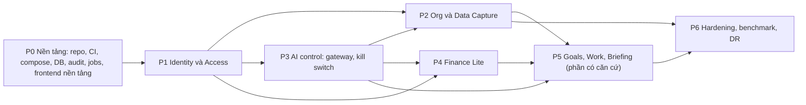

# AI-EOS — Implementation Plan (Stage 2D)

> Phiên bản: 1.0 (cập nhật 14/10/2026: D-42, D-43) · Ngày: 12/10/2026 · Trạng thái: **Kế hoạch — chờ CDA duyệt trước khi triển khai code**
> Hiện trạng code: khung repo (T-001 `DONE`) và toolchain/CI (T-002 `DONE`, branch protection `main` bật) đã commit và push (`318689c`); nền tảng frontend T-012 `IN_REVIEW` (14/10/2026); cấu hình/secret T-004 `DONE` (14/10/2026); chưa có chức năng nghiệp vụ. Trạng thái thực thi từng task: mục 10; task không có ở mục 10 là `TODO`.
> Nguồn: [SRS](../02-requirements/SRS.md) 1.1, [Architecture](../03-architecture/Architecture.md) 1.2, [Database_Design](../03-architecture/Database_Design.md) 1.2, [API_Specification](../03-architecture/API_Specification.md) 1.2, ADR-001…013 (ADR-005/008/009 có Amendment 1), [Decision_Log](../00-source/Decision_Log.md) 0.7. Kiểm thử: [TEST_Plan](TEST_Plan.md).

## 1. Quy ước

| Trường | Ý nghĩa |
| --- | --- |
| ID | `T-xxx`, ổn định, không tái sử dụng |
| Sẵn sàng | `READY` (đủ căn cứ để làm) · `PARTIAL` (làm được phần có căn cứ; phần còn lại ghi rõ) · `BLOCKED` (chờ quyết định, không làm) |
| Thực thi | `TODO` (chưa làm) · `IN_REVIEW` (đã có code, kiểm tra cục bộ đã chạy, chờ CDA review; chưa đủ DoD vì DoD cần CI) · `DONE` (đủ DoD chung + DoD riêng, có bằng chứng CI). Ghi ở mục 10 |
| Điều kiện bắt đầu | Tách khỏi "Sẵn sàng": `READY` chỉ nói task **đủ căn cứ**, không nói dependency đã đáp ứng. Task chỉ được bắt đầu khi mọi task ở cột "Phụ thuộc" đã `DONE`. **Ngoại lệ duy nhất** (CDA, 12/10/2026): T-002 được bắt đầu khi T-001 đang `IN_REVIEW`, vì DoD chung 1 của T-001 cần CI do T-002 tạo. Ngoại lệ không áp dụng cho task khác và không đổi trạng thái T-001 |
| DoD chung | Áp dụng cho mọi task, xem mục 2 |

Không task nào được triển khai nghiệp vụ không có trong SRS. Giá trị `PROPOSED` (vd. 07:00 cho Briefing, thang độ tự tin 0–10) được cài dưới dạng **cấu hình**, có nhãn "đề xuất" trong mã và tài liệu, để đổi được mà không sửa code.

## 2. Definition of Done chung

1. Code theo ranh giới module ADR-001; lint, type check, test pass trong CI (ADR-013).
2. Test tương ứng trong TEST_Plan được viết và chạy xanh; test âm (từ chối quyền, lỗi validation) bắt buộc với mọi endpoint.
3. Thao tác nhạy cảm có audit (thành công và thất bại); không log secret.
4. Migration (nếu có) chạy được từ rỗng → head trong CI; có ràng buộc CSDL theo Database_Design §8.
5. API khớp API_Specification; thay đổi contract phải cập nhật tài liệu trước.
6. Requirements_Traceability cập nhật cột Task/Test; trạng thái requirement chỉ chuyển `IMPLEMENTED` khi có code, `VERIFIED` khi test liên quan xanh trong CI.

## 3. Trình tự và phụ thuộc

Đường găng (suy ra từ cột "Phụ thuộc" ở mục 4; chưa có ước lượng thời lượng nên tính theo số task nối tiếp; `{…}` = cần tất cả; cập nhật 14/10/2026 theo D-43): P0: T-001 → {T-002, T-004} → T-005 → T-008 → T-009; T-003, T-006 chỉ cần T-001, T-007 và T-010 cần T-005, T-011 cần T-004, T-012 cần T-001 và T-002 — làm song song; T-013 (Compose tích hợp) cần T-003, T-004, T-005, T-006, T-009. Chuỗi dài nhất tới P5: T-001 → {T-002, T-004} → T-005 → T-101 → T-102 → T-104 → T-402 → T-403 → T-404 → T-406 → T-510 → T-511. Finance (P4) có thể làm song song P2 sau khi có T-108 và T-302.

## 4. Danh sách task

### P0 — Nền tảng

| ID | Task | Phụ thuộc | SRS / requirement | Thiết kế | DoD riêng | Sẵn sàng |
| --- | --- | --- | --- | --- | --- | --- |
| T-001 | Khung repo: `backend/` (package theo module ADR-001), `frontend/` (React + Vite + TS strict), `infra/` (Compose), `docs/` | — | ADR-001, ADR-002, ADR-003 | Architecture §3 | Cấu trúc thư mục khớp module; README chạy local | READY |
| T-002 | Toolchain + CI: lint, format, type check (Python, TS), pytest với PostgreSQL container, Vitest, quét phụ thuộc, kiểm tra quy tắc import giữa module | T-001 | ADR-013, ADR-001 | ADR-013 | CI chặn merge khi một bước lỗi; vi phạm ranh giới module làm CI đỏ | READY |
| T-003 | Docker Compose — **cấu hình** (D-43): khai báo `proxy` (TLS nội bộ), `api`, `worker`, `db`, `scanner`; mạng nội bộ, volume, biến môi trường/secret theo mục 7 (chỉ tên), healthcheck; chỉ `proxy` publish cổng. Không gồm profile `llm` (chờ D-08) và `observability` (D-43). Chạy đủ service thuộc T-013 | T-001 | SRS-NFR-04 | Architecture §9.1, ADR-004, D-43 | `docker compose config` hợp lệ — chạy ở môi trường có Docker (CI); không có Docker → ghi NOT RUN, không tuyên bố đạt. Kiểm tra tĩnh: chỉ `proxy` có `ports`, `db` không publish cổng, mạng backend `internal`, không có giá trị secret trong file | BLOCKED — công cụ `proxy`, `scanner` chờ CDA duyệt (D-43 `PROPOSED`); Q-50 |
| T-004 | Cấu hình và secret: loader kiểm tra biến bắt buộc khi khởi động, không có giá trị mặc định cho secret, `.env.example` chỉ chứa tên biến (mục 7) | T-001 | ADR-006, ADR-011 | Architecture §9.1 | Thiếu secret → tiến trình dừng với lỗi rõ ràng, không in giá trị | READY |
| T-005 | Nền CSDL: SQLAlchemy 2, Alembic, 3 role CSDL (`aieos_owner`, `aieos_app`, `aieos_backup`), harness test migration; engine/session và tích hợp Alembic ở `platform` (D-42) | T-002, T-004 (D-43: bỏ T-003) | SRS-NFR-03 | Database_Design §2, §10 | Migration rỗng → head trong CI; role ứng dụng không có DDL | READY |
| T-006 | Logging JSON, correlation ID, bộ lọc che secret, `/health/live`, `/health/ready` | T-001 | SRS-GEN-05 | ADR-012, API-SYS-01, API-SYS-02 | Test: header `Authorization`, cookie, mật khẩu không xuất hiện trong log | READY |
| T-007 | Hạ tầng HTTP: lỗi `problem+json`, CSRF + kiểm tra `Origin`, idempotency store, `ETag`/`If-Match`, rate limit | T-005 | SRS-GEN-01, SRS-GEN-02, SRS-GEN-03, SRS-GEN-04, SRS-GEN-05 | API_Specification §1 | Test TC-GEN-01…05 | READY |
| T-008 | Module audit: bảng append-only, trigger chặn UPDATE/DELETE, API ghi trong transaction, che trường nhạy cảm | T-005 | SRS-AUD-01, SRS-AUD-02, SRS-AUD-03 | ADR-010, Database_Design §9 | UPDATE/DELETE audit bị CSDL từ chối | READY |
| T-009 | Module jobs: queue, claim `SKIP LOCKED`, lease, reaper, retry + backoff, scheduler (advisory lock), registry `job_class` + test cấm handler `ORCHESTRATION` gọi gateway/provider/bảng nghiệp vụ | T-005, T-008 | SRS-JOB-01, SRS-JOB-02, SRS-JOB-03, SRS-AIC-06 | ADR-005 (+Amendment 1), Database_Design §5 | Test TC-JOB-01…06 | READY |
| T-010 | Thông báo in-app | T-005 | SRS-NTF-01, SRS-NTF-02 | API-NOT-01, API-NOT-02 | Nội dung thông báo không chứa dữ liệu nhạy cảm | READY |
| T-011 | Storage adapter (volume cục bộ), khóa UUID | T-004 | SRS-CAP-03 | ADR-004 | Không đường dẫn nào lấy từ tên file người dùng | READY |
| T-012 | Nền tảng frontend (ADR-003): Tailwind CSS + shadcn/ui (Radix) với design token trung tính (D-35); React Router; TanStack Query (request kèm cookie session, không lưu token ở `localStorage`/`sessionStorage`); manifest PWA + service worker chỉ cache tài nguyên tĩnh, không cache response `/api`. Không gồm: đăng nhập, app shell nghiệp vụ (T-111), i18n (T-607), màn hình nghiệp vụ | T-001, T-002 | ADR-003 | ADR-003, UX §8.1–8.2, Architecture §2.2 | Qua toàn bộ `scripts/ci.sh` (T-002); test: service worker không cache `/api`; không dùng `dangerouslySetInnerHTML`; build không có inline script (tương thích CSP của ADR-003). Chưa có TC trong TEST_Plan — bổ sung khi triển khai, cần CDA duyệt | READY (đủ căn cứ: Q-45, D-41) — dependency T-001, T-002 đã `DONE`; thực thi: mục 10 |
| T-013 | Docker Compose — **tích hợp** (D-43): Dockerfile/image `api`, `worker` build được; `docker compose up` chạy đủ service của T-003 và vượt healthcheck; `db` dùng script role và lệnh migration của T-005 | T-003, T-004, T-005, T-006, T-009 | SRS-NFR-04 | Architecture §9.1, ADR-004, ADR-012, D-43 | Mọi service `healthy` ở môi trường có Docker (CI); TC-NFR-01; không publish cổng DB | BLOCKED — như T-003 (D-43 công cụ `PROPOSED`); Q-50 |

### P1 — Identity và Access

| ID | Task | Phụ thuộc | SRS / requirement | Thiết kế | DoD riêng | Sẵn sàng |
| --- | --- | --- | --- | --- | --- | --- |
| T-101 | Bảng `identity.*` + migration | T-005 | SRS-IAM-06 | Database_Design §4 | Token chỉ lưu hash | READY |
| T-102 | Đăng nhập, session (xoay ID, hết hạn), đăng xuất, `/auth/me`, giới hạn thử | T-101, T-007 | SRS-IAM-04, SRS-IAM-06, SRS-IAM-07, SRS-GEN-01 | API-AUTH-01, API-AUTH-06, API-AUTH-07 | TC-IAM-01…05 | READY |
| T-103 | MFA TOTP: đăng ký, xác minh, mã khôi phục; bắt buộc với ADMIN | T-102 | SRS-IAM-05 | API-AUTH-02, API-AUTH-03, API-AUTH-04 | TC-IAM-06, TC-IAM-07 | READY |
| T-104 | Step-up (reauth), đổi mật khẩu + thu hồi session khác | T-102 | SRS-IAM-08, SRS-IAM-11 | API-AUTH-05, API-AUTH-09 | TC-IAM-08 | READY |
| T-105 | Tạo tài khoản + lời mời; chấp nhận lời mời | T-102, T-108 | SRS-IAM-01, SRS-IAM-02, SRS-IAM-03 | API-ADM-02, API-ADM-03, API-AUTH-08 | TC-IAM-09, TC-IAM-10; thời hạn lời mời và chính sách mật khẩu là cấu hình (PROPOSED) | READY |
| T-106 | CLI `bootstrap-admin`, `recover-admin` | T-101, T-107 | SRS-IAM-09, SRS-IAM-10 | ADR-006 | TC-IAM-11, TC-IAM-12 | READY |
| T-107 | Bảng `access.*`, seed role/permission (Architecture §6) qua migration, trigger INV-09/10/11, kiểm tra điều kiện assignment | T-101 | SRS-ACC-05, SRS-ACC-06, SRS-ACC-07, SRS-ACC-08 | Database_Design §4, §8 | Không seed tài khoản; seed `hr.*`, `pii.unmask`, `goals.activate` **không** có quyền nền | READY |
| T-108 | Module policy `authorize()`, bộ lọc phạm vi, mặc định deny, bắt buộc mọi route khai báo permission | T-107 | SRS-ACC-01, SRS-ACC-02, SRS-ACC-03, SRS-ACC-09, SRS-ACC-11 | ADR-007 | Route chưa khai báo quyền bị từ chối (TC-ACC-02) | PARTIAL — SRS-ACC-04 (định nghĩa "team") dùng mặc định PROPOSED |
| T-109 | API quản trị người dùng/role/assignment, thu hồi session, khóa ADMIN cuối | T-108, T-104 | SRS-ACC-05, SRS-ACC-06, SRS-ACC-07, SRS-ACC-08, SRS-IAM-11 | API-ADM-01, API-ADM-04, API-ADM-05, API-ADM-06, API-ADM-07, API-ADM-08, API-ADM-09 | TC-ACC-04…08 | READY |
| T-110 | Xem audit, trang tình trạng hệ thống (gồm cảnh báo thiếu người quản lý kỳ, không có kỳ mở, hàng chờ không người, chưa ai có `goals.activate`) | T-109, T-009 | SRS-AUD-04, SRS-FIN-12 | API-ADM-10, API-ADM-11 | TC-AUD-04, TC-FIN-14 | READY |
| T-111 | Frontend: app shell, đăng nhập, MFA, chấp nhận lời mời, quản trị người dùng/quyền, ẩn mục không có quyền, trạng thái chung | T-102…T-109, T-012 | SRS-ACC-09, SRS-GEN-06 | UX_Flows §0, FL-01, FL-02, FL-03 | E2E TC-E2E-01 | READY |
| T-112 | Che dữ liệu cá nhân: phát hiện bằng quy tắc (CCCD, số tài khoản…), nhãn `sensitivity`, che ở API, file xuất, câu trả lời AI | T-108 | SRS-ACC-10, SRS-PRV-02 | Architecture §6, §8.5 | TC-PRV-01…03 | PARTIAL — người giữ `hr.profile.read`, `hr.salary.read`, `hr.export`, `pii.unmask` chờ R6; không ai giữ |

### P2 — Org và Data Capture

| ID | Task | Phụ thuộc | SRS / requirement | Thiết kế | DoD riêng | Sẵn sàng |
| --- | --- | --- | --- | --- | --- | --- |
| T-201 | `org.*` + API danh bạ | T-108 | SRS-ACC-11 | API-ORG-01, API-ORG-02, Database_Design §6 | Chỉ trường danh bạ | READY |
| T-202 | Bảng `capture.*` + migration | T-005, T-201 | SRS-CAP-13, SRS-REV-07, SRS-REV-09 | Database_Design §6 | — | READY |
| T-203 | Upload: allowlist + magic bytes, giới hạn, chuẩn hóa tên, lưu, hash trùng, job quét mã độc | T-202, T-011, T-009 | SRS-CAP-01, SRS-CAP-02, SRS-CAP-03, SRS-CAP-04, SRS-CAP-05, SRS-CAP-06, SRS-CAP-07 | API-DOC-01, API-DOC-02, API-DOC-03, API-DOC-04, API-DOC-05 | TC-FILE-01…08 | READY |
| T-204 | Provider adapter: interface LLM/OCR/converter, adapter giả lập cho test, định tuyến theo phân loại dữ liệu, timeout/retry/fallback, call log, trần chi phí | T-004, T-009 | SRS-PRV-01, SRS-PRV-02, SRS-PRV-03, SRS-PRV-04, SRS-NFR-07 | ADR-011 | TC-PRV-04…07; trần chi phí là cấu hình (GAP-14) | READY |
| T-205 | Adapter provider thật (LLM, OCR) | T-204, T-606 | SRS-PRV-01 | ADR-011 | Theo kết quả benchmark | BLOCKED — D-08 |
| T-206 | Pipeline xử lý: tiền xử lý ảnh, phân loại, trích xuất, chuẩn hóa VN, kiểm tra, định tuyến (tự ghi tắt mặc định), tách/gộp, thử lại | T-203, T-204, T-302 | SRS-CAP-08, SRS-CAP-10, SRS-CAP-11, SRS-CAP-12, SRS-CAP-14, SRS-CAP-15, SRS-CAP-16, SRS-CAP-17, SRS-CAP-18, SRS-CAP-20, SRS-CAP-21, SRS-CAP-22 | Architecture §8.5, API-DOC-06, API-DOC-07 | TC-CAP-01…08 | PARTIAL — danh mục đơn vị hành chính (GAP-13), danh sách trường trọng yếu (D-16), ngưỡng (D-29) dùng mặc định an toàn |
| T-207 | Hàng chờ review + API + UI bàn phím | T-206, T-108, T-012 | SRS-REV-01, SRS-REV-02, SRS-REV-03, SRS-REV-04, SRS-REV-05, SRS-REV-06, SRS-REV-07, SRS-REV-08, SRS-REV-09, SRS-NFR-10 | API-REV-01…07, FL-05 | TC-REV-01…06 | PARTIAL — SLA (GAP-18) là cấu hình trống |
| T-208 | Cấu hình loại tài liệu/schema/ngưỡng, kiểm tra điều kiện bật tự ghi (BR-05) | T-206 | SRS-CAP-15, SRS-CAP-16, SRS-CAP-17 | API-CFG-01…05 | TC-CAP-05, TC-CAP-06 | READY |
| T-209 | Form sinh từ schema, gợi ý/trùng, nhập ngôn ngữ tự nhiên (bản dự kiến), lưu nháp, audit thay đổi thủ công | T-206, T-204 | SRS-CAP-30, SRS-CAP-31, SRS-CAP-32, SRS-CAP-33, SRS-CAP-34 | API-CAP-01…04 | TC-CAP-09…11 | READY |
| T-210 | Import XLSX/CSV: map cột, xem trước, lỗi theo dòng, commit qua gateway; import nhân sự giới hạn cột | T-206, T-302 | SRS-IMP-01, SRS-IMP-02, SRS-IMP-03 | API-IMP-01…05, FL-06 | TC-IMP-01…04 | READY |
| T-211 | Lineage API + popover nguồn | T-206 | SRS-CAP-19, SRS-BRF-04 | API-ORG-03 | TC-CAP-12 | READY |
| T-212 | Frontend capture: drop zone toàn cục, thẻ tiến trình, chụp ảnh (app đang mở), import | T-203, T-210, T-012 | SRS-CAP-09 | FL-04, FL-06 | TC-E2E-02 | READY |

### P3 — AI control

| ID | Task | Phụ thuộc | SRS / requirement | Thiết kế | DoD riêng | Sẵn sàng |
| --- | --- | --- | --- | --- | --- | --- |
| T-301 | Bảng `ai.*`, seed Tool Registry (tool BRD §3.9 + tool đích MVP), trần autonomy | T-005, T-107 | SRS-AIC-02, SRS-AIC-03 | Database_Design §5, INV-12, INV-13 | CHECK trần có hiệu lực | READY |
| T-302 | Write gateway: thứ tự kiểm tra, bản nháp L2, thực thi L3, idempotency, audit; lint chặn ghi domain bỏ qua gateway | T-301, T-108, T-008 | SRS-AIC-01, SRS-AIC-02, SRS-AIC-05, SRS-AIC-09, SRS-CAP-18 | ADR-008, Architecture §8.1 | TC-AIC-01…06 | READY |
| T-303 | Kill switch: API, step-up, banner, tích hợp gateway và jobs (`job_class`) | T-302, T-009 | SRS-AIC-04, SRS-AIC-05, SRS-AIC-06 | API-AI-01, API-AI-02, FL-10 | TC-KS-01…10 | READY |
| T-304 | Bản nháp: review/xác nhận/từ chối, hoàn tác L3 (toast + 24 giờ), đánh dấu quá hạn (cấu hình, mặc định 30 ngày), nhắc hằng ngày | T-302, T-010 | SRS-AIC-07, SRS-AIC-08, SRS-AIC-10, SRS-AIC-11 | API-AI-06, API-AI-07, API-AI-08, API-AI-09, API-AI-10, API-AI-11, FL-09 | TC-AIC-07…11 | READY |
| T-305 | Cấu hình autonomy trong trần | T-301 | SRS-AIC-15 | API-AI-03, API-AI-04, API-AI-05 | TC-AIC-12 | READY |
| T-306 | Chat AI: SSE, tool READ theo phạm vi, trích dẫn, Dừng, trả lời theo ngôn ngữ câu hỏi | T-204, T-108 | SRS-AIC-12, SRS-AIC-13 | API-AI-12 | TC-AIC-13…15 (adapter giả lập) | PARTIAL — chất lượng trả lời chờ provider thật (D-08) |
| T-307 | Phản hồi người dùng; harness Evaluation Engine (bộ câu hỏi/đáp án, chạy trước thay đổi model/prompt) | T-306 | SRS-AIC-14, SRS-AIC-16 | API-AI-13, ADR-013 | Harness chạy được với adapter giả lập | READY |

### P4 — Finance Lite

| ID | Task | Phụ thuộc | SRS / requirement | Thiết kế | DoD riêng | Sẵn sàng |
| --- | --- | --- | --- | --- | --- | --- |
| T-401 | Bảng `finance.*` + trigger INV-01…07, ràng buộc loại trừ chồng lấn kỳ, `ON_HOLD`/`hold_reason` | T-005, T-107 | SRS-FIN-13, SRS-FIN-17 | Database_Design §7, §8 | TC-FIN-01…04 ở mức CSDL | READY |
| T-402 | Kỳ báo cáo: mở/khóa, khóa dòng, chặn khóa khi còn chờ duyệt | T-401, T-104 | SRS-FIN-12 | API-FIN-01, API-FIN-02, API-FIN-03 | TC-FIN-12…15 | PARTIAL — độ dài kỳ mặc định tháng (Q-31); người giữ `finance.period.manage` do CDA giao vận hành |
| T-403 | Tạo/sửa/gửi/hủy/rút lại giao dịch; idempotency; kiểm tra kỳ `OPEN` khi gửi (AMD-01); cờ thiếu người duyệt | T-401, T-402, T-010 | SRS-FIN-01, SRS-FIN-02, SRS-FIN-04, SRS-FIN-05, SRS-FIN-06, SRS-FIN-07, SRS-FIN-16 | API-FIN-04…09 | TC-FIN-05…11 | PARTIAL — danh mục (Q-42) là văn bản tự do |
| T-404 | Duyệt/từ chối: khóa dòng, version, tách nhiệm vụ, nhánh `ON_HOLD` | T-403 | SRS-FIN-08, SRS-FIN-09, SRS-FIN-17 | API-FIN-10, API-FIN-11 | TC-FIN-16…22 | READY |
| T-405 | Bút toán đảo và điều chỉnh | T-404 | SRS-FIN-10, SRS-FIN-11 | API-FIN-12 | TC-FIN-23…28 | READY |
| T-406 | Lịch sử, tổng hợp doanh thu/chi phí/tiền mặt với `as_of` | T-404 | SRS-FIN-14 | API-FIN-13, API-FIN-14 | TC-FIN-29 | READY |
| T-407 | Runway | T-406 | SRS-FIN-15 | API-FIN-14 | — | BLOCKED — Q-39 (định nghĩa burn ròng) |
| T-408 | Tool AI `create_finance_draft` qua gateway (chỉ tạo `DRAFT`) | T-302, T-403 | SRS-FIN-03, SRS-REV-08 | ADR-008, ADR-009 | TC-FIN-30 | READY |
| T-409 | Frontend tài chính (FL-11, FL-12) | T-403…T-406, T-012 | SRS-FIN-12 | UX_Flows FL-11, FL-12 | TC-E2E-03 | READY |

### P5 — Goals, Work, Briefing (phần có căn cứ)

| ID | Task | Phụ thuộc | SRS / requirement | Thiết kế | DoD riêng | Sẵn sàng |
| --- | --- | --- | --- | --- | --- | --- |
| T-501 | `goals.*`: tạo/sửa bản nháp, đo lường, check-in, xem theo phạm vi; hiển thị baseline/target/giá trị, **không** tính % | T-108, T-201 | SRS-GOAL-01, SRS-GOAL-02, SRS-GOAL-05, SRS-GOAL-06, SRS-GOAL-07, SRS-GOAL-09, SRS-GOAL-11 | API-GOAL-01, API-GOAL-02, API-GOAL-03, API-GOAL-05, API-GOAL-06 | TC-GOAL-01…06 | PARTIAL — thang độ tự tin (Q-30) là cấu hình PROPOSED |
| T-502 | Kích hoạt mục tiêu với permission `goals.activate` (assignment, không quyền nền) | T-501, T-109 | SRS-GOAL-03, SRS-GOAL-04 | API-GOAL-04 | TC-GOAL-07, TC-GOAL-08 | PARTIAL — ai được giao: Q-28 |
| T-503 | Commit mục tiêu và giá trị đo từ tài liệu (kế hoạch, báo cáo định kỳ) qua gateway; gợi ý alignment L1 | T-206, T-302, T-501 | SRS-GOAL-03, SRS-GOAL-06, SRS-GOAL-10 | ADR-008 | TC-GOAL-09 | READY |
| T-504 | Frontend mục tiêu (cây, check-in) | T-501, T-502, T-012 | SRS-GOAL-08 | FL-15 | TC-E2E-04 | PARTIAL — điền sẵn check-in = giá trị đo gần nhất (PROPOSED); điền từ task bị chặn (Q-29) |
| T-505 | `work.task`: tạo, sửa, hoàn thành/mở lại, xem theo phạm vi | T-108, T-201 | SRS-WRK-01, SRS-WRK-02, SRS-WRK-03, SRS-WRK-04, SRS-WRK-10 | API-WORK-01, API-WORK-03, API-WORK-04, API-WORK-05 | TC-WRK-01…05 | PARTIAL — mở lại bởi người giao, EMPLOYEE tự giao (PROPOSED); trạng thái mở rộng chờ Q-33 |
| T-506 | Biên bản → Meeting/Decision/ActionItem → giao việc qua gateway | T-206, T-302, T-505 | SRS-WRK-05, SRS-WRK-06, SRS-WRK-07, SRS-WRK-11 | API-WORK-02, API-WORK-06, FL-08 | TC-WRK-06…08 | READY |
| T-507 | Job `ORCHESTRATION` task quá hạn + thông báo | T-009, T-505 | SRS-WRK-09 | ADR-005 | TC-WRK-09 | READY |
| T-508 | Action card F1 tạo task L3 + hoàn tác | T-304, T-505 | SRS-WRK-08 | ADR-008 | TC-WRK-10 | READY |
| T-509 | Frontend công việc | T-505, T-506, T-012 | SRS-WRK-10 | FL-08 | TC-E2E-05 | READY |
| T-510 | Trang chủ CEO: ô chỉ số (nhãn "đề xuất — chưa chính thức", không cảnh báo), "Cần anh quyết" (chỉ mục có nguồn), "AI đã làm", trạng thái trống, ẩn khối chưa đủ căn cứ, chọn ô | T-406, T-501, T-505, T-304 | SRS-BRF-01, SRS-BRF-02, SRS-BRF-03, SRS-BRF-04, SRS-BRF-05, SRS-BRF-06, SRS-BRF-07, SRS-BRF-08, SRS-BRF-09, SRS-BRF-12, SRS-SLS-03 | API-INS-01, API-INS-02, FL-07 | TC-BRF-01…07 | PARTIAL — công thức ô PROPOSED (Q-37, D-39); ngưỡng "dữ liệu cũ" là cấu hình trống |
| T-511 | Tạo nội dung Briefing (`AI_CONTENT`) theo lịch + API quản lý lịch; hành vi kill switch | T-510, T-303, T-204 | SRS-BRF-10, SRS-BRF-11, SRS-BRF-13 | API-INS-03, ADR-005/008 Amendment 1 | TC-BRF-08…11, TC-KS-08, TC-KS-09 | PARTIAL — giờ/tần suất PROPOSED (Q-36); chất lượng tóm tắt chờ D-08 |
| T-512 | Tài liệu quy trình/SOP → knowledge item | T-206, T-302 | FR-DCS-02 | API-KNOW-01 | TC-CAP-13 | READY |

### P6 — Hardening, benchmark, phục hồi

| ID | Task | Phụ thuộc | SRS / requirement | Thiết kế | DoD riêng | Sẵn sàng |
| --- | --- | --- | --- | --- | --- | --- |
| T-601 | Sinh bộ test ma trận authorization từ seed | T-107, các API | SRS-ACC-01, SRS-ACC-02, SRS-NFR-11 | ADR-013 | Mọi endpoint × role × phạm vi | READY |
| T-602 | Bộ test bảo mật (TEST_Plan §6) | T-111, T-203, T-306 | SRS-NFR-11 | Architecture §10 | AC-ARCH-05, 07, 08, 09, 11, 12 xanh | READY |
| T-603 | Test đồng thời và idempotency | T-404, T-405, T-009 | SRS-GEN-03, SRS-GEN-04 | Architecture §7.2 | AC-ARCH-01, 02, 03 xanh | READY |
| T-604 | Test hiệu năng NFR-01/02 | T-206, T-205 | SRS-NFR-01, SRS-NFR-02 | ADR-005 | Báo cáo số đo; không tuyên bố đạt nếu chưa đo | BLOCKED — cần provider thật (D-08) để đo đại diện; có thể đo pipeline với adapter giả lập |
| T-605 | Backup/restore: base backup + WAL archiving, backup volume, quy trình và diễn tập | T-005, T-013 (D-43) | SRS-NFR-03 | Architecture §9.3 | Diễn tập ghi kết quả RPO/RTO đo được | READY (công cụ cụ thể chọn khi triển khai) |
| T-606 | Benchmark LLM/OCR: tạo bộ dữ liệu tổng hợp, ground truth, harness, báo cáo | T-204 | SRS-NFR-09 | TEST_Plan §9, ADR-011 | Báo cáo so sánh ≥ 2 phương án; không dùng PII thật | READY |
| T-607 | Truy cập (WCAG 2.1 AA), i18n vi/en | T-111 | SRS-NFR-05, SRS-NFR-08 | ADR-003 | Kiểm tra tự động + thủ công | READY |
| T-608 | E2E Playwright cho FL-01…FL-15 trong phạm vi | Các task frontend, T-013 (D-43) | SRS-NFR-06 | UX_Flows | TC-E2E-01…06 | READY |

### Bị chặn / ngoài phạm vi triển khai

| ID | Hạng mục | Phụ thuộc | Requirement | Lý do | Sẵn sàng |
| --- | --- | --- | --- | --- | --- |
| T-901 | Sales Pipeline Lite | — | SRS-SLS-01, SRS-SLS-02, FR-HM-04 | D-40, Q-38; điều kiện mở: CDA cung cấp đặc tả | BLOCKED |
| T-902 | Workload/quá tải (F5) | — | SRS-WRK-12, F5, FR-HM-06 | Q-34; điều kiện mở: Mô hình workload | BLOCKED |
| T-903 | Đặt lịch / đồng bộ lịch | — | SRS-WRK-12 | Q-35, D-31; điều kiện mở: Quyết định lịch nội bộ/ngoài | BLOCKED |
| T-904 | % đạt mục tiêu, cảnh báo lệch | — | SRS-GOAL-09 | Q-29, D-39; điều kiện mở: Công thức được duyệt | BLOCKED |
| T-905 | Theo dõi Decision Log 30/60/90 | — | SRS-WRK-11 | Q-41; điều kiện mở: Quyết định phạm vi | BLOCKED |
| T-906 | Nhắc check-in tự động | — | SRS-GOAL-07 | Q-30; điều kiện mở: Nhịp check-in | BLOCKED |
| T-907 | Quyền xem dữ liệu nhân sự nhạy cảm | — | SRS-ACC-10 | R6; điều kiện mở: CDA chỉ định người giữ | BLOCKED |
| T-908 | Hóa đơn/biên lai, email forwarding, C6–C10, L4 | — | SRS-NTF-03 | D-11, D-17, D-18; điều kiện mở: Phase 2 | BLOCKED |

## 5. Kế hoạch migration (không chạy trong Stage 2D)

| # | Migration | Nội dung | Bất biến kèm theo | Task |
| --- | --- | --- | --- | --- |
| M-01 | `base_roles_schemas` | Schema theo module, quyền role CSDL | Role ứng dụng không DDL | T-005 |
| M-02 | `identity` | Bảng identity | Hash token | T-101 |
| M-03 | `access_seed` | Role, permission, role_permission (seed), user_role, assignment | INV-09, INV-10, INV-11 | T-107 |
| M-04 | `audit` | `audit.event` | INV-14 | T-008 |
| M-05 | `jobs_notify` | `jobs.job` (`job_class`), `jobs.schedule`, `notify.notification` | — | T-009, T-010 |
| M-06 | `org` | `org_unit`, `employee` (chỉ trường danh bạ) | — | T-201 |
| M-07 | `capture` | Bảng capture | — | T-202 |
| M-08 | `ai_seed` | `ai.*`, seed tool | INV-12, INV-13, INV-15 | T-301 |
| M-09 | `finance` | Kỳ, giao dịch (`ON_HOLD`), event, delegation (rỗng) | INV-01…INV-08 | T-401 |
| M-10 | `goals_work_knowledge_insights` | Bảng theo Database_Design §6 | — | T-501, T-505, T-510 |

Quy tắc: một chuỗi revision; mỗi migration có test rỗng → head và test bất biến tương ứng; không seed tài khoản; thay đổi phá vỡ theo mở rộng → di chuyển → thu hẹp (Database_Design §10).

## 6. Môi trường local và điều kiện triển khai

| Hạng mục | Yêu cầu |
| --- | --- |
| Công cụ | Docker + Docker Compose v2; Python và Node phiên bản ổn định được hỗ trợ (chốt trong lockfile ở T-001); trình duyệt hiện đại cho E2E |
| TLS local | Reverse proxy cấp chứng chỉ nội bộ; cookie `Secure` cần HTTPS |
| Phần cứng | Chưa xác định — scanner và model local là phần tốn RAM; xác định sau T-606 |
| Dữ liệu | Chỉ dữ liệu giả/tổng hợp trong dev, test, CI |
| Triển khai nội bộ | Chưa có trong phạm vi Stage 2D; điều kiện: T-605 diễn tập đạt, T-602/T-603 xanh, CDA duyệt |

## 7. Biến cấu hình và secret (chỉ tên, không có giá trị)

| Biến | Loại | Dùng bởi |
| --- | --- | --- |
| `AIEOS_DATABASE_URL` | Secret | api, worker (role `aieos_app`) |
| `AIEOS_DATABASE_OWNER_URL` | Secret | lệnh migration |
| `AIEOS_CSRF_KEY` | Secret | api |
| `AIEOS_TOTP_ENCRYPTION_KEY` | Secret | api |
| `AIEOS_STORAGE_PATH` | Cấu hình | api, worker |
| `AIEOS_ALLOWED_ORIGINS` | Cấu hình | api |
| `AIEOS_SCANNER_HOST` | Cấu hình | worker |
| `AIEOS_LLM_PROVIDERS`, `AIEOS_OCR_PROVIDERS` | Cấu hình (JSON: tên, URL, `local`, mức phân loại cho phép) | worker, api |
| `AIEOS_LLM_API_KEY_<NAME>` | Secret | worker, api |
| `AIEOS_AI_BUDGET_LIMIT` | Cấu hình (GAP-14) | worker, api |
| `AIEOS_SESSION_IDLE_MINUTES`, `AIEOS_SESSION_ABSOLUTE_HOURS`, `AIEOS_INVITE_TTL_HOURS`, `AIEOS_REAUTH_MINUTES` | Cấu hình | api |
| `AIEOS_BACKUP_TARGET` | Cấu hình | backup |

Secret nạp qua Docker secrets hoặc file môi trường không commit. Không có giá trị mặc định cho secret; thiếu → tiến trình dừng (T-004).

## 8. Rủi ro còn mở

| Rủi ro | Ảnh hưởng | Giảm thiểu |
| --- | --- | --- |
| Provider chưa chọn (D-08) | Chất lượng trích xuất, hiệu năng chưa biết | T-606 trước T-205; adapter giả lập để không chặn phát triển |
| Một người tài chính duy nhất | Giao dịch không ghi sổ được | Cảnh báo hệ thống; CDA giao assignment |
| Module P5 thiếu quy tắc | Phải sửa khi có câu trả lời | Giá trị PROPOSED là cấu hình; endpoint giữ ổn định |
| Thông lượng queue PostgreSQL chưa đo | NFR-02 | T-604 |
| Audit không có chuỗi hash | Người có quyền owner CSDL có thể can thiệp | Tách role CSDL; ghi nhận rủi ro (ADR-010) |
| PWA trên iOS | Thông báo/camera hạn chế | Không cam kết (ADR-003) |

## 9. Tiêu chí nghiệm thu MVP (kỹ thuật)

1. Mọi task `READY` và phần có căn cứ của task `PARTIAL` hoàn thành theo DoD.
2. AC-ARCH-01…12 xanh trong CI.
3. TEST_Plan: mọi test mức độ P0 xanh; không có lỗi Critical/High mở.
4. Benchmark D-08 có báo cáo; mục tiêu MET-01 chỉ được tuyên bố khi đo đạt.
5. Diễn tập backup/restore có kết quả.
6. Traceability: mọi requirement P0 không DEFERRED có Task và Test, hoặc lý do N/A/BLOCKED.

## 10. Tiến độ thực thi

Điều kiện bắt đầu T-002: đáp ứng theo ngoại lệ ở mục 1 (CDA, 12/10/2026); T-002 đã bắt đầu theo ngoại lệ này, nay `DONE`. T-012 không thuộc ngoại lệ; dependency T-001, T-002 nay đã `DONE`.

Chỉ ghi task đã bắt đầu (ID trong dấu `` ` `` để không trùng với bảng task mục 4); bằng chứng là lệnh đã thực sự chạy. Trạng thái "Sẵn sàng" ở mục 4 không đổi.

| Task | Thực thi | Ngày | Bằng chứng | Chưa đạt / giới hạn |
| --- | --- | --- | --- | --- |
| `T-001` | `DONE` | 12/10/2026 | Cấu trúc `backend/` (package `aieos`, 17 module theo Architecture §3), `frontend/`, `infra/`, README. Python 3.12.14 (uv 0.12.11): `uv lock --check`, `uv sync --locked`, `uv build`, `python -m unittest` (test cấu trúc 2/2 OK; kiểm tra âm — package thừa, file `.py` lẻ, thư mục thiếu `__init__.py`, module bị xóa, module thiếu `__init__.py` — đều FAIL; chạy được từ thư mục khác). Node 22.23.3 / npm 10.9.9: `npm ci`, `npm run typecheck` (rc 0; kiểm tra âm: tham số `any` ngầm → TS7006), `npm run build`, `npm audit` 0 lỗ hổng, `npm run dev` (Vite 8.3.4 trả 200 cho `/` và `/src/main.tsx`); Node 24 bị chặn `EBADENGINE`. Review 12/10/2026: lặp lại các lệnh README trên bản sao sạch (không `.venv`/`node_modules`) → đạt; lockfile có binary cho linux gnu/musl, darwin, win32; không peer dependency `invalid` | **DONE 12/10/2026 — bằng chứng CI:** commit `318689c`, GitHub Actions run `38257197546` (`completed`/`success`): `scripts/ci.sh` 17/17 bước gồm ruff, mypy, import-contracts, pytest 14 passed (có test cấu trúc T-001), ESLint, tsc, Vitest, build. DoD chung: (1) đạt qua run trên; (2) T-001 không có TC trong TEST_Plan, không có endpoint; (3)–(5) không áp dụng (không thao tác nhạy cảm, migration, API); (6) không dòng requirement nào gắn T-001, không đổi trạng thái. DoD riêng: cấu trúc khớp module (test cấu trúc trong run trên); README chạy local (`scripts/ci.sh` local rc 0; `npm run dev` chạy lại 12/10/2026 với cấu hình T-002: 200 cho `/` và `/src/main.tsx`). Giới hạn còn lại (ngoài DoD): chưa kiểm tra giao diện bằng trình duyệt |
| `T-002` | `DONE` | 12/10/2026 | `scripts/ci.sh` local rc 0, 17/17 bước (Python 3.12.14, Node 22.23.3): runtime, docs, `uv lock --check`, `uv sync --locked`, ruff check/format, mypy `--strict`, import-linter C1–C3 (3 kept), pytest (13 passed, 1 skipped = test PostgreSQL NOT RUN), `npm ci`, ESLint, Prettier, tsc, Vitest (1 passed), build, pip-audit (0 lỗ hổng), `npm audit --audit-level=high` (0). `scripts/negative_checks.sh` rc 0: N1–N19 (N17, N19 tách a/b) — 21/21 ca thất bại đúng bước. Workflow `.github/workflows/ci.yml` qua actionlint 1.7.7; `ci.sh`, `negative_checks.sh` qua shellcheck 0.11.0. Thay đổi sản phẩm T-001: TypeScript 7.0.2 → 6.0.3, Node tối thiểu 22.22.2, test chạy bằng pytest | **DONE 12/10/2026.** Branch protection `main` (đọc lại qua `GET …/branches/main/protection`): required check `ci` (GitHub Actions, app_id 15368, `strict: false`), `enforce_admins: true`, bắt buộc PR (0 approval), cấm force-push và xóa branch; không có ruleset. PR đỏ #2 (head `26297bf`, run `38261777697` `failure` tại pytest: `1 failed, 14 passed`): `mergeStateStatus: BLOCKED`, `viewerCanMergeAsAdmin: false`; thử merge thông thường → HTTP 405 `Required status check "ci" is failing.`; `main` không đổi. PR xanh #1 (head `c599fcc`, run `38261808375` `success`): `CLEAN`/`MERGEABLE`, không merge. Hai PR đã đóng, nhánh thử đã xóa. Workflow xanh trên `main`: run `38257197546` (`318689c`, PostgreSQL 18 smoke đạt, pytest 14 passed, 0 skipped), `38260718270` (`2f30196`) |
| `T-004` | `DONE` | 14/10/2026 | Branch `feat/t004-config-secrets`. `backend/src/aieos/platform/config.py` (+ `platform/api.py`): registry biến Plan §7 (loại, tiến trình api/worker/migrate, bắt buộc), `load_settings`, `load_settings_or_exit` (stderr + mã 2), `Secret` (luôn che), `NAME_FILE` cho secret, `is_secret_name` (cho bộ lọc log T-006); `infra/.env.example` chỉ tên biến. Test `backend/tests/test_platform_config.py` (22): đủ biến theo từng tiến trình, thiếu/rỗng, báo mọi lỗi một lần, `_FILE` (đọc, xung đột, file không đọc được — không in đường dẫn), biến cấu hình không nhận `_FILE`, che secret, secret luôn bắt buộc, tiến trình con thoát mã 2 và không in giá trị nào, `.env.example` khớp registry và không có giá trị. Kiểm tra đột biến (sửa tạm rồi khôi phục): mặc định cho secret, `str(Secret)` lộ giá trị, giá trị trong thông điệp lỗi, giá trị trong `.env.example`, mã thoát 0, secret thành tùy chọn → đều đỏ. `scripts/ci.sh` local rc 0 (18/18) | **DONE 14/10/2026 — bằng chứng CI:** PR #8, commit `9e32d22`, GitHub Actions run `38541183244` (`completed`/`success`): `scripts/ci.sh` 18/18 bước, pytest 50 passed (gồm PostgreSQL), import-linter 5 kept. DoD chung: (1) đạt qua run trên; (2) T-004 không có TC trong TEST_Plan, có test âm; (3) không thao tác nhạy cảm cần audit, test xác nhận không in giá trị secret; (4), (5) không có migration, API; (6) không dòng ma trận nào gắn T-004. DoD riêng: thiếu secret → tiến trình dừng mã 2, chỉ nêu tên biến (test tiến trình con). Giả định `[CẦN XÁC NHẬN — T-204]` ở mục 13 |
| `T-012` | `IN_REVIEW` | 14/10/2026 | Branch `feat/t012-frontend-foundation`. Thêm: Tailwind CSS 4.3.3 (`@tailwindcss/vite`), token trung tính `src/index.css`; shadcn/ui (`components.json`, `cn`, `Button` trên `@radix-ui/react-slot` 1.3.3, `class-variance-authority`); React Router 8.4.0 (route `/` và `*`); TanStack Query 5.104.0 + `apiFetch` (`credentials: "include"`); manifest + icon giữ chỗ; service worker `src/sw.ts` → `dist/sw.js`; luật ESLint chặn `dangerouslySetInnerHTML`; `scripts/check-build.js` (bước `build-check` mới của `scripts/ci.sh`). `scripts/ci.sh` local rc 0, 18/18 bước (Python 3.12.14, Node 22.23.3): Vitest 5 file / 47 test passed; pytest 13 passed, 1 skipped (PostgreSQL NOT RUN local); `build-check` OK; pip-audit 0, `npm audit` 0. Kiểm tra âm (sửa tạm rồi khôi phục): script inline trong `dist/index.html` → `build-check` rc 1; tắt luật ESLint → `src/lint.test.ts` đỏ; `credentials: "same-origin"` → test client đỏ; ghi `localStorage` trong client → test client đỏ; cache mọi GET cùng origin → test cache policy đỏ; `dangerouslySetInnerHTML` trong `HomePage` → `npm run lint` rc 1. `vite preview`: `/`, `/sw.js`, `/manifest.webmanifest`, icon, route lạ → 200 | **Bằng chứng CI:** PR #5, commit `16c1e9e`, GitHub Actions run `38536047844` (`completed`/`success`): `scripts/ci.sh` 18/18 bước, pytest 14 passed (PostgreSQL 18.6), Vitest 47 passed, `build-check` OK. DoD riêng phần kỹ thuật (qua `scripts/ci.sh`, test không cache `/api`, không `dangerouslySetInnerHTML`, build không inline script) đạt trong run này. Giữ `IN_REVIEW` vì: 7 test dự kiến (đề xuất TC ở 12.2) ở mục 12 đã viết và chạy (ánh xạ ở 12.1) nhưng **chưa đăng ký TC trong TEST_Plan** — cần CDA duyệt (hàng T-012 mục 4). Chưa kiểm tra trên trình duyệt thật (cài PWA, đăng ký service worker) |

## 11. Kế hoạch chi tiết T-002 (chưa triển khai)

Căn cứ: hàng T-002 ở mục 4 (không đổi), ADR-013, Decision_Log D-41 (gồm bổ sung 0.9), Q-43…Q-47. **Hướng toolchain đã chốt** (D-41 bổ sung 0.9): TypeScript 6.0.3 + ESLint 10 + typescript-eslint, GitHub Actions (Q-46), PostgreSQL 18 (Q-47). Phiên bản cụ thể dưới đây vẫn là `PROPOSED`: mới kiểm tra metadata registry và resolve lockfile thử trên bản sao (12/10/2026) — **không đủ làm bằng chứng**; chỉ xác nhận sau khi T-002 cài và chạy thành công. **Cập nhật T-002 (12/10/2026):** toàn bộ phiên bản ở 11.1 đã được cài và `scripts/ci.sh` chạy thành công **cục bộ** (mục 10); chưa có lần chạy trên GitHub Actions.

### 11.1. Phiên bản đề xuất và bằng chứng tương thích

| Thành phần | Phiên bản | Bằng chứng |
| --- | --- | --- |
| TypeScript | 6.0.3 (thay 7.0.2 của T-001; hướng đã chốt, phiên bản chờ chạy thực tế) | typescript-eslint 8.71.1 khai báo peer `typescript >=4.8.4 <6.1.0`; TS 7.0.2 nằm ngoài khoảng. Vite 8.3.4, plugin-react 6.1.2, Vitest 5.0.4 không khai báo peer `typescript` |
| ESLint, `@eslint/js` | 10.12.0, 10.0.1 | engines Node `^20.19.0 \|\| ^22.13.0 \|\| >=24`; `@eslint/js` peer `eslint ^10.0.0` |
| typescript-eslint | 8.71.1 | peer `eslint ^8.57.0 \|\| ^9.0.0 \|\| ^10.0.0` |
| eslint-plugin-react-hooks | 7.1.1 | peer gồm `eslint ^10.0.0` |
| eslint-config-prettier, Prettier | 10.1.8, 3.9.10 | peer `eslint >=7.0.0`; Prettier không có peer |
| globals | 17.13.0 | engines `>=18` |
| Vitest | 5.0.4 | peer `vite ^6.4.0 \|\| ^7.0.0 \|\| ^8.0.0`; engines `^22.12.0 \|\| ^24.0.0 \|\| >=26.0.0` |
| @testing-library/react, @testing-library/dom | 16.3.3, 10.4.2 | peer `react`/`react-dom` `^18 \|\| ^19`, `@testing-library/dom ^10.0.0` |
| jsdom | 30.1.2 | engines `^22.22.2 \|\| ^24.15.0 \|\| >=26.0.0` — quyết định mức Node tối thiểu (11.2) |
| Resolve thử frontend | — | `npm install --package-lock-only` với toàn bộ bộ trên: rc 0, không xung đột peer, TypeScript trong lock 6.0.3 |
| ruff | 0.17.0 | Lint + format Python; `requires_python >=3.7` |
| mypy | 2.4.0 | Type check `--strict`; `>=3.10` |
| pytest | 9.1.1 | Thay `unittest` của T-001 (chạy được test kiểu `unittest`); `>=3.10` |
| import-linter | 2.15 | Kiểm tra import-contract (ADR-001); `>=3.10` |
| psycopg[binary] | 3.3.6 | Driver test kết nối PostgreSQL; có wheel cp312 manylinux x86_64 |
| pip-audit | 2.10.1 | Quét lỗ hổng Python, nhóm phụ thuộc riêng `audit`. `uv audit` (uv 0.12.11) còn là tính năng thử nghiệm nên không dùng |
| Resolve thử backend | — | `uv add` toàn bộ bộ trên cho Python 3.12: resolve 46 package |

### 11.2. Mức Node tối thiểu

Dependency được chọn yêu cầu Node 22 tối thiểu: jsdom 30.1.2 và phụ thuộc của nó (`^22.22.2`), undici (`>=22.19.0`), ESLint 10 (`^22.13.0`). T-002 nâng mức tối thiểu lên **22.22.2** và đồng bộ: `frontend/package.json` `engines` `>=22.22.2 <23`, `frontend/.nvmrc` `22.23.3` (bản 22 LTS mới nhất đã dùng để kiểm tra), `frontend/.npmrc` giữ `engine-strict=true`, README, CLAUDE.md §5, workflow CI (đọc `.nvmrc`). Python giữ 3.12.x.

### 11.3. `scripts/ci.sh` — nguồn lệnh thống nhất

Chạy tuần tự, dừng ở bước lỗi đầu tiên, in tên bước và mã thoát:

1. Runtime: Python 3.12.x, Node ≥ 22.22.2 và < 23; sai → thất bại.
2. Tài liệu: `python3 scripts/check_docs.py`.
3. Backend: `uv lock --check`, `uv sync --locked`, `ruff check`, `ruff format --check`, `mypy --strict`, `lint-imports`, `pytest`.
4. Frontend: `npm ci`, `eslint`, `prettier --check`, `tsc --noEmit`, `vitest run`, `vite build`.
5. Quét phụ thuộc: `pip-audit` trên danh sách khóa từ `uv.lock`; `npm audit --audit-level=high`.

**Test PostgreSQL:** marker `db`; biến `AIEOS_TEST_DATABASE_URL`. Khi `AIEOS_REQUIRE_DB=1` (workflow CI đặt biến này) mà thiếu URL → **thất bại**, không skip. Chạy local không đặt `AIEOS_REQUIRE_DB` → các test `db` không chạy và `ci.sh` in rõ "PostgreSQL: NOT RUN — chưa xác minh". T-002 chỉ có smoke test kết nối (`SELECT 1`); schema và migration thuộc T-005.

**Ba lớp, ghi bằng chứng riêng:** (a) `scripts/ci.sh` chạy local — chứng minh được trong T-002; (b) workflow GitHub Actions `.github/workflows/ci.yml` (Q-46): runner Ubuntu, Python theo `backend/.python-version` qua uv, Node theo `frontend/.nvmrc`, service `postgres:18` (Q-47), đặt `AIEOS_REQUIRE_DB=1` và `AIEOS_TEST_DATABASE_URL`, gọi `scripts/ci.sh`; action bên thứ ba ghim theo commit SHA — chỉ xác minh khi có remote GitHub và lần chạy thật; (c) branch protection cho `main` yêu cầu job CI xanh trước merge — cấu hình trên GitHub, chỉ xác minh khi có bằng chứng cấu hình và một PR bị chặn khi CI đỏ. Chưa có (b), (c) thì không tuyên bố "CI chặn merge".

**PostgreSQL 18 (Q-47) — điều kiện xác minh:** smoke test `db` chạy thật trên GitHub Actions với `postgres:18` và psycopg 3.3.6; ghi phiên bản server thực tế (`SHOW server_version`) vào bằng chứng; T-003 (Compose) và T-005 dùng cùng major. Chưa có lần chạy thật thì cấu hình CSDL/CI chưa được coi là hoàn tất.

### 11.4. Import-contract (theo Architecture §3 hiện hành)

| Contract | Quy tắc | Công cụ | Giả định |
| --- | --- | --- | --- |
| C1 | `providers` không import module `aieos` nào khác, trừ `platform` (quy tắc 6, 8) | import-linter `forbidden` | `[CẦN XÁC NHẬN]` diễn giải chặt: cấm cả module hạ tầng (`audit`, `storage`). `platform` được phép theo D-42 |
| C2 | `ai`, `jobs`, `capture` không import `goals`, `work`, `org`, `knowledge`, `finance` (quy tắc 2) | import-linter `forbidden` | Đã chốt (Q-43, D-41 bổ sung 0.9): cấm mọi import, kể cả `<module>.api` và module con; không áp dụng cho `insights`, `gateway` |
| C3 | `goals`, `work`, `org`, `knowledge`, `finance`, `sales` không import `gateway` (quy tắc 3) | import-linter `forbidden` | Danh sách "domain" lấy từ quy tắc 2 cộng `sales` |
| C4 | Module chỉ import `<module>.api` của module khác, không import `models`/`repository`/module con khác (quy tắc 1) | Test pytest phân tích AST toàn bộ `src/aieos` | Không bắt được import động (`importlib`); ghi là giới hạn |
| C5 | `platform` không import module `aieos` nào khác (quy tắc 8, D-42) | import-linter `forbidden` | — |
| C6 | Không module nào import `app` (quy tắc 9, D-42) | import-linter `forbidden` | — |
| C7 | Chỉ `platform` tạo engine SQLAlchemy (`create_engine`, `create_async_engine`), cấu hình logging toàn cục (`logging.basicConfig`, `logging.config.*`), đọc biến môi trường (`os.environ`, `os.getenv`, `os.environb`) (quy tắc 10, D-42) | Test pytest AST `tests/test_platform_ownership.py` | So khớp theo tên; không bắt được gọi gián tiếp (`getattr`, `importlib`) |

Quy tắc 4 (audit qua `audit.api.record`) và 5 (`access.policy.authorize`) không kiểm tra được bằng import-contract; kiểm chứng bằng test ở T-008, T-108.

### 11.5. Kiểm tra âm (mỗi lỗi tiêm vào bản sao tạm, `scripts/ci.sh` phải trả mã khác 0 ở đúng bước)

| # | Lỗi tiêm | Bước phải thất bại |
| --- | --- | --- |
| N1 | Import không dùng trong Python | `ruff check` |
| N2 | Sai định dạng Python | `ruff format --check` |
| N3 | Sai kiểu Python | `mypy --strict` |
| N4 | `aieos.ai` import `aieos.finance` (cả `.api`) | `lint-imports` (C2) |
| N5 | `aieos.providers` import `aieos.access` | `lint-imports` (C1) |
| N6 | `aieos.finance` import `aieos.gateway` | `lint-imports` (C3) |
| N7 | `aieos.goals` import `aieos.finance.models` | test AST (C4) |
| N8 | Test Python sai | `pytest` |
| N9 | `AIEOS_REQUIRE_DB=1` không có `AIEOS_TEST_DATABASE_URL` | `pytest` (thất bại, không skip) |
| N10 | Gọi hook có điều kiện | `eslint` (react-hooks) |
| N11 | Promise không được xử lý | `eslint` (typescript-eslint, luật dựa trên kiểu) |
| N12 | Sai định dạng TS | `prettier --check` |
| N13 | Sai kiểu TS | `tsc --noEmit` |
| N14 | Test frontend sai | `vitest run` |
| N15 | `pyproject.toml` lệch `uv.lock` | `uv lock --check` |
| N16 | `package.json` lệch `package-lock.json` | `npm ci` |
| N17 | Chạy bằng Node 24 hoặc Python 3.10 | Bước runtime |
| N18 | Link hỏng trong tài liệu | `check_docs.py` |
| N19 | Ghim phụ thuộc có lỗ hổng đã công bố (Python và npm) | `pip-audit`, `npm audit` |
| N20 | `aieos.platform` import `aieos.access.api` (D-42) | `lint-imports` (C5) |
| N21 | `aieos.goals` import `aieos.app` (D-42) | `lint-imports` (C6) |
| N22 | `aieos.goals` gọi `create_engine` / đọc `os.environ` (D-42) | test AST (C7) |

### 11.6. Bằng chứng, trạng thái, traceability

- Bằng chứng ghi ở mục 10: lệnh, mã thoát, phiên bản runtime, kết quả N1–N19; lớp (b), (c) của 11.3 ghi riêng.
- T-002 → `IN_REVIEW` khi `scripts/ci.sh` local xanh và N1–N19 đạt; → `DONE` chỉ khi workflow GitHub Actions chạy thật xanh (kể cả test PostgreSQL 18) và branch protection `main` được xác nhận (Q-46, Q-47). **Đã chuyển `DONE` ngày 12/10/2026** (mục 10); N1–N19 đã chạy (mục 10); không TC nào trong TEST_Plan `PASSED`.
- T-001 giữ `IN_REVIEW`; chuyển `DONE` khi bước T-001 nằm trong workflow CI chạy thật xanh (DoD chung 1). **Đã chuyển `DONE` ngày 12/10/2026** — run `38257197546` (mục 10).
- T-002 không có dòng trong ma trận traceability và không có TC trong TEST_Plan → chỉ ghi chú ở Requirements_Traceability; không TC nào chuyển trạng thái.
- T-002 sửa sản phẩm của T-001: TypeScript 7.0.2 → 6.0.3, mức Node (11.2), test cấu trúc chạy bằng pytest, README và CLAUDE.md §5 cập nhật lệnh.
- Ngoài phạm vi T-002: Docker Compose (T-003), cấu hình/secret (T-004), schema và migration (T-005), FastAPI (T-006).

## 12. Ghi chú T-012 (nền tảng frontend)

- ID: dải P0 là T-001…T-011, ID tiếp theo trong dải là T-012; T-012 chưa được dùng hay dành trước ở tài liệu nào (kiểm tra 12/10/2026).
- Dependency: T-001 (khung `frontend/`), T-002 (lint, type check, Vitest, `scripts/ci.sh` phải có trước khi thêm thư viện UI). Task phụ thuộc trực tiếp T-012: T-111, T-207, T-212, T-409, T-504, T-509 (bắc cầu: T-607, T-608); chuỗi dài nhất ở mục 3 không đổi (kiểm tra lại sau khi thêm dependency).
- Dependency của task frontend — cập nhật 12/10/2026 theo yêu cầu CDA rà từng task (thay ghi chú trước đó "giữ nguyên dependency, đề xuất thêm T-012 chờ CDA duyệt"). ID trong bảng đặt trong dấu `` ` `` để không trùng với bảng task mục 4:

| Task | Kết luận | Căn cứ trực tiếp từ phạm vi task |
| --- | --- | --- |
| `T-111` | Thêm T-012 | App shell: điều hướng (React Router), gọi API (TanStack Query), component (shadcn/ui) |
| `T-212` | Thêm T-012 | Màn hình capture (drop zone, thẻ tiến trình, chụp ảnh khi app mở) dựng trên component và lớp dữ liệu của T-012 |
| `T-409` | Thêm T-012 | Màn hình tài chính FL-11, FL-12 |
| `T-504` | Thêm T-012 | Màn hình mục tiêu (cây, check-in) |
| `T-509` | Thêm T-012 | Màn hình công việc |
| `T-607` | Không đổi | Đã phụ thuộc T-111 (nay phụ thuộc T-012) nên có T-012 qua bắc cầu; WCAG/i18n không cần trực tiếp thêm thành phần nào của T-012 ngoài app shell |
| `T-608` | Không đổi | Cột "Phụ thuộc" ghi "Các task frontend", đã bao gồm T-012 |

- Không đổi: phạm vi, trạng thái "Sẵn sàng" và các dependency khác của các task trên. Sau khi thêm: không ID trùng, không dependency thiếu, không chu trình; chuỗi dài nhất không đổi (12 task).
- Rà tiếp T-207, T-306, T-510 (12/10/2026, theo yêu cầu CDA; chỉ thêm T-012 khi deliverable của task có phần frontend):

| Task | Kết luận | Căn cứ |
| --- | --- | --- |
| `T-207` | Thêm T-012 | Phạm vi ghi "Hàng chờ review + API + **UI bàn phím**"; SRS-REV-02 (màn review song song, tô vùng nguồn), SRS-REV-03 (màu và hình), SRS-REV-05 (thao tác bàn phím) là yêu cầu giao diện; TC-REV-06, TC-REV-07 là E2E |
| `T-306` | Không đổi | Thiết kế chỉ có API-AI-12 (SSE); TC-AIC-13…15 đều là test API; "Dừng" và trích dẫn được kiểm ở mức API |
| `T-510` | Không đổi | Thiết kế API-INS-01, API-INS-02; TC-BRF-01…07 là test API/integration (vd. nhãn "chưa chính thức" kiểm bằng trường `official=false`) |

- `[CẦN XÁC NHẬN]` Chưa có task frontend nào được giao tường minh cho: thanh/panel chat AI (phần giao diện của SRS-AIC-12: source chip, độ tin cậy, nút Dừng) và màn Trang chủ CEO (FL-07; TC-E2E-05 có FL-07 nhưng gắn với T-509 "Frontend công việc"). Không tạo task hay đổi dependency khi chưa được CDA quyết định.
- Test case dự kiến khi triển khai T-012 (chưa tạo ID, chưa thêm vào TEST_Plan; bổ sung cần CDA duyệt):
  1. Vitest: router hiển thị route gốc và route không tồn tại.
  2. Vitest: client TanStack Query gửi request kèm cookie (`credentials: "include"`) và không đọc/ghi `localStorage`/`sessionStorage`.
  3. Service worker: request `/api/*` không được cache; chỉ tài nguyên tĩnh của bản build được cache.
  4. Manifest PWA hợp lệ (tên, `start_url`, `display`, icon) trong bản build.
  5. `dist/index.html` không có inline script (tương thích CSP ADR-003; liên quan TC-SEC-01).
  6. Lint chặn `dangerouslySetInnerHTML` (luật lõi ESLint `no-restricted-syntax`, không cần thêm plugin; liên quan TC-SEC-01).
  7. Component nền tảng (shadcn/ui) render được với design token trung tính (D-35).

### 12.1. Ghi chú triển khai T-012 (14/10/2026)

- Chọn task: task có mọi dependency `DONE` là T-003, T-004, T-006, T-012. T-004 và T-006 (cùng mã dùng chung của T-005, T-007) chưa có module sở hữu trong Architecture §3 — ghi Q-48, không tự chọn vị trí. T-003 cần chọn reverse proxy, scanner, runtime LLM, stack observability (Architecture §9.1 chỉ ghi "mã nguồn mở") và image `api` chưa có ứng dụng; máy local không có Docker. T-012 đủ căn cứ (Q-45, D-41), không phụ thuộc quyết định đang mở.
- Ánh xạ test dự kiến (mục 12) → file: (1) `src/routes.test.tsx`; (2) `src/api/client.test.ts`; (3) `src/sw/cachePolicy.test.ts` (logic) + `scripts/check-build.js` (`dist/sw.js` độc lập); (4), (5) `scripts/check-build.js`; (6) `src/lint.test.ts` (ESLint API) + luật trong `eslint.config.js`; (7) `src/components/ui/button.test.tsx` (gồm kiểm tra token UX §8.2).
- Service worker viết tay (không dùng plugin PWA): chỉ cache GET cùng origin, không query, đường dẫn `/assets/*` (tên đã băm) hoặc manifest/icon; `/api`, `/api/*` và điều hướng HTML không đi qua cache (không cam kết ngoại tuyến, D-27). Chỉ đăng ký khi build production. Logic ở `src/sw/cachePolicy.ts`; `src/sw.ts` kiểm tra kiểu bằng `tsconfig.sw.json` (lib WebWorker).
- Token: `primary` dùng thang xám vì thương hiệu chưa quyết định (D-35); `ai`, màu trạng thái và icon là giá trị giữ chỗ, ghi chú "đề xuất" trong `src/index.css`. Chưa làm: chế độ tối, hai mật độ, kiểm tra tương phản (T-607), font tải về (chỉ khai báo danh sách font).
- Ngoài phạm vi T-012, chuyển cho task sau: header CSRF cho request ghi (T-007, T-111); xử lý lỗi `problem+json` (T-007); reverse proxy phải trả `sw.js` với `Cache-Control: no-cache` và đặt CSP (T-003).
- Phiên bản phụ thuộc mới ghim chính xác, chọn bản ổn định phát hành trước 30/09/2026 (≥ 2 tuần): tailwindcss, @tailwindcss/vite 4.3.3; react-router 8.4.0; @tanstack/react-query 5.104.0; @radix-ui/react-slot 1.3.3; class-variance-authority 0.7.1; clsx 2.1.1; tailwind-merge 3.7.0.

### 12.2. Đề xuất test case cho T-012 (`PROPOSED` — chờ CDA duyệt, chưa đăng ký trong TEST_Plan)

Mã `ĐX-12-n` chỉ là nhãn đề xuất, **không phải** ID test case. Khi CDA duyệt, ID chính thức được gán theo quy ước TEST_Plan (nhóm và số do CDA chốt) và thêm vào TEST_Plan với trạng thái `NOT RUN`; chỉ khi đó T-012 mới được xét `DONE`. Hiện thực tương ứng đã có trong code và chạy xanh trong GitHub Actions run `38536047844` (mục 10), nhưng đó là bằng chứng kỹ thuật, không thay cho việc duyệt.

| Mã đề xuất | Mục tiêu | Điều kiện tiên quyết | Bước kiểm thử | Kết quả mong đợi | Liên kết DoD T-012 / nguồn | Loại · mức đề xuất | Hiện thực |
| --- | --- | --- | --- | --- | --- | --- | --- |
| ĐX-12-1 | Router hiển thị route gốc và route không tồn tại | `npm ci` | Render `App` với memory router tại `/` và tại một đường dẫn không khai báo | `/`: tiêu đề "AI-EOS"; đường dẫn lạ: "Không tìm thấy hoặc bạn không có quyền" + liên kết "Về Trang chủ" tới `/` | Phạm vi React Router; UX_Flows §0.2, SRS-ACC-02 | U · P1 | `frontend/src/routes.test.tsx` |
| ĐX-12-2 | Client API dùng cookie session, không dùng Web Storage | `fetch` được thay bằng hàm giả | Gọi `apiFetch` (GET, POST, kể cả khi nơi gọi truyền `credentials: "omit"`); theo dõi mọi phương thức của `Storage` | `credentials: "include"` mọi request; không phương thức `Storage` nào được gọi; `localStorage`/`sessionStorage` rỗng; lỗi HTTP → `ApiError` | Phạm vi TanStack Query; ADR-003, ADR-006 | U · P0 | `frontend/src/api/client.test.ts` |
| ĐX-12-3 | Service worker không cache `/api` và HTML | — | Kiểm hàm chính sách cache với `/api`, `/api/*`, `/`, `/index.html`, route SPA, request có query, khác GET, khác origin; kiểm cache-first chỉ lưu response thành công | Chỉ `/assets/*` (GET, cùng origin, không query) và manifest/icon được cache; mọi trường hợp còn lại không qua cache | DoD: "service worker không cache `/api`"; ADR-003 | U · P0 | `frontend/src/sw/cachePolicy.test.ts` |
| ĐX-12-4 | Manifest PWA hợp lệ trong bản build | `vite build` thành công | Chạy `npm run check:build` | `dist/manifest.webmanifest` có `name`, `short_name`, `start_url`, `display`, icon 192 và 512 tồn tại trong `dist`; `index.html` liên kết manifest | Phạm vi manifest PWA; ADR-003 | U · P1 | `frontend/scripts/check-build.js` |
| ĐX-12-5 | Bản build không có script inline | `vite build` thành công | Chạy `npm run check:build` | `dist/index.html` không có `<script>` thiếu `src` hoặc có nội dung, không có thuộc tính sự kiện `on…=`; `dist/sw.js` không import module khác | DoD: "build không có inline script"; ADR-003 (CSP); liên quan TC-SEC-01 | S · P0 | `frontend/scripts/check-build.js` |
| ĐX-12-6 | Lint chặn `dangerouslySetInnerHTML` | `npm ci` | Lint một đoạn TSX có `dangerouslySetInnerHTML` và một đoạn render văn bản | Đoạn thứ nhất: lỗi `no-restricted-syntax` mức error; đoạn thứ hai: không lỗi | DoD: "không dùng `dangerouslySetInnerHTML`"; ADR-003; liên quan TC-SEC-01 | S · P0 | `frontend/src/lint.test.ts` + `frontend/eslint.config.js` |
| ĐX-12-7 | Component nền tảng render với token trung tính | `npm ci` | Render `Button` (mặc định và `asChild`); đọc `src/index.css` | Class dùng token (`bg-primary`…); đủ token UX §8.2 (`primary`, `ai`, `success`, `warning`, `danger`, `info`, `stale`, `neutral-0…900`); `primary` thuộc thang xám (D-35) | Phạm vi Tailwind + shadcn/ui; UX §8.1–8.2, D-35 | U · P2 | `frontend/src/components/ui/button.test.tsx` |

CDA cần quyết định: (1) duyệt hay sửa 7 đề xuất; (2) nhóm ID và mục đặt trong TEST_Plan; (3) mức P0/P1/P2.

### 11.7. Ghi chú triển khai T-002 (12/10/2026)

- Contract import-linter đặt tên không dấu (`C1 providers khong import module aieos khac`, …) để output một dòng, kiểm tra âm grep được; diễn giải tiếng Việt ở chú thích trong `backend/pyproject.toml`.
- ruff `line-length = 120` (docstring tiếng Việt); Prettier `printWidth: 120`.
- `pip-audit` thất bại với **mọi** lỗ hổng đã công bố (công cụ không lọc theo mức) — chặt hơn yêu cầu "mức cao" của ADR-013; `npm audit` dùng `--audit-level=high`.
- Kiểm tra âm N17 tách N17a (Node khác major 22, cần `AIEOS_N17_NODE_DIR`; không đặt → NOT RUN) và N17b (Python khác 3.12 qua `UV_PYTHON`); N19 tách N19a (Python, jinja2 2.10) và N19b (npm, lodash 4.17.20).
- Lỗi phát hiện khi chạy N17b và đã sửa: bước runtime dùng `uv python find` không áp `UV_PYTHON`, nên báo OK trong khi các lệnh uv sau dùng Python 3.10; nay truyền `UV_PYTHON` cho `uv python find`.
- Workflow dùng `POSTGRES_HOST_AUTH_METHOD=trust` cho CSDL tạm của job (không có mật khẩu nên không có secret); action ghim theo commit SHA (checkout v7.0.1, setup-uv v10.3.0, setup-node v7.1.0).

## 13. Ghi chú triển khai T-004 (14/10/2026)

- Vị trí: module `platform` (D-42); module khác dùng qua `platform.api`; chỉ `platform` đọc biến môi trường (C7).
- Biến bắt buộc theo tiến trình lấy từ cột "Dùng bởi" ở mục 7 (`lệnh migration` → tiến trình `migrate`). `AIEOS_BACKUP_TARGET` dùng bởi công cụ backup (T-605), không được tiến trình Python nạp.
- Không đặt giá trị mặc định cho biến nào (kể cả cấu hình): tài liệu không có giá trị mặc định cho session/lời mời/reauth (SRS-IAM-06 "giá trị cấu hình"); thiếu → tiến trình dừng.
- `[CẦN XÁC NHẬN — T-204]` `AIEOS_LLM_PROVIDERS`, `AIEOS_OCR_PROVIDERS`, `AIEOS_AI_BUDGET_LIMIT` là tùy chọn ở T-004 vì hệ thống phải chạy khi không có provider (SRS-NFR-07) và trần chi phí còn mở (GAP-14). `AIEOS_LLM_API_KEY_<NAME>` được nhận diện là secret (`is_secret_name`) nhưng điều kiện bắt buộc phụ thuộc danh sách provider — T-204 kiểm.
- Docker secrets: secret đọc từ `NAME` hoặc file ở `NAME_FILE` (bỏ ký tự xuống dòng cuối); đặt cả hai là lỗi. Biến cấu hình không nhận `_FILE`.
- Ngoài phạm vi: kiểm tra định dạng giá trị (URL, số, JSON, danh sách origin) thuộc task dùng biến (T-005, T-007, T-102, T-204); không từ chối biến `AIEOS_*` lạ (CI dùng `AIEOS_REQUIRE_DB`, `AIEOS_TEST_DATABASE_URL`).
