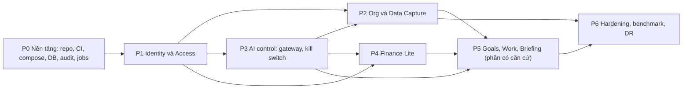

# AI-EOS — Implementation Plan (Stage 2D)

> Phiên bản: 1.0 · Ngày: 12/10/2026 · Trạng thái: **Kế hoạch — chờ CDA duyệt trước khi triển khai code**
> Hiện trạng code: **chưa có** (D-04). Mọi task ở trạng thái thực thi `TODO`; không có task "đã triển khai" hay "cần sửa".
> Nguồn: [SRS](../02-requirements/SRS.md) 1.1, [Architecture](../03-architecture/Architecture.md) 1.2, [Database_Design](../03-architecture/Database_Design.md) 1.2, [API_Specification](../03-architecture/API_Specification.md) 1.2, ADR-001…013 (ADR-005/008/009 có Amendment 1), [Decision_Log](../00-source/Decision_Log.md) 0.7. Kiểm thử: [TEST_Plan](TEST_Plan.md).

## 1. Quy ước

| Trường | Ý nghĩa |
| --- | --- |
| ID | `T-xxx`, ổn định, không tái sử dụng |
| Sẵn sàng | `READY` (đủ căn cứ để làm) · `PARTIAL` (làm được phần có căn cứ; phần còn lại ghi rõ) · `BLOCKED` (chờ quyết định, không làm) |
| Thực thi | `TODO` cho mọi task (chưa có code) |
| DoD chung | Áp dụng cho mọi task, xem mục 2 |

Không task nào được triển khai nghiệp vụ không có trong SRS. Giá trị `PROPOSED` (vd. 07:00 cho Briefing, thang độ tự tin 0–10) được cài dưới dạng **cấu hình**, có nhãn "đề xuất" trong mã và tài liệu, để đổi được mà không sửa code.

## 2. Definition of Done chung

1. Code theo ranh giới module ADR-001; lint, type check, test pass trong CI (ADR-013).
2. Test tương ứng trong TEST_Plan được viết và chạy xanh; test âm (từ chối quyền, lỗi validation) bắt buộc với mọi endpoint.
3. Thao tác nhạy cảm có audit (thành công và thất bại); không log secret.
4. Migration (nếu có) chạy được từ rỗng → head trong CI; có ràng buộc CSDL theo Database_Design §8.
5. API khớp API_Specification; thay đổi contract phải cập nhật tài liệu trước.
6. Requirements_Traceability cập nhật cột Task/Test; trạng thái requirement chỉ chuyển `IMPLEMENTED` khi có code, `VERIFIED` khi test liên quan xanh trong CI.

## 3. Trình tự và phụ thuộc

Đường găng (suy ra từ cột "Phụ thuộc" ở mục 4; chưa có ước lượng thời lượng nên tính theo số task nối tiếp; `{…}` = cần tất cả): P0: T-001 → {T-002, T-003} → T-005 → T-008 → T-009; T-004, T-006 chỉ cần T-001, T-007 và T-010 cần T-005, T-011 cần T-004 — làm song song. Chuỗi dài nhất tới P5: T-001 → {T-002, T-003} → T-005 → T-101 → T-102 → T-104 → T-402 → T-403 → T-404 → T-406 → T-510 → T-511. Finance (P4) có thể làm song song P2 sau khi có T-108 và T-302.

## 4. Danh sách task

### P0 — Nền tảng

| ID | Task | Phụ thuộc | SRS / requirement | Thiết kế | DoD riêng | Sẵn sàng |
| --- | --- | --- | --- | --- | --- | --- |
| T-001 | Khung repo: `backend/` (package theo module ADR-001), `frontend/` (React + Vite + TS strict), `infra/` (Compose), `docs/` | — | ADR-001, ADR-002, ADR-003 | Architecture §3 | Cấu trúc thư mục khớp module; README chạy local | READY |
| T-002 | Toolchain + CI: lint, format, type check (Python, TS), pytest với PostgreSQL container, Vitest, quét phụ thuộc, kiểm tra quy tắc import giữa module | T-001 | ADR-013, ADR-001 | ADR-013 | CI chặn merge khi một bước lỗi; vi phạm ranh giới module làm CI đỏ | READY |
| T-003 | Docker Compose local: `proxy` (TLS nội bộ), `api`, `worker`, `db`, `scanner`; profile `llm`, `observability`; chỉ `proxy` publish cổng | T-001 | SRS-NFR-04 | Architecture §9.1, ADR-004 | `docker compose up` (ở giai đoạn triển khai) chạy đủ service; không publish cổng DB | READY |
| T-004 | Cấu hình và secret: loader kiểm tra biến bắt buộc khi khởi động, không có giá trị mặc định cho secret, `.env.example` chỉ chứa tên biến (mục 7) | T-001 | ADR-006, ADR-011 | Architecture §9.1 | Thiếu secret → tiến trình dừng với lỗi rõ ràng, không in giá trị | READY |
| T-005 | Nền CSDL: SQLAlchemy 2, Alembic, 3 role CSDL (`aieos_owner`, `aieos_app`, `aieos_backup`), harness test migration | T-002, T-003 | SRS-NFR-03 | Database_Design §2, §10 | Migration rỗng → head trong CI; role ứng dụng không có DDL | READY |
| T-006 | Logging JSON, correlation ID, bộ lọc che secret, `/health/live`, `/health/ready` | T-001 | SRS-GEN-05 | ADR-012, API-SYS-01, API-SYS-02 | Test: header `Authorization`, cookie, mật khẩu không xuất hiện trong log | READY |
| T-007 | Hạ tầng HTTP: lỗi `problem+json`, CSRF + kiểm tra `Origin`, idempotency store, `ETag`/`If-Match`, rate limit | T-005 | SRS-GEN-01, SRS-GEN-02, SRS-GEN-03, SRS-GEN-04, SRS-GEN-05 | API_Specification §1 | Test TC-GEN-01…05 | READY |
| T-008 | Module audit: bảng append-only, trigger chặn UPDATE/DELETE, API ghi trong transaction, che trường nhạy cảm | T-005 | SRS-AUD-01, SRS-AUD-02, SRS-AUD-03 | ADR-010, Database_Design §9 | UPDATE/DELETE audit bị CSDL từ chối | READY |
| T-009 | Module jobs: queue, claim `SKIP LOCKED`, lease, reaper, retry + backoff, scheduler (advisory lock), registry `job_class` + test cấm handler `ORCHESTRATION` gọi gateway/provider/bảng nghiệp vụ | T-005, T-008 | SRS-JOB-01, SRS-JOB-02, SRS-JOB-03, SRS-AIC-06 | ADR-005 (+Amendment 1), Database_Design §5 | Test TC-JOB-01…06 | READY |
| T-010 | Thông báo in-app | T-005 | SRS-NTF-01, SRS-NTF-02 | API-NOT-01, API-NOT-02 | Nội dung thông báo không chứa dữ liệu nhạy cảm | READY |
| T-011 | Storage adapter (volume cục bộ), khóa UUID | T-004 | SRS-CAP-03 | ADR-004 | Không đường dẫn nào lấy từ tên file người dùng | READY |

### P1 — Identity và Access

| ID | Task | Phụ thuộc | SRS / requirement | Thiết kế | DoD riêng | Sẵn sàng |
| --- | --- | --- | --- | --- | --- | --- |
| T-101 | Bảng `identity.*` + migration | T-005 | SRS-IAM-06 | Database_Design §4 | Token chỉ lưu hash | READY |
| T-102 | Đăng nhập, session (xoay ID, hết hạn), đăng xuất, `/auth/me`, giới hạn thử | T-101, T-007 | SRS-IAM-04, SRS-IAM-06, SRS-IAM-07, SRS-GEN-01 | API-AUTH-01, API-AUTH-06, API-AUTH-07 | TC-IAM-01…05 | READY |
| T-103 | MFA TOTP: đăng ký, xác minh, mã khôi phục; bắt buộc với ADMIN | T-102 | SRS-IAM-05 | API-AUTH-02, API-AUTH-03, API-AUTH-04 | TC-IAM-06, TC-IAM-07 | READY |
| T-104 | Step-up (reauth), đổi mật khẩu + thu hồi session khác | T-102 | SRS-IAM-08, SRS-IAM-11 | API-AUTH-05, API-AUTH-09 | TC-IAM-08 | READY |
| T-105 | Tạo tài khoản + lời mời; chấp nhận lời mời | T-102, T-108 | SRS-IAM-01, SRS-IAM-02, SRS-IAM-03 | API-ADM-02, API-ADM-03, API-AUTH-08 | TC-IAM-09, TC-IAM-10; thời hạn lời mời và chính sách mật khẩu là cấu hình (PROPOSED) | READY |
| T-106 | CLI `bootstrap-admin`, `recover-admin` | T-101, T-107 | SRS-IAM-09, SRS-IAM-10 | ADR-006 | TC-IAM-11, TC-IAM-12 | READY |
| T-107 | Bảng `access.*`, seed role/permission (Architecture §6) qua migration, trigger INV-09/10/11, kiểm tra điều kiện assignment | T-101 | SRS-ACC-05, SRS-ACC-06, SRS-ACC-07, SRS-ACC-08 | Database_Design §4, §8 | Không seed tài khoản; seed `hr.*`, `pii.unmask`, `goals.activate` **không** có quyền nền | READY |
| T-108 | Module policy `authorize()`, bộ lọc phạm vi, mặc định deny, bắt buộc mọi route khai báo permission | T-107 | SRS-ACC-01, SRS-ACC-02, SRS-ACC-03, SRS-ACC-09, SRS-ACC-11 | ADR-007 | Route chưa khai báo quyền bị từ chối (TC-ACC-02) | PARTIAL — SRS-ACC-04 (định nghĩa "team") dùng mặc định PROPOSED |
| T-109 | API quản trị người dùng/role/assignment, thu hồi session, khóa ADMIN cuối | T-108, T-104 | SRS-ACC-05, SRS-ACC-06, SRS-ACC-07, SRS-ACC-08, SRS-IAM-11 | API-ADM-01, API-ADM-04, API-ADM-05, API-ADM-06, API-ADM-07, API-ADM-08, API-ADM-09 | TC-ACC-04…08 | READY |
| T-110 | Xem audit, trang tình trạng hệ thống (gồm cảnh báo thiếu người quản lý kỳ, không có kỳ mở, hàng chờ không người, chưa ai có `goals.activate`) | T-109, T-009 | SRS-AUD-04, SRS-FIN-12 | API-ADM-10, API-ADM-11 | TC-AUD-04, TC-FIN-14 | READY |
| T-111 | Frontend: app shell, đăng nhập, MFA, chấp nhận lời mời, quản trị người dùng/quyền, ẩn mục không có quyền, trạng thái chung | T-102…T-109 | SRS-ACC-09, SRS-GEN-06 | UX_Flows §0, FL-01, FL-02, FL-03 | E2E TC-E2E-01 | READY |
| T-112 | Che dữ liệu cá nhân: phát hiện bằng quy tắc (CCCD, số tài khoản…), nhãn `sensitivity`, che ở API, file xuất, câu trả lời AI | T-108 | SRS-ACC-10, SRS-PRV-02 | Architecture §6, §8.5 | TC-PRV-01…03 | PARTIAL — người giữ `hr.profile.read`, `hr.salary.read`, `hr.export`, `pii.unmask` chờ R6; không ai giữ |

### P2 — Org và Data Capture

| ID | Task | Phụ thuộc | SRS / requirement | Thiết kế | DoD riêng | Sẵn sàng |
| --- | --- | --- | --- | --- | --- | --- |
| T-201 | `org.*` + API danh bạ | T-108 | SRS-ACC-11 | API-ORG-01, API-ORG-02, Database_Design §6 | Chỉ trường danh bạ | READY |
| T-202 | Bảng `capture.*` + migration | T-005, T-201 | SRS-CAP-13, SRS-REV-07, SRS-REV-09 | Database_Design §6 | — | READY |
| T-203 | Upload: allowlist + magic bytes, giới hạn, chuẩn hóa tên, lưu, hash trùng, job quét mã độc | T-202, T-011, T-009 | SRS-CAP-01, SRS-CAP-02, SRS-CAP-03, SRS-CAP-04, SRS-CAP-05, SRS-CAP-06, SRS-CAP-07 | API-DOC-01, API-DOC-02, API-DOC-03, API-DOC-04, API-DOC-05 | TC-FILE-01…08 | READY |
| T-204 | Provider adapter: interface LLM/OCR/converter, adapter giả lập cho test, định tuyến theo phân loại dữ liệu, timeout/retry/fallback, call log, trần chi phí | T-004, T-009 | SRS-PRV-01, SRS-PRV-02, SRS-PRV-03, SRS-PRV-04, SRS-NFR-07 | ADR-011 | TC-PRV-04…07; trần chi phí là cấu hình (GAP-14) | READY |
| T-205 | Adapter provider thật (LLM, OCR) | T-204, T-606 | SRS-PRV-01 | ADR-011 | Theo kết quả benchmark | BLOCKED — D-08 |
| T-206 | Pipeline xử lý: tiền xử lý ảnh, phân loại, trích xuất, chuẩn hóa VN, kiểm tra, định tuyến (tự ghi tắt mặc định), tách/gộp, thử lại | T-203, T-204, T-302 | SRS-CAP-08, SRS-CAP-10, SRS-CAP-11, SRS-CAP-12, SRS-CAP-14, SRS-CAP-15, SRS-CAP-16, SRS-CAP-17, SRS-CAP-18, SRS-CAP-20, SRS-CAP-21, SRS-CAP-22 | Architecture §8.5, API-DOC-06, API-DOC-07 | TC-CAP-01…08 | PARTIAL — danh mục đơn vị hành chính (GAP-13), danh sách trường trọng yếu (D-16), ngưỡng (D-29) dùng mặc định an toàn |
| T-207 | Hàng chờ review + API + UI bàn phím | T-206, T-108 | SRS-REV-01, SRS-REV-02, SRS-REV-03, SRS-REV-04, SRS-REV-05, SRS-REV-06, SRS-REV-07, SRS-REV-08, SRS-REV-09, SRS-NFR-10 | API-REV-01…07, FL-05 | TC-REV-01…06 | PARTIAL — SLA (GAP-18) là cấu hình trống |
| T-208 | Cấu hình loại tài liệu/schema/ngưỡng, kiểm tra điều kiện bật tự ghi (BR-05) | T-206 | SRS-CAP-15, SRS-CAP-16, SRS-CAP-17 | API-CFG-01…05 | TC-CAP-05, TC-CAP-06 | READY |
| T-209 | Form sinh từ schema, gợi ý/trùng, nhập ngôn ngữ tự nhiên (bản dự kiến), lưu nháp, audit thay đổi thủ công | T-206, T-204 | SRS-CAP-30, SRS-CAP-31, SRS-CAP-32, SRS-CAP-33, SRS-CAP-34 | API-CAP-01…04 | TC-CAP-09…11 | READY |
| T-210 | Import XLSX/CSV: map cột, xem trước, lỗi theo dòng, commit qua gateway; import nhân sự giới hạn cột | T-206, T-302 | SRS-IMP-01, SRS-IMP-02, SRS-IMP-03 | API-IMP-01…05, FL-06 | TC-IMP-01…04 | READY |
| T-211 | Lineage API + popover nguồn | T-206 | SRS-CAP-19, SRS-BRF-04 | API-ORG-03 | TC-CAP-12 | READY |
| T-212 | Frontend capture: drop zone toàn cục, thẻ tiến trình, chụp ảnh (app đang mở), import | T-203, T-210 | SRS-CAP-09 | FL-04, FL-06 | TC-E2E-02 | READY |

### P3 — AI control

| ID | Task | Phụ thuộc | SRS / requirement | Thiết kế | DoD riêng | Sẵn sàng |
| --- | --- | --- | --- | --- | --- | --- |
| T-301 | Bảng `ai.*`, seed Tool Registry (tool BRD §3.9 + tool đích MVP), trần autonomy | T-005, T-107 | SRS-AIC-02, SRS-AIC-03 | Database_Design §5, INV-12, INV-13 | CHECK trần có hiệu lực | READY |
| T-302 | Write gateway: thứ tự kiểm tra, bản nháp L2, thực thi L3, idempotency, audit; lint chặn ghi domain bỏ qua gateway | T-301, T-108, T-008 | SRS-AIC-01, SRS-AIC-02, SRS-AIC-05, SRS-AIC-09, SRS-CAP-18 | ADR-008, Architecture §8.1 | TC-AIC-01…06 | READY |
| T-303 | Kill switch: API, step-up, banner, tích hợp gateway và jobs (`job_class`) | T-302, T-009 | SRS-AIC-04, SRS-AIC-05, SRS-AIC-06 | API-AI-01, API-AI-02, FL-10 | TC-KS-01…10 | READY |
| T-304 | Bản nháp: review/xác nhận/từ chối, hoàn tác L3 (toast + 24 giờ), đánh dấu quá hạn (cấu hình, mặc định 30 ngày), nhắc hằng ngày | T-302, T-010 | SRS-AIC-07, SRS-AIC-08, SRS-AIC-10, SRS-AIC-11 | API-AI-06, API-AI-07, API-AI-08, API-AI-09, API-AI-10, API-AI-11, FL-09 | TC-AIC-07…11 | READY |
| T-305 | Cấu hình autonomy trong trần | T-301 | SRS-AIC-15 | API-AI-03, API-AI-04, API-AI-05 | TC-AIC-12 | READY |
| T-306 | Chat AI: SSE, tool READ theo phạm vi, trích dẫn, Dừng, trả lời theo ngôn ngữ câu hỏi | T-204, T-108 | SRS-AIC-12, SRS-AIC-13 | API-AI-12 | TC-AIC-13…15 (adapter giả lập) | PARTIAL — chất lượng trả lời chờ provider thật (D-08) |
| T-307 | Phản hồi người dùng; harness Evaluation Engine (bộ câu hỏi/đáp án, chạy trước thay đổi model/prompt) | T-306 | SRS-AIC-14, SRS-AIC-16 | API-AI-13, ADR-013 | Harness chạy được với adapter giả lập | READY |

### P4 — Finance Lite

| ID | Task | Phụ thuộc | SRS / requirement | Thiết kế | DoD riêng | Sẵn sàng |
| --- | --- | --- | --- | --- | --- | --- |
| T-401 | Bảng `finance.*` + trigger INV-01…07, ràng buộc loại trừ chồng lấn kỳ, `ON_HOLD`/`hold_reason` | T-005, T-107 | SRS-FIN-13, SRS-FIN-17 | Database_Design §7, §8 | TC-FIN-01…04 ở mức CSDL | READY |
| T-402 | Kỳ báo cáo: mở/khóa, khóa dòng, chặn khóa khi còn chờ duyệt | T-401, T-104 | SRS-FIN-12 | API-FIN-01, API-FIN-02, API-FIN-03 | TC-FIN-12…15 | PARTIAL — độ dài kỳ mặc định tháng (Q-31); người giữ `finance.period.manage` do CDA giao vận hành |
| T-403 | Tạo/sửa/gửi/hủy/rút lại giao dịch; idempotency; kiểm tra kỳ `OPEN` khi gửi (AMD-01); cờ thiếu người duyệt | T-401, T-402, T-010 | SRS-FIN-01, SRS-FIN-02, SRS-FIN-04, SRS-FIN-05, SRS-FIN-06, SRS-FIN-07, SRS-FIN-16 | API-FIN-04…09 | TC-FIN-05…11 | PARTIAL — danh mục (Q-42) là văn bản tự do |
| T-404 | Duyệt/từ chối: khóa dòng, version, tách nhiệm vụ, nhánh `ON_HOLD` | T-403 | SRS-FIN-08, SRS-FIN-09, SRS-FIN-17 | API-FIN-10, API-FIN-11 | TC-FIN-16…22 | READY |
| T-405 | Bút toán đảo và điều chỉnh | T-404 | SRS-FIN-10, SRS-FIN-11 | API-FIN-12 | TC-FIN-23…28 | READY |
| T-406 | Lịch sử, tổng hợp doanh thu/chi phí/tiền mặt với `as_of` | T-404 | SRS-FIN-14 | API-FIN-13, API-FIN-14 | TC-FIN-29 | READY |
| T-407 | Runway | T-406 | SRS-FIN-15 | API-FIN-14 | — | BLOCKED — Q-39 (định nghĩa burn ròng) |
| T-408 | Tool AI `create_finance_draft` qua gateway (chỉ tạo `DRAFT`) | T-302, T-403 | SRS-FIN-03, SRS-REV-08 | ADR-008, ADR-009 | TC-FIN-30 | READY |
| T-409 | Frontend tài chính (FL-11, FL-12) | T-403…T-406 | SRS-FIN-12 | UX_Flows FL-11, FL-12 | TC-E2E-03 | READY |

### P5 — Goals, Work, Briefing (phần có căn cứ)

| ID | Task | Phụ thuộc | SRS / requirement | Thiết kế | DoD riêng | Sẵn sàng |
| --- | --- | --- | --- | --- | --- | --- |
| T-501 | `goals.*`: tạo/sửa bản nháp, đo lường, check-in, xem theo phạm vi; hiển thị baseline/target/giá trị, **không** tính % | T-108, T-201 | SRS-GOAL-01, SRS-GOAL-02, SRS-GOAL-05, SRS-GOAL-06, SRS-GOAL-07, SRS-GOAL-09, SRS-GOAL-11 | API-GOAL-01, API-GOAL-02, API-GOAL-03, API-GOAL-05, API-GOAL-06 | TC-GOAL-01…06 | PARTIAL — thang độ tự tin (Q-30) là cấu hình PROPOSED |
| T-502 | Kích hoạt mục tiêu với permission `goals.activate` (assignment, không quyền nền) | T-501, T-109 | SRS-GOAL-03, SRS-GOAL-04 | API-GOAL-04 | TC-GOAL-07, TC-GOAL-08 | PARTIAL — ai được giao: Q-28 |
| T-503 | Commit mục tiêu và giá trị đo từ tài liệu (kế hoạch, báo cáo định kỳ) qua gateway; gợi ý alignment L1 | T-206, T-302, T-501 | SRS-GOAL-03, SRS-GOAL-06, SRS-GOAL-10 | ADR-008 | TC-GOAL-09 | READY |
| T-504 | Frontend mục tiêu (cây, check-in) | T-501, T-502 | SRS-GOAL-08 | FL-15 | TC-E2E-04 | PARTIAL — điền sẵn check-in = giá trị đo gần nhất (PROPOSED); điền từ task bị chặn (Q-29) |
| T-505 | `work.task`: tạo, sửa, hoàn thành/mở lại, xem theo phạm vi | T-108, T-201 | SRS-WRK-01, SRS-WRK-02, SRS-WRK-03, SRS-WRK-04, SRS-WRK-10 | API-WORK-01, API-WORK-03, API-WORK-04, API-WORK-05 | TC-WRK-01…05 | PARTIAL — mở lại bởi người giao, EMPLOYEE tự giao (PROPOSED); trạng thái mở rộng chờ Q-33 |
| T-506 | Biên bản → Meeting/Decision/ActionItem → giao việc qua gateway | T-206, T-302, T-505 | SRS-WRK-05, SRS-WRK-06, SRS-WRK-07, SRS-WRK-11 | API-WORK-02, API-WORK-06, FL-08 | TC-WRK-06…08 | READY |
| T-507 | Job `ORCHESTRATION` task quá hạn + thông báo | T-009, T-505 | SRS-WRK-09 | ADR-005 | TC-WRK-09 | READY |
| T-508 | Action card F1 tạo task L3 + hoàn tác | T-304, T-505 | SRS-WRK-08 | ADR-008 | TC-WRK-10 | READY |
| T-509 | Frontend công việc | T-505, T-506 | SRS-WRK-10 | FL-08 | TC-E2E-05 | READY |
| T-510 | Trang chủ CEO: ô chỉ số (nhãn "đề xuất — chưa chính thức", không cảnh báo), "Cần anh quyết" (chỉ mục có nguồn), "AI đã làm", trạng thái trống, ẩn khối chưa đủ căn cứ, chọn ô | T-406, T-501, T-505, T-304 | SRS-BRF-01, SRS-BRF-02, SRS-BRF-03, SRS-BRF-04, SRS-BRF-05, SRS-BRF-06, SRS-BRF-07, SRS-BRF-08, SRS-BRF-09, SRS-BRF-12, SRS-SLS-03 | API-INS-01, API-INS-02, FL-07 | TC-BRF-01…07 | PARTIAL — công thức ô PROPOSED (Q-37, D-39); ngưỡng "dữ liệu cũ" là cấu hình trống |
| T-511 | Tạo nội dung Briefing (`AI_CONTENT`) theo lịch + API quản lý lịch; hành vi kill switch | T-510, T-303, T-204 | SRS-BRF-10, SRS-BRF-11, SRS-BRF-13 | API-INS-03, ADR-005/008 Amendment 1 | TC-BRF-08…11, TC-KS-08, TC-KS-09 | PARTIAL — giờ/tần suất PROPOSED (Q-36); chất lượng tóm tắt chờ D-08 |
| T-512 | Tài liệu quy trình/SOP → knowledge item | T-206, T-302 | FR-DCS-02 | API-KNOW-01 | TC-CAP-13 | READY |

### P6 — Hardening, benchmark, phục hồi

| ID | Task | Phụ thuộc | SRS / requirement | Thiết kế | DoD riêng | Sẵn sàng |
| --- | --- | --- | --- | --- | --- | --- |
| T-601 | Sinh bộ test ma trận authorization từ seed | T-107, các API | SRS-ACC-01, SRS-ACC-02, SRS-NFR-11 | ADR-013 | Mọi endpoint × role × phạm vi | READY |
| T-602 | Bộ test bảo mật (TEST_Plan §6) | T-111, T-203, T-306 | SRS-NFR-11 | Architecture §10 | AC-ARCH-05, 07, 08, 09, 11, 12 xanh | READY |
| T-603 | Test đồng thời và idempotency | T-404, T-405, T-009 | SRS-GEN-03, SRS-GEN-04 | Architecture §7.2 | AC-ARCH-01, 02, 03 xanh | READY |
| T-604 | Test hiệu năng NFR-01/02 | T-206, T-205 | SRS-NFR-01, SRS-NFR-02 | ADR-005 | Báo cáo số đo; không tuyên bố đạt nếu chưa đo | BLOCKED — cần provider thật (D-08) để đo đại diện; có thể đo pipeline với adapter giả lập |
| T-605 | Backup/restore: base backup + WAL archiving, backup volume, quy trình và diễn tập | T-003, T-005 | SRS-NFR-03 | Architecture §9.3 | Diễn tập ghi kết quả RPO/RTO đo được | READY (công cụ cụ thể chọn khi triển khai) |
| T-606 | Benchmark LLM/OCR: tạo bộ dữ liệu tổng hợp, ground truth, harness, báo cáo | T-204 | SRS-NFR-09 | TEST_Plan §9, ADR-011 | Báo cáo so sánh ≥ 2 phương án; không dùng PII thật | READY |
| T-607 | Truy cập (WCAG 2.1 AA), i18n vi/en | T-111 | SRS-NFR-05, SRS-NFR-08 | ADR-003 | Kiểm tra tự động + thủ công | READY |
| T-608 | E2E Playwright cho FL-01…FL-15 trong phạm vi | Các task frontend | SRS-NFR-06 | UX_Flows | TC-E2E-01…06 | READY |

### Bị chặn / ngoài phạm vi triển khai

| ID | Hạng mục | Phụ thuộc | Requirement | Lý do | Sẵn sàng |
| --- | --- | --- | --- | --- | --- |
| T-901 | Sales Pipeline Lite | — | SRS-SLS-01, SRS-SLS-02, FR-HM-04 | D-40, Q-38; điều kiện mở: CDA cung cấp đặc tả | BLOCKED |
| T-902 | Workload/quá tải (F5) | — | SRS-WRK-12, F5, FR-HM-06 | Q-34; điều kiện mở: Mô hình workload | BLOCKED |
| T-903 | Đặt lịch / đồng bộ lịch | — | SRS-WRK-12 | Q-35, D-31; điều kiện mở: Quyết định lịch nội bộ/ngoài | BLOCKED |
| T-904 | % đạt mục tiêu, cảnh báo lệch | — | SRS-GOAL-09 | Q-29, D-39; điều kiện mở: Công thức được duyệt | BLOCKED |
| T-905 | Theo dõi Decision Log 30/60/90 | — | SRS-WRK-11 | Q-41; điều kiện mở: Quyết định phạm vi | BLOCKED |
| T-906 | Nhắc check-in tự động | — | SRS-GOAL-07 | Q-30; điều kiện mở: Nhịp check-in | BLOCKED |
| T-907 | Quyền xem dữ liệu nhân sự nhạy cảm | — | SRS-ACC-10 | R6; điều kiện mở: CDA chỉ định người giữ | BLOCKED |
| T-908 | Hóa đơn/biên lai, email forwarding, C6–C10, L4 | — | SRS-NTF-03 | D-11, D-17, D-18; điều kiện mở: Phase 2 | BLOCKED |

## 5. Kế hoạch migration (không chạy trong Stage 2D)

| # | Migration | Nội dung | Bất biến kèm theo | Task |
| --- | --- | --- | --- | --- |
| M-01 | `base_roles_schemas` | Schema theo module, quyền role CSDL | Role ứng dụng không DDL | T-005 |
| M-02 | `identity` | Bảng identity | Hash token | T-101 |
| M-03 | `access_seed` | Role, permission, role_permission (seed), user_role, assignment | INV-09, INV-10, INV-11 | T-107 |
| M-04 | `audit` | `audit.event` | INV-14 | T-008 |
| M-05 | `jobs_notify` | `jobs.job` (`job_class`), `jobs.schedule`, `notify.notification` | — | T-009, T-010 |
| M-06 | `org` | `org_unit`, `employee` (chỉ trường danh bạ) | — | T-201 |
| M-07 | `capture` | Bảng capture | — | T-202 |
| M-08 | `ai_seed` | `ai.*`, seed tool | INV-12, INV-13, INV-15 | T-301 |
| M-09 | `finance` | Kỳ, giao dịch (`ON_HOLD`), event, delegation (rỗng) | INV-01…INV-08 | T-401 |
| M-10 | `goals_work_knowledge_insights` | Bảng theo Database_Design §6 | — | T-501, T-505, T-510 |

Quy tắc: một chuỗi revision; mỗi migration có test rỗng → head và test bất biến tương ứng; không seed tài khoản; thay đổi phá vỡ theo mở rộng → di chuyển → thu hẹp (Database_Design §10).

## 6. Môi trường local và điều kiện triển khai

| Hạng mục | Yêu cầu |
| --- | --- |
| Công cụ | Docker + Docker Compose v2; Python và Node phiên bản ổn định được hỗ trợ (chốt trong lockfile ở T-001); trình duyệt hiện đại cho E2E |
| TLS local | Reverse proxy cấp chứng chỉ nội bộ; cookie `Secure` cần HTTPS |
| Phần cứng | Chưa xác định — scanner và model local là phần tốn RAM; xác định sau T-606 |
| Dữ liệu | Chỉ dữ liệu giả/tổng hợp trong dev, test, CI |
| Triển khai nội bộ | Chưa có trong phạm vi Stage 2D; điều kiện: T-605 diễn tập đạt, T-602/T-603 xanh, CDA duyệt |

## 7. Biến cấu hình và secret (chỉ tên, không có giá trị)

| Biến | Loại | Dùng bởi |
| --- | --- | --- |
| `AIEOS_DATABASE_URL` | Secret | api, worker (role `aieos_app`) |
| `AIEOS_DATABASE_OWNER_URL` | Secret | lệnh migration |
| `AIEOS_CSRF_KEY` | Secret | api |
| `AIEOS_TOTP_ENCRYPTION_KEY` | Secret | api |
| `AIEOS_STORAGE_PATH` | Cấu hình | api, worker |
| `AIEOS_ALLOWED_ORIGINS` | Cấu hình | api |
| `AIEOS_SCANNER_HOST` | Cấu hình | worker |
| `AIEOS_LLM_PROVIDERS`, `AIEOS_OCR_PROVIDERS` | Cấu hình (JSON: tên, URL, `local`, mức phân loại cho phép) | worker, api |
| `AIEOS_LLM_API_KEY_<NAME>` | Secret | worker, api |
| `AIEOS_AI_BUDGET_LIMIT` | Cấu hình (GAP-14) | worker, api |
| `AIEOS_SESSION_IDLE_MINUTES`, `AIEOS_SESSION_ABSOLUTE_HOURS`, `AIEOS_INVITE_TTL_HOURS`, `AIEOS_REAUTH_MINUTES` | Cấu hình | api |
| `AIEOS_BACKUP_TARGET` | Cấu hình | backup |

Secret nạp qua Docker secrets hoặc file môi trường không commit. Không có giá trị mặc định cho secret; thiếu → tiến trình dừng (T-004).

## 8. Rủi ro còn mở

| Rủi ro | Ảnh hưởng | Giảm thiểu |
| --- | --- | --- |
| Provider chưa chọn (D-08) | Chất lượng trích xuất, hiệu năng chưa biết | T-606 trước T-205; adapter giả lập để không chặn phát triển |
| Một người tài chính duy nhất | Giao dịch không ghi sổ được | Cảnh báo hệ thống; CDA giao assignment |
| Module P5 thiếu quy tắc | Phải sửa khi có câu trả lời | Giá trị PROPOSED là cấu hình; endpoint giữ ổn định |
| Thông lượng queue PostgreSQL chưa đo | NFR-02 | T-604 |
| Audit không có chuỗi hash | Người có quyền owner CSDL có thể can thiệp | Tách role CSDL; ghi nhận rủi ro (ADR-010) |
| PWA trên iOS | Thông báo/camera hạn chế | Không cam kết (ADR-003) |

## 9. Tiêu chí nghiệm thu MVP (kỹ thuật)

1. Mọi task `READY` và phần có căn cứ của task `PARTIAL` hoàn thành theo DoD.
2. AC-ARCH-01…12 xanh trong CI.
3. TEST_Plan: mọi test mức độ P0 xanh; không có lỗi Critical/High mở.
4. Benchmark D-08 có báo cáo; mục tiêu MET-01 chỉ được tuyên bố khi đo đạt.
5. Diễn tập backup/restore có kết quả.
6. Traceability: mọi requirement P0 không DEFERRED có Task và Test, hoặc lý do N/A/BLOCKED.
